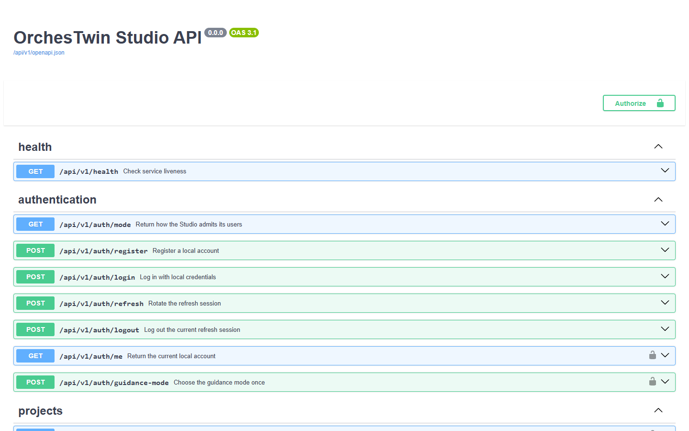

# The API

The web interface and `ut` work on the same data through an HTTP API written with FastAPI. The web reaches it through its own server, which forwards every address that starts with `/api`; `ut` calls it directly, on `http://127.0.0.1:8000` unless it is pointed at another Studio.

All 214 operations sit under the `/api/v1` prefix, the only version the API has, and the OpenAPI 3.1.0 schema declares the package version, 0.0.0. The API speaks JSON. The exceptions are four routes that upload or return files, such as the ZIP of a version of the knowledge folder.

## Reading the API

While the Studio is running, the API answers on `http://127.0.0.1:8000` and the web on `http://127.0.0.1:8080`. Swagger UI is at `/api/v1/docs` and the schema at `/api/v1/openapi.json`; ReDoc is switched off. The "Authorize" button accepts the access token. A padlock marks the operations that ask for it.



In local mode, Swagger UI is better opened through the web. At `http://127.0.0.1:8080/api/v1/docs` its requests go through like the web's own, whereas a write request sent from the page served on 8000 carries an origin the Studio does not admit. Requests sent from Swagger UI act on the real database, and on the routes that generate they start a generation.

Next to this page sits [`openapi.json`](openapi.json), exported on 12 October 2026 from the code of the sprint 48 branch, `sprint/48-point-and-ask`: 180 paths, 214 operations, 419 schemas. It is written by `esporta_openapi47.py`, a sprint 47 script kept outside the repository. The script builds the app in memory with fake settings, as `test_health.py` does, with no database and without reading `.env`. Two runs give the same file (sha256 `c519b32b…`), and the [Routes](reference.md) page is generated from it.

## Access and local mode

`GET /api/v1/auth/mode`, open to everyone, tells how the Studio admits its users: `ACCOUNTS` or `LOCAL_OWNER`.

With `ACCOUNTS`, the default mode, registration and login return an `access_token`. It is an HS256 JWT that lasts 900 seconds unless the configuration says otherwise, and it travels in the `Authorization: Bearer` header. The refresh token is kept in the HttpOnly cookie `orchestwin_refresh`, valid for 30 days and limited to `/api/v1/auth`. Renewal through `POST /api/v1/auth/refresh` returns a new access token and replaces the refresh token as well; presenting a refresh token that was already used revokes every session in its family.

With `LOCAL_OWNER`, registration and login answer 404 `local_mode`. A request without a token counts as the owner's when it meets three conditions. The `Host` header points to the loopback (`127.0.0.1`, `localhost` or `[::1]`, with or without a port). The `Origin` header is missing or among the admitted ones, which with the Studio's scripts are the web on 8080 and the development server on 5173. `Sec-Fetch-Site` is not `cross-site`. This lets `ut` and the web through, while a page from another site receives 401. A valid token works here too.

## Route groups

| Group | What it does | Operations |
| --- | --- | --- |
| `health` | tells whether the API process answers | 1 |
| `authentication` | access mode, accounts, session, the choice between guided and expert | 7 |
| `projects` | projects, brief versions, state and realignment of the sections | 11 |
| `project-clarification` | the brief's assumptions and gate | 9 |
| `project-brief` | the dialogue that completes the brief | 6 |
| `agent-teams` | agent catalogue, Perspectives and their gate, project readiness | 11 |
| `user-modeling` | archetypes, personas, User Twins, snapshots, gates, import, conversation with a twin | 26 |
| `requirements` | the Definition: proposals, revisions, changes, traceability, coverage, gate | 18 |
| `design` | alternatives, mockups, iterations, the twins' evaluations and discussions, critique, distance, versions, gate | 48 |
| `generation-jobs` | generation jobs | 2 |
| `artifacts` | provenance graph, "Why?", diagrams | 5 |
| `validation` | hypotheses to check with people, and their outcomes | 5 |
| `activity` | activity history and study sessions | 5 |
| `workflow-inputs` | declared gaps and the prototype supplied by the owner | 10 |
| `knowledge` | versions and archive of the knowledge folder, import of a folder | 5 |
| `code-changes` | commits reviewed by `ut verify`, code tasks, the aligned point | 10 |
| `knowledge-alignment` | `ut align` runs and the proposals to apply or skip | 6 |
| `acceptance-tests` | `ut test` plans and runs | 9 |
| `twin-learning` | observations the twins have learned and changes to their profiles | 6 |
| `research-evidence` | the owner's research evidence | 7 |
| `agent-team` | realignment of the Perspectives | 2 |
| `model-generations` | recorded generations | 2 |
| `model-runtime` | model readiness | 1 |
| `model-usage` | spending budget and model usage | 2 |

## Generations as jobs

Long generations became background jobs in sprint 24, on 28 September 2026, because they outlasted the connections carrying them. The public tunnel used for the demo at the time closed unanswered requests after 100 seconds, the container's nginx after 60, and the design alternatives took 186. Today seventeen routes that ask the model for a proposal accept `Prefer: respond-async`. Without the header they answer when the generation is over; with it they answer 202 straight away, with the job and with `Preference-Applied: respond-async`. Mockups and iterations have routes of their own, `POST .../design/mockups/jobs` and `POST .../design/iterations/jobs`, which always answer 202.

The request below does start a real generation of the Definition. The response is the one `test_generation_requests.py` expects when the job starts.

```bash
curl -X POST http://127.0.0.1:8000/api/v1/projects/$PROJECT/requirements/proposals \
  -H "Authorization: Bearer $TOKEN" \
  -H "Prefer: respond-async"
```

```json
{
  "job_id": "<job uuid>",
  "kind": "REQUEST",
  "operation": "REQUIREMENTS_PROPOSAL",
  "status": "RUNNING",
  "stage": "GENERATING",
  "attempt": 1,
  "started_at": "<start time>",
  "finished_at": null,
  "alternative_id": null,
  "result": null,
  "failure": null,
  "response": null
}
```

The job is read with `GET /api/v1/projects/{project_id}/generation-jobs/{job_id}`. Its `status` moves from `RUNNING` to `SUCCEEDED`, `REJECTED` or `FAILED`, and `stage` (`GENERATING`, `VALIDATING`, `RETRYING`) goes back to `null` at the end. In jobs born from a request, `response` holds what the route would have answered inline, refusals included, for example `{"status_code": 409, "body": {"detail": {"code": "DESIGN_CONTEXT_CHANGED"}}}`.

Repeating a request while its job is running returns the same job, and when an account already has four jobs running, the fifth gets 429. The registry lives in the memory of the process: a finished job stays readable for an hour, and shutting the API down cancels the ones in progress.

## Three requests from the tests

The examples come from the tests in `src/test/python/api/`. `$TOKEN` is the access token and `$PROJECT` the project identifier; in local mode, from the same computer, the `Authorization` header can be left out. The values in angle brackets are chosen by the Studio.

`GET /api/v1/health` needs no authentication and does not touch the database. The start scripts use it to know when the API is ready (`test_health.py`).

```bash
curl http://127.0.0.1:8000/api/v1/health
```

```json
{"status": "ok"}
```

Creating a project answers 201. A new project always starts from the brief, and `next_action` says what has to be done next (`test_project_api.py`).

```bash
curl -X POST http://127.0.0.1:8000/api/v1/projects \
  -H "Authorization: Bearer $TOKEN" \
  -H "Content-Type: application/json" \
  -d '{"display_name": "Project", "mode": "GREENFIELD_GENERATION"}'
```

```json
{
  "id": "<project uuid>",
  "display_name": "Project",
  "mode": "GREENFIELD_GENERATION",
  "current_brief_version": 0,
  "is_archived": false,
  "created_at": "<creation time>",
  "updated_at": "<creation time>",
  "current_stage": "BRIEF",
  "next_action": "DESCRIBE_IDEA"
}
```

The state of the sections says what needs redoing and why. In the response from `test_sections_api.py` the Perspectives changed after the first pass, and the change cascaded: User Twins, Definition and design all became `TO_UPDATE`. The folder has fallen behind, while `alignment` lists the sections that `POST .../sections/alignment` can realign.

```bash
curl http://127.0.0.1:8000/api/v1/projects/$PROJECT/sections -H "Authorization: Bearer $TOKEN"
```

```json
{
  "first_pass_complete": true,
  "sections": [
    {"key": "BRIEF", "state": "FINE", "version_number": 2, "reasons": [], "blocked": null, "codes": []},
    {"key": "TEAM", "state": "FINE", "version_number": 2, "reasons": [], "blocked": null, "codes": []},
    {"key": "USER_TWINS", "state": "TO_UPDATE", "version_number": 1, "reasons": ["PERSPECTIVES_CHANGED"], "blocked": null, "codes": []},
    {"key": "REQUIREMENTS", "state": "TO_UPDATE", "version_number": 3, "reasons": ["PERSPECTIVES_CHANGED", "USER_TWINS_CHANGED"], "blocked": null, "codes": []},
    {"key": "DESIGN", "state": "TO_UPDATE", "version_number": 4, "reasons": ["REQUIREMENTS_CHANGED"], "blocked": null, "codes": []},
    {"key": "PACKAGE", "state": "TO_UPDATE", "version_number": 6, "reasons": ["FOLDER_BEHIND"], "blocked": null, "codes": []}
  ],
  "alignment": {"available": true, "sections": ["USER_TWINS", "REQUIREMENTS", "DESIGN"], "uncovered_codes": []}
}
```

## Refusals and errors

Every refusal carries a `detail`: either a string such as `invalid_authentication`, or an object with a `code` and, for model errors, the `stage`. Many routers build it with the `refusal()` and `conflict()` functions of `api/refusals.py`, which were born in the sprint 46 refactor. A validation 422 says where each error is and what kind it is without repeating the values sent, so a password never comes back.

A 4xx is about the request or the state of the project, and the same request will meet the same refusal until something changes; a 429 only asks the caller to wait. A 5xx is about the Studio or the model provider, and the same request may succeed later.

| Status | When | Code |
| --- | --- | --- |
| 401 | token missing, expired or invalid; a request that is not the owner's in local mode | `invalid_authentication` |
| 402 | generation spending cap exceeded | `GENERATION_BUDGET_EXCEEDED` |
| 404 | resource that does not exist for that account; registration and login in local mode | `PROJECT_NOT_FOUND`, `local_mode` |
| 409 | a gate changed in the meantime, a context that changed, a choice already made | `gate_state_conflict`, `DESIGN_CONTEXT_CHANGED` |
| 422 | invalid body or parameters, context too large for the model | `invalid_request`, `CONTEXT_BUDGET_EXCEEDED` |
| 429 | too many login attempts, too many generations running | `too_many_attempts`, `TOO_MANY_GENERATIONS` |
| 502 | model output that fails validation | `INVALID_PROVIDER_OUTPUT` |
| 503 | provider unavailable, timeout, provider limit, service not configured | `PROVIDER_UNAVAILABLE`, `TIMEOUT` |

## The contract through the refactors

The sprint 46 refactor, between 10 and 11 October 2026, had one criterion: "same behaviour, same tests, all green". For the API this meant comparing two fingerprints before and after every unit of work. The first was the sha256 of the OpenAPI with sorted keys, `b11950b7…`, with 185 paths, 218 operations and 419 schemas at commit `2cbc053`; the second, `96e8fefc…`, covered the list of the 218 routes in registration order. Both stayed identical after every unit of the API refactor.

The only intended change came from deleting the `training` package (commit `66f8988`, 11 October 2026), which took away six routes and two schemas and left 179 paths and 212 operations. Sprint 48 added `GET` and `POST /design/opinions`, and that is where today's 180 paths and 214 operations come from. The `ut` tests guard the contract on every run, because the fake Studio they use can only have routes that exist in the real OpenAPI (`test_fake_studio_routes.py`).
