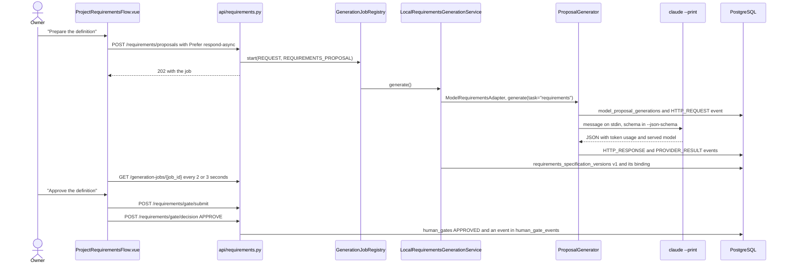
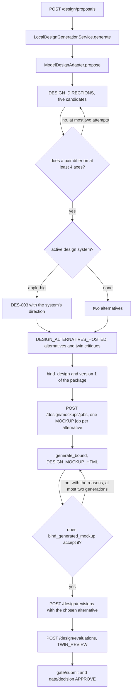
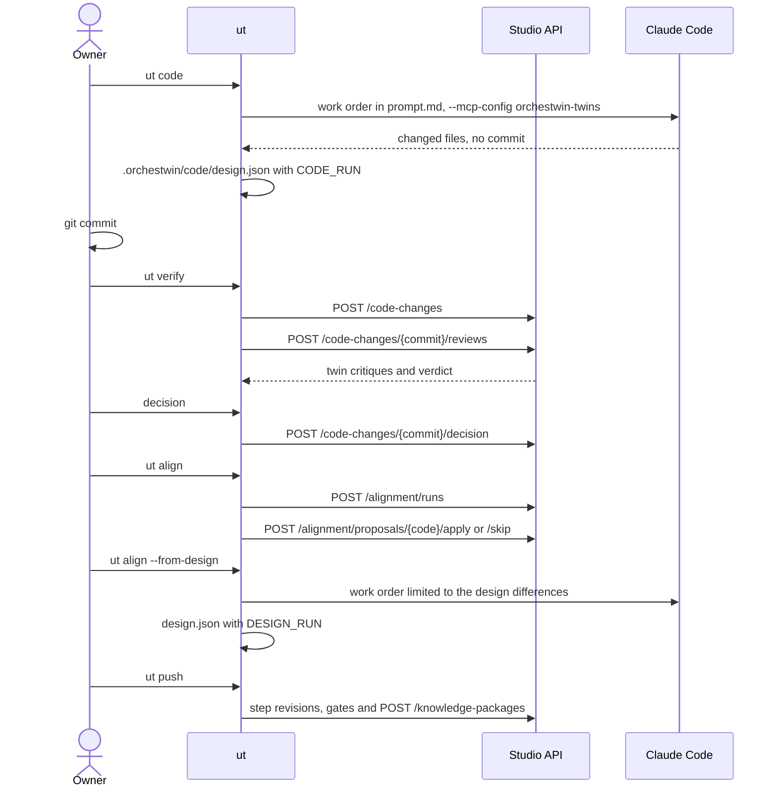

# Flows

A generation takes minutes, and that decides the shape of every flow. In sprint 24, at the end of September 2026, the public tunnel used for the demo cut off any request still unanswered after 100 seconds, and the container's nginx did the same after 60. The design alternatives took 186. Since then the operations that generate answer at once with a job and leave the client to follow it. Almost all of them do so when the request carries the `Prefer: respond-async` header; mockups and iterations go through dedicated job routes. The paths of the Python modules start from `src/orchestwin/`.

## A step, from the gesture to the approved section

The example is the Definition. The other steps follow the same pattern with their own services.

The "Prepare the definition" gesture sends `POST /projects/{id}/requirements/proposals` with `Prefer: respond-async`. The route hands the use case to `generation_request` (`api/generation_requests.py`), which starts a `REQUEST` job and answers 202. The job key contains the SHA-256 hash of the body, so a repeated request finds the running job again. The job registry accepts at most four running jobs per owner, and the fifth gets 429 `TOO_MANY_GENERATIONS`. The web app polls the status every 2 seconds for the first 30, then every 3, for up to 20 minutes; `ut` polls every 3 seconds.

The use case is `LocalRequirementsGenerationService.generate`, decorated with `@evidence_application`, which opens the scope in which every event of the generation ends up in the evidence tables. The service checks that the upstream steps are approved and asks `ModelRequirementsAdapter` for the proposal. The adapter requires the Needs analyst in the team and calls `ProposalGenerator.generate(task="requirements")` with the model entry that the providers file assigns to that task.

The response goes through three filters. The schema comes first: with Claude Code it travels in `--json-schema` (`STRICT` mode) or, if the provider refuses it, in the text of the request (`PROMPTED`), and either way the response is validated again against the full schema. Then `ProposalGenerator` checks the served model, the `STOP` finish reason and the tokens, and validates the JSON with Pydantic in strict mode. Last comes the domain binding, `bind_requirements`, which replaces the keys the model used with the real references to the sources and the twins. A schema error earns a second attempt, and a transient error that was not billed earns a 10-second wait.

If the context has not changed in the meantime, the service adds version 1 of the Definition and binds it to the generation with `bind_model_artifacts`, in the same transaction. The hash of the saved content has to be one of those the adapter accepted, otherwise the transaction is rolled back with `ARTIFACT_CONTENT_MISMATCH`.

The second gesture, "Approve the definition", sends `POST /requirements/gate/submit` and then `POST /requirements/gate/decision` with `APPROVE`, and the gate service writes to `human_gates` and `human_gate_events`. On the next read, `GET /sections` finds the gate approved on the current version, and the section becomes "Up to date". The rules are in [Gates, sections and versions](states.md).

The diagram sums up the path with the names of the modules and the tables.

## A design generation

The `POST /design/proposals` route reaches `LocalDesignGenerationService.generate`, which needs the approved Definition, and from there `ModelDesignAdapter.propose`. The adapter requires the UX/UI designer in the team and puts into the context the chosen perspectives and the active design system, which is `apple-hig` unless the configuration says `none`.

Before the alternatives comes a generation with the purpose `DESIGN_DIRECTIONS`. The model writes five candidate visual directions, each with a value on the axes `layout`, `shape`, `type`, `colour` and `density`. The Studio picks the most distant pair, provided it differs on at least four axes, and between pairs at the same distance the least typical one (`artifacts/visual_directions.py`). If no pair is far enough apart, the request goes back to the model with the reason, for a second and last attempt. The web app puts it this way: "Proposed by the model among {n} candidates; chosen by the Studio because it is far from the other." When the design system is active, the third alternative, DES-003, takes the system's direction.

The alternatives arrive with the purpose `DESIGN_ALTERNATIVES_HOSTED`, under a cap of 24,000 output tokens for two and 36,000 for three. In the same response every twin judges every alternative with a critique, a verdict of at most five words and a sentence in the first person. After `bind_design` the service saves version 1 of the design package, bound to the generation just like the Definition.

The mockups are separate jobs, one per alternative, started by `POST /design/mockups/jobs`; `ut design` asks for up to three at once. The `generate_bound` function makes at most two generations with the purpose `DESIGN_MOCKUP_HTML` and a cap of 48,000 tokens, attaching the reference mockups in `var/studio/references` when there are any. Every response goes through `bind_generated_mockup`. It repairs styles and markup, fixes the contrast, and checks the mockup, its language, the number of screens and the coverage of at least half of the declared requirements. A rejection goes back to the model with the reasons, and the job moves from the `VALIDATING` stage to `RETRYING`. Only mockup and iteration jobs pass through these stages; a `REQUEST` job stays in `GENERATING` until the outcome.

Choosing an alternative is a revision: `POST /design/revisions` proposes the package with the chosen alternative, and the decision on the diff creates the next version. The twin review, `POST /design/evaluations` in `TWIN_REVIEW` mode, makes one generation per twin with the purpose `DESIGN_TWIN_REVIEW`. The other mode, `STATIC_CHECK`, needs a local evaluator, which the Studio started by `start-studio.ps1` with the hosted providers does not configure, so in that case the route answers 503 `DESIGN_EVALUATOR_NOT_CONFIGURED`. Approval goes through the gate, as it does for the Definition.

On 10 October 2026, on the gym project, the three alternatives arrived in 6 min 38 s and the three mockups, drawn together, in 10 min 35 s. The quality of those designs is a separate question, still open, discussed in [Design quality and variety](../design/index.md).

The diagram follows the generation from the route to the approval, with the two points where a response goes back to the model.

## After the design, the code cycle

After the design, the project is developed outside the Studio with the usual tools, and the twins watch the commits. The cycle started on 29 September 2026 with the routes that record a commit and ask for its review. On 6 October 2026 the review took the name `ut verify`, `ut align` became the realignment from the code to the knowledge, and `ut push` arrived. On 7 October 2026 `ut align --from-design` added the opposite direction. The commands are in [Development](../ut/development.md).

`ut code` writes a work order in `.orchestwin/code/` and starts the agent. For Claude Code the line is "Read the file … of this repository and carry out the work order it contains.", with `--mcp-config` pointing to the `orchestwin-twins` server. The order tells the agent not to commit or push, because the developer reviews and records the changes. After a successful run `ut code` records in `.orchestwin/code/design.json` the design version the code comes from, with the reason `CODE_RUN`.

The developer makes the commit. Then `ut verify` records the new commits and asks for a review of those that touch more than the knowledge folder. The review is a critique per twin, with the purpose `CODE_CHANGE_REVIEW`, followed by a verdict from the model, with the purpose `CODE_ALIGNMENT`, against the approved requirements and design.

| Verdict | What `ut verify` says |
|---|---|
| `ALIGNED` | "The code is aligned with the approved requirements and design (ALIGNED)." |
| `CODE_DRIFT` | "The code departs from the approved design or requirements: the code should change (CODE_DRIFT)." |
| `DESIGN_OUTDATED` | "The change is a legitimate evolution that the approved design does not describe: the design should get a new version (DESIGN_OUTDATED)." |
| `REQUIREMENTS_OUTDATED` | "The change is a legitimate evolution that the approved requirements do not cover: the requirements should get a new version (REQUIREMENTS_OUTDATED)." |

The verdict on its own changes nothing. The owner decides, with `POST /code-changes/{commit}/decision`: `ALIGNED`, `DESIGN_CHANGE`, `REQUIREMENTS_CHANGE`, `CODE_TASKS` to open tasks on the code, or `DISMISSED`.

The realignment from the code to the knowledge, `ut align`, starts from `POST /alignment/runs`. The model reads the changes and proposes at most twelve `ALN-nnn` updates to the Definition, the design or the test plan, which are decided one by one. Applying an update to the Definition or the design starts a change asked in words, which produces a new version to approve.

In the opposite direction, `ut align --from-design` needs an approved design and a clean Git working tree. It starts from the design version the code is aligned to, the higher of the one in `design.json` and the one recorded by `ut verify`, and compares it with the approved version. It writes a work order limited to the differences that touch the code and starts the agent the way `ut code` does, then records the reason `DESIGN_RUN`. If no difference touches the code, the aligned point moves forward with `NO_CODE_CHANGES`.

`ut push` closes the loop on the folder's side. Of the five JSON documents of the steps it sends the ones changed by hand, in step order, because the other files are regenerated. It goes through the revision routes and the gate with one gesture per step, then republishes the folder and downloads it again. It does not call the model.

On 7 October 2026, on Calcolatrice iPhone (the iPhone-style calculator), a change asked in words added the ⌫ key to the keypad and took the design to version 7. The `ut align --from-design` run kept Claude Code working for 2 min 57 s on four files, which were then recorded in commit `05d1fad`. In 1 min 51 s the three twins and the model gave that commit the verdict `CODE_DRIFT`. The ⌫ key had removed the wide zero that requirement REQ-001 still calls for, since it asks for the same look as the iPhone calculator. It was a real conflict between the changed design and a requirement, and the decision was left to the owner.

The diagram shows the cycle from the side of `ut`.

## Publishing the folder

The knowledge folder is published with a gesture in the Dossier or with `ut package publish`, through `POST /knowledge-packages`. The Studio collects the approved brief and the steps after it, as long as they are approved and consistent, validates the files against the schemas and computes a content hash. If the hash matches the latest version, it answers 200 and reuses that version. Otherwise it builds the folder, packs it into a deterministic zip with its SHA-256 hash and answers 201. On download, `ut` compares the hash with the `X-Content-SHA256` header, writes the files into a folder alongside and only at the end swaps it with `orchestwin/`. What the folder contains is described in [The knowledge folder](knowledge-folder.md).
