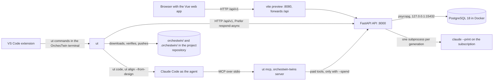

# Architecture

OrchesTwin Studio runs on the computer of the person who uses it. The Studio is three local processes: the PostgreSQL database in a Docker container, the API written with FastAPI, and the Vue web app that calls it. All three can be reached only at the loopback address 127.0.0.1. Around them sit `ut`, the terminal command, which is a client of the API just as the web app is, and the Visual Studio Code extension, which knows the Studio only through `ut`.

A local server with a database was the answer given to the supervisors on 6 October 2026: versions, gates, approvals and costs have to stay recorded and traceable. Whoever uses it on their own computer can do without registration and login, thanks to [local mode](../installation/local-mode.md).

## Processes and ports

| Process | Address | Started by |
|---|---|---|
| PostgreSQL 18, image `postgres:18-alpine` | 127.0.0.1:15432, forwarded to port 5432 of the container | `docker compose … up -d --wait database` inside `scripts/start-studio.ps1` |
| FastAPI API on Uvicorn | 127.0.0.1:8000, prefix `/api/v1` | `scripts/studio_runtime.py api` |
| Vue 3 web app | 127.0.0.1:8080 with the build served by `vite preview`, 127.0.0.1:5173 with the development server | `scripts/start-studio.ps1`, or `npm run dev:frontend` |
| `ut` | HTTP client of the API | the command installed with the Python package |
| `claude --print` | subprocess of the API, one per generation | the API |
| Claude Code as the coding agent | process in the project folder | `ut code` and `ut align --from-design` |
| `ut mcp` | MCP server `orchestwin-twins` on stdio | the editor's agent |

The start script checks that the ports are free, starts the database, applies the Alembic migrations and builds the web app. Before it starts the API it checks that the models are ready, without asking for any inference, and if that check fails the Studio does not start. Then it starts the API and the web app, with their logs in `var/studio/logs`, and waits up to 60 seconds for `GET /api/v1/health` to answer. Stopping closes only the processes recorded at startup. The database stays up, and so do the projects: "Studio processes stopped. PostgreSQL and all saved projects are retained." The commands are in [Starting and stopping the Studio](../installation/studio.md).

The `compose.yaml` file also describes a variant that runs entirely in containers. There the migrations get a container of their own, the API is published on 127.0.0.1:8000, and nginx, on port 8080, forwards `/api/` to the API.

## Who talks to whom

The diagram shows the calls: who calls whom, and over which channel. The Studio's generations go through the API alone; the coding agent is a separate thing, started by `ut` in the project folder.

For every generation the API opens `claude --print` in a temporary folder, with the system prompt in a file and the message on standard input. It strips from the child process's environment the variables that would point Claude Code at an API key or at another service. A generation therefore runs on the Claude subscription of whoever runs the Studio, which is the route the supervisors asked for on 1 October 2026 in place of the paid API. The model check is the same one the API exposes at `GET /model-runtime/readiness`. It runs `claude --version` and `claude auth status` and insists on a login made through claude.ai. The process runs in a thread because on Windows the API uses the `SelectorEventLoop` event loop, which psycopg needs and which does not start subprocesses. The rest is in [Providers, model contracts and guard](models.md).

The `ut` command never calls the model. It talks to the Studio at http://127.0.0.1:8000, the default address, or at http://127.0.0.1:8080, where `vite preview` forwards `/api`. It accepts plain HTTP only towards a loopback address and saves the login outside the project, in `%APPDATA%\orchestwin\sessions.json` on Windows. The exceptions are `ut code` and `ut align --from-design`, which start the developer's own coding agent in the project folder; the agent consults the twins through `ut mcp`.

The Visual Studio Code extension opens no connections. It reads the project files and writes `ut` commands into the "OrchesTwin" terminal; for the "Why?" and for validation it runs `ut why … --offline --json` and `ut validation … --json`.

## Where the data and the knowledge live

What the Studio records lives in PostgreSQL: accounts, projects, step versions, gates and their events, the evidence of every generation, and the Dossier versions with their archive. Versions are never modified or deleted, because database triggers reject UPDATE and DELETE. Stopping the Studio touches none of this.

The project's knowledge lives in the project's own repository instead, in the `orchestwin/` folder, which the Studio publishes as a Dossier version and `ut` downloads. Next to it sits `.orchestwin/`, with the link to the Studio and the local state of `ut`. The Dossier puts it this way: "The project's `orchestwin/` folder is the source of truth: hand-made changes come back to the Studio with `ut push` as versions supplied by you." A change made by hand reaches the database only when `ut push` sends it to the revision routes and the owner approves it.

The registry of generation jobs is different, because it lives only in the API's memory. It holds at most four running jobs per owner and two hundred in total, and keeps each one for an hour after it ends. A restart loses them, while whatever a generation has already written to the evidence tables stays.

## Size

The counts cover the files tracked by Git at commit `a850cd6`, on 11 October 2026.

| Part | Files | Lines | Tests |
|---|---|---|---|
| Python backend, `src/orchestwin` | 607 | 181,798, of which 12,622 in the 76 migrations | 12,436 cases collected, 517 `test_*.py` files |
| Web, `frontend/src` without the specs | 242 | 70,358 | 2,482 tests in 164 `*.spec.ts` files |
| Extension, `editors/vscode` | 14 | 5,952 | 197 tests in 13 `*.test.js` files |
| Scripts, `scripts/` | 10 | 1,326 | none |

The sprint 46 refactor had left the backend at 181,794 lines. The four extra lines, and test case number 12,436, come from the fix `77da801` of 11 October 2026. In the final chain of sprint 46, 12,248 Python tests passed on Windows, with 13 skipped and 174 integration tests left out, and 173 integration tests passed on PostgreSQL. The API registers 42 routers, and the OpenAPI document read from the running Studio on 11 October 2026 had 179 paths and 212 operations. [The API](../api/index.md) explains how to read it, and [The test suites](../quality/index.md) describes the suites.

## The architecture pages

The page on [packages](packages.md) describes the backend, the frontend, the command line and the dependencies between them. The one on [flows](flows.md) follows a step, a design generation and the code cycle module by module, and the one on [gates, sections and versions](states.md) covers the state machines. After them come [persistence](persistence.md), the [knowledge folder](knowledge-folder.md), the [model contracts](models.md) and the [editor extension](vscode-extension.md).
