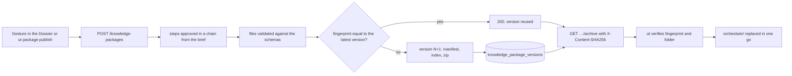

# The knowledge folder

On 24 September 2026 the supervisors asked for the framework to become a knowledge base about the project, detached from the web interface. Twins, requirements and design were to live in a folder of the project with a schema, be reusable across projects and stay up to date during development done with the usual tools. The `orchestwin/` folder is the answer. It sits in the project's repository next to the code, and it is read by people, by `ut`, by the twins' MCP server and by the coding agent. The Studio produces it and keeps every version. Beside it, `.orchestwin/` holds the link to the Studio and the local state of the commands.

## Two schemas

Schema 2 entered the code on 28 September 2026 with sprint 23 (commit b371de3). It brought the `ORCHESTWIN.md` index, a manifest with SHA-256 fingerprints and stable identifiers, one file per twin, 14 CSV tables, Mermaid diagrams built without a model, the twins' feedback and 10 JSON schemas: 54 files with two twins. Before that there was a zip generated on the fly, with no saved versions.

Schema 3 arrived the next day (commit aba6674, sprint 26). The folder can be published from the approved brief onwards, with only the approved steps, and it collects the state of development. At the time a folder with only the brief had 19 files, and a complete one with two twins had 59. Today's code writes schema 3 and still verifies schema 2 (`knowledge/layout.py:18-19`).

## What `orchestwin/` contains

On 6 October 2026, in the real `ut align` run on Calcolatrice iPhone (the iPhone-style calculator), proposal ALN-006 took the design to version 5 and the Dossier to version 7, with 72 files. The tree below is the same folder as read on 11 October 2026: 72 published files plus the `.gitattributes` that `ut` writes.

```text
orchestwin/
├── ORCHESTWIN.md
├── orchestwin.json
├── .gitattributes
├── brief/            brief.json, brief.md
├── team/             team.json, team.md
├── twins/            twins.json, twins.md, evidence.json, evidence.md
│   ├── chi-fa-conti-veloci-59bfe8f4/         twin.json, twin.md
│   ├── chi-passa-da-iphone-249752ca/         twin.json, twin.md
│   ├── utente-con-una-mano-sola-d283bacf/    twin.json, twin.md
│   └── feedback/     reviews.json, discussions.json, insights.json, changes.json,
│                     tests.json, learned.json, feedback.md
├── requirements/     requirements.json, requirements.md
│   ├── diagrams/     use-cases.mmd, requirements.mmd, traceability.mmd
│   └── tables/       8 .csv files
├── design/           design.json, design.md, mockup.html, mockups.md, critiques.md
│   ├── diagrams/     des-001-workflows.mmd, des-002-workflows.mmd,
│   │                 screen-map.mmd, traceability.mmd
│   └── tables/       8 .csv files
├── schema/           16 .schema.json files
├── state/            state.json, state.md
└── traceability/     why.json
```

The three twin folders keep the Italian names of the calculator's twins: someone who does quick sums, someone switching from an iPhone to another phone, a one-handed user.

Each step has a JSON document, which carries the content, and a Markdown view (`knowledge/layout.py:54-59`). Only the steps approved in an unbroken chain from the brief go in. If a step is not approved, or its context is no longer the current one, the folder stops at the step before (`knowledge/export.py:88-139`). Tables and diagrams are views of the same documents.

| Path | What it contains |
|---|---|
| `ORCHESTWIN.md` | index for people and agents |
| `orchestwin.json` | manifest: schema, generator and Mermaid version, package number and fingerprint, steps with version, fingerprint and gate, state, twins, views, identifiers, the fingerprint of every file, "Why?" (`knowledge/folder.py:521-583`) |
| `brief/`, `team/`, `twins/`, `requirements/`, `design/` | `<step>.json` and `<step>.md` for each step; `team/` holds the Perspectives, `requirements/` the Definition |
| `twins/<name>-<8 characters>/` | one twin per folder; the eight characters come from its identifier (`knowledge/layout.py:66-78`) |
| `twins/feedback/` | reviews, discussions, insights, commit reviews, test outcomes, learned observations |
| `twins/evidence.json` | the twins' text sources, when there are any |
| `*/diagrams/` | `.mmd` diagrams for Mermaid 12.0.0 (`knowledge/diagrams.py:10`) |
| `requirements/tables/` | `requirements`, `user-stories`, `acceptance-criteria`, `scenarios`, `risks`, `definition-of-done`; with a schema 2 Definition also `needs`, and `journeys` when there are any |
| `design/tables/` | `alternatives`, `workflows`, `visual-language`, `palette`, `critiques`, `concerns`, `screens`, `transitions` (`knowledge/tables.py:38-176`) |
| `design/mockup.html` | static mockup of the chosen alternative |
| `schema/` | JSON Schema 2020-12 files for the manifest and the documents (`knowledge/schema.py:114-130`) |
| `state/` | aligned point, recorded commits with critiques and decisions, tasks |
| `traceability/why.json` | the "Why?" graph |
| `validation/`, `workflow/` | validation hypotheses and outcomes, declared gaps, when there are any |
| `.gitattributes` | `* -text`, so that Git does not change line endings and the fingerprints stay valid (`cli/folder.py:23-24`) |

## `.orchestwin/`, the link and the local state

`.orchestwin/` is created by `ut init` and tells `ut` which Studio project the folder belongs to. It holds no sign-in: the `ut` sessions live in the user's profile, on Windows in `%APPDATA%\orchestwin` (`cli/session.py:104-123`).

| Path | What it contains |
|---|---|
| `project.json` | Studio address, API prefix, project, mode `DESIGN_ONLY` or `DESIGN_AND_CODE`, language (`cli/project.py:16-44`) |
| `steps/`, `previews/` | the latest `ut` steps and HTML previews of the design, the previews excluded from Git |
| `code.json`, `code/` | settings and runs of `ut code`; `design.json` with the design version the code is aligned with and the reason, `CODE_RUN`, `DESIGN_RUN` or `NO_CODE_CHANGES` (`cli/flows/code_run.py:36-50,375-386`) |
| `align/` | one file per `ut align` run, plus `latest.json` |
| `push/latest.json` | the latest `ut push`: starting and resulting version, steps sent |
| `test.json`, `tests/` | settings, plan and outcomes of `ut test` |
| `activity-session.json` | the study session in progress |

`code/` has its own `.gitignore` containing `*`, so `design.json` stays out of Git as well.

## Publishing and downloading

A folder is published with a gesture in the Dossier step of the web interface or with `ut package publish`, and both call `POST /api/v1/projects/{id}/knowledge-packages` (`api/knowledge_packages.py:202-221`). The Studio loads the approved steps, writes the files and validates them against their schemas. Then it computes the content fingerprint: the SHA-256 of the sorted list of file fingerprints, leaving out the manifest and the index (`knowledge/folder.py:155-163`). If fingerprint and schema match the latest version, the Studio reuses it and answers 200. Otherwise, with the project row locked, it builds version N+1 and packs it into a deterministic zip, with files in order, a fixed date of 1 January 1980 and permissions 0644. The zip is saved with its fingerprint in `knowledge_package_versions` and the answer is 201 (`knowledge/package_service.py:72-118`).

The download goes through `GET …/knowledge-packages/{n}/archive`, which carries the `X-Content-SHA256` header. If the fingerprint of the bytes received differs, `ut` stops with `ARCHIVE_HASH_MISMATCH` (`cli/flows/publish.py:91-112`). Otherwise it verifies the folder, within limits of 400 files and 16 MB of archive (`knowledge/archive.py:36-40,230-316`). It checks paths, schema 2 or 3, the fingerprint of every file, unlisted files, conformance to the schemas, and `why.json`, which must match the one derived from the documents. Only then does it write the files into a temporary folder alongside and swap it with `orchestwin/`. If the swap fails, the old folder goes back in its place (`cli/folder.py:149-164,310-332`).

The diagram follows one publication from the gesture to the replaced folder.



## The round trip

The proof that the folder is enough to rebuild a project dates from the evening of 27 September 2026. Five projects from the sprint 22 measurement, with two twins each, were published, downloaded, imported as new projects, approved again and published again. The comparison covered the five step documents and the 21 views, normalised for identifiers, fingerprints, versions and dates. It found 0 differences in all five, with 54 files per folder, publications between 0.370 and 0.464 seconds and imports between 0.184 and 0.259. At the time the import did not recreate the twins' revisions.

## Importing a folder

`ut package import` creates a new project in the Studio from a folder or from its zip. The import verifies the folder the same way the download does and writes the versions in a single transaction. Before the commit it recomputes the "Why?" from the data it has just written and compares it with `why.json`. If the two graphs differ, the transaction rolls back with `FOLDER_WHY_MISMATCH` (`knowledge/project_import_service.py:393-406,423-538`). Whatever cannot be rebuilt ends up in `import_limits`, for example `OWNER_WORKFLOW_APPROVALS_NOT_RESTORED` (`knowledge/project_import.py:456-502`).

Changes made by hand in the folder go back to the Studio with `ut push`, described in [Dossier, push, why and validation](../ut/dossier.md). Only the five step documents are sent. The other files are derived, and the Studio rewrites them at the next publication (`cli/flows/push_compare.py:15-21`).
