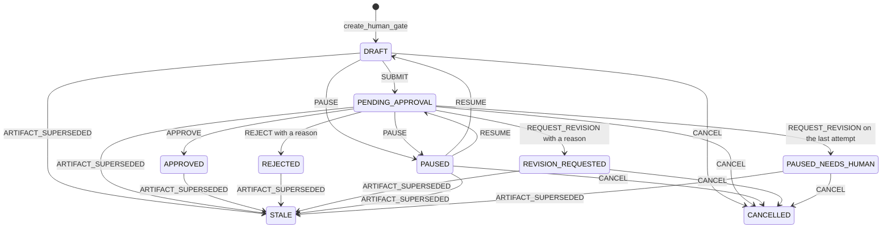
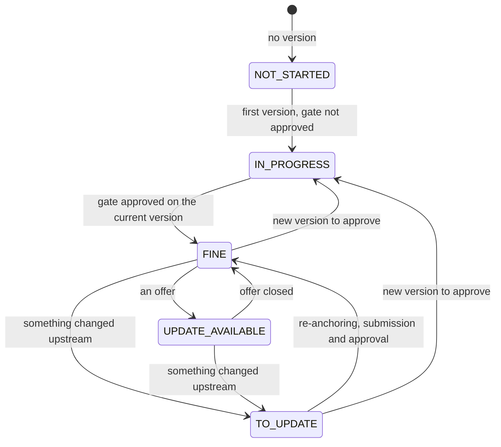

# Gates, sections and versions

Every step of the framework ends with a decision by the project owner, and the decision holds for one precise content. That is why the Studio ties every approval to a version that never changes again, with its number and its SHA-256 hash: if the content changes, the approval does not follow it. The gates record the decisions, the sections say on every read what has fallen behind, and the version chain keeps everything.

## Gates

A gate (`HumanGate`, in `workflow/gates.py`) is bound to an exact artifact: project, gate type, identifier, version number and hash. Five types are in use, one per step. The Dossier has no gate, because it only publishes what the other five have approved.

| Gate | Step | Service |
|---|---|---|
| `PROJECT_BRIEF` | Brief | `projects/brief_gate.py` |
| `AGENT_TEAM` | Perspectives | `agents/team_gate.py` |
| `USER_MODELING` | User Twins | `twins/user_modeling_gate.py` |
| `REQUIREMENTS` | Definition | `projects/requirements_gate.py` |
| `DESIGN` | Design and evaluation | `artifacts/design_gate.py` |

The enumeration still contains `ARCHITECTURE`, `HIGH_IMPACT_OPERATION` and `FINAL_OUTPUT` as well, introduced by migrations 0016, 0019 and 0027 between 21 and 31 August 2026. No module uses them any more. Migration 0052 of 24 September 2026 dropped the tables of their artifacts, but the three values are still in the CHECK constraints of `human_gates` and `human_gate_events`.

| State | What it means | Owner's actions |
|---|---|---|
| `DRAFT` | created and not yet submitted | `SUBMIT`, `PAUSE`, `CANCEL` |
| `PENDING_APPROVAL` | waiting for the decision | `APPROVE`, `REJECT`, `REQUEST_REVISION`, `PAUSE`, `CANCEL` |
| `APPROVED` | approved | none |
| `REJECTED` | rejected, with a reason | none |
| `REVISION_REQUESTED` | change requested, with a reason | `CANCEL` |
| `PAUSED` | paused, remembers the state to resume from | `RESUME`, `CANCEL` |
| `PAUSED_NEEDS_HUMAN` | change requested on the last attempt | `CANCEL` |
| `CANCELLED` | cancelled | none |
| `STALE` | superseded by a different artifact | none |

Only the owner of the gate decides, and anyone else gets `ACTOR_NOT_OWNER`. The `REJECT` and `REQUEST_REVISION` actions need a reason of at most 2,000 characters. Every transition adds a numbered event to `human_gate_events`, where a trigger has rejected UPDATE and DELETE ever since migration 0007. A gate is saved against its previous state: if that state changed in the meantime, the request ends with a 409 `gate_state_conflict`.

When an artifact other than the gate's own becomes current, the gate moves to `STALE` with the `ARTIFACT_SUPERSEDED` event. It is the only event without an author, because the system writes it. It can happen from every state except `CANCELLED`, which refuses the transition, and `STALE` itself. The shared protocol in `workflow/gate_flow.py` applies it when a new artifact arrives to be submitted, and when a decision concerns an artifact that is no longer the gate's one; in that case the decision gets the `ARTIFACT_STALE` response.

The diagram shows states and actions; the arrows towards `STALE` are the system event.

Gates of the same type count attempts. The first one starts as attempt 1 of 3, and every new artifact submitted creates a gate with the next attempt. A `REQUEST_REVISION` on the last attempt leads to `PAUSED_NEEDS_HUMAN`. From there, as from `CANCELLED`, no submission gets through any more (`GATE_BLOCKED`), and past the cap the answer is `ITERATION_LIMIT_REACHED`. Since 1 October 2026 an approval renews the cap, so after an approved gate the next one has three more attempts ahead of it. The rule comes from sprint 30: without it, sections that reopened got stuck at the fourth version. Since 11 October 2026, with the sprint 46 refactor, the five gate services share the same protocol in `workflow/gate_flow.py`.

## Sections

After the first pass the steps become sections, each with its own state, and the work stops being a sequence walked through once. This is a sprint 30 decision, from 1 October 2026. The state is not saved in any table: the `project_sections` function in `projects/sections.py` derives it on every read from the current versions, the gates and the upstream references.

| State | In the web app | When |
|---|---|---|
| `NOT_STARTED` | "Waiting" | there is no version yet |
| `IN_PROGRESS` | "Your turn" | there is a version, but its gate is not approved |
| `FINE` | "Up to date" | the version is approved and nothing upstream has changed |
| `UPDATE_AVAILABLE` | "Update available" | the version is approved and there is an offer: twins that learned something (`TWINS_LEARNED`), requirements the design does not cover (`REQUIREMENTS_NOT_COVERED`), a mockup without the twins' review (`EVALUATION_MISSING`) |
| `TO_UPDATE` | "To update" | the version is approved but something upstream changed: `BRIEF_CHANGED`, `PERSPECTIVES_CHANGED`, `ARCHETYPES_CHANGED`, `USER_TWINS_CHANGED` or `REQUIREMENTS_CHANGED` |

The Dossier follows a rule of its own. With no published folder it is "Waiting". It is "Up to date" if the folder contains exactly the approved chain and no upstream section needs updating, and "To update" otherwise, with the reason `FOLDER_BEHIND`.

A section that needs updating can be blocked, and the web app explains the block with the sentence "{section} cannot be updated by itself: {reason}."

| Block | The reason in the web app |
|---|---|
| `REQUIREMENT_NO_LONGER_AVAILABLE` | "the design cites {codes}, which the Definition no longer contains: regenerate the alternatives in the Design & Evaluation section" |
| `TWIN_SET_CHANGED`, `TWIN_NO_LONGER_AVAILABLE` | "the twins are no longer the same" |
| `REVISION_PENDING` | "a proposed change is waiting for your decision" |
| `UPSTREAM_NOT_READY` | "the section upstream has to be settled first" |
| `PREPARE_AGAIN` | "the brief changed: prepare the perspectives again" |
| `PREPARE_TWINS` | "the archetypes changed: prepare and approve the updated twins in the User Twin section" |

The diagram summarises the conditions. Its arrows are not saved transitions: they say which state a section falls into when the facts it is derived from change.

## Re-anchoring

When a section needs updating but its content is still right, there is no reason to regenerate it. A new version with the same content and references to the new upstream versions is enough. This is re-anchoring, and it arrived together with the sections. In the measurement of 1 October 2026 a design was re-anchored to a changed Definition without regenerating either the alternatives or the mockups. For the design the work is done by `realign_design`, in `artifacts/design_realignment.py`, which refuses if the design cites a requirement that has disappeared or if the set of twins has changed. Each section has its own route: `/team/context-alignment` for Perspectives, added on 2 October 2026, `/user-modeling/context-alignment` for the twins, `/requirements/twin-alignment` for the Definition and `/design/requirements-alignment` for the design.

The "Update and confirm" gesture in the web app and `ut sections update` both call `POST /sections/alignment`. The service walks through Perspectives, User Twins, Definition and Design in that order, and stops at the first blocked section. For each section that needs updating it performs the re-anchoring, the submission to the gate and the approval, with the reason "Aligned to the current upstream versions with unchanged content." The gesture therefore counts as an approval, and the web app says so beforehand: "{sections} to update: something upstream changed. The content you approved stays the same; it is only re-anchored to the new versions."

In the night between 1 and 2 October 2026, on Calcolatrice iPhone (the iPhone-style calculator), `ut sections update` re-anchored and approved Definition v2 and downloaded Dossier v5 in 8.2 s, with no generation. The content and identifiers of 10 requirements, 4 stories and 10 criteria stayed the same.

## The version chain

Every step saves numbered versions that never change again. Version N declares that it derives from N−1 (the first from none), and its hash has to match the content. The version types of the Definition, the twins and the design check this, `DesignPackageVersion` in `artifacts/design_packages.py` among them. In the database a trigger rejects UPDATE and DELETE on the version tables, for example `requirements_specification_versions` (migration 0011) and `design_package_versions` (0013).

A change never touches the current version. It becomes a diff in the `PROPOSED` state, which the owner approves (`APPROVED`) or rejects (`REJECTED`). Approving the diff adds version N+1, which then waits for its own gate, and until it is approved the section goes back to "Your turn". The pattern holds for the Definition, the twins and the design, and re-anchoring, in the end, is also a version N+1 with the same content.

## Design versions and restore

Until sprint 43 there was no way to get an earlier version of the design back. Since 8 October 2026 the `ut design restore N` command and, in the web app, "Go back to this version" in the "Versions of the design" block call `POST /design/revisions/restore`. A restore does not rewrite history. It creates a diff with the package of version N re-anchored to the current Definition, approves it with the note "Restored from version N" and adds a new version, which goes through the gate like any other. The `ut` command announces it like this: "I go back to version {version}: version {next} is created, the same as {version} and re-anchored to the current Definition, and then it has to be approved. The model does not work on it: it costs nothing."

This needed a migration. The `design_package_versions` table had a uniqueness constraint on project and content hash, and the first real run on 8 October 2026, `ut design restore 9`, was refused with 409 `PERSISTENCE_REJECTED`. Migration 0074 drops the constraint. Restoring a version identical to the current one is still refused, with 409 `DESIGN_RESTORE_CURRENT`. The second run, later the same day, answered "Version 11 created from version 9: approve it with `ut design approve`." On 9 October 2026 the redesign that came out of the [critique](../design/critique.md) of apple.com became version 13 of the Calcolatrice iPhone design, and all twelve earlier versions are still in the history.
