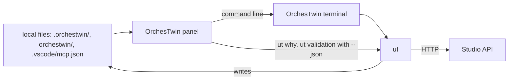

# The Visual Studio Code extension

Development outside the Studio happens in the editor. The OrchesTwin panel brings the project's state and the `ut` commands there without becoming a second client of the Studio: it reads the files in the project folder and leaves everything else to `ut`. It was born with sprint 28, on 30 September 2026 (commit b192db2), and it is JavaScript without dependencies, using only Node.js modules and the VS Code API.

The diagram shows where the panel gets its data and which way it reaches the Studio.



## What it shows

The panel appears in the activity bar as "OrchesTwin", with the "Project" view. It activates when the workspace contains `.orchestwin/project.json` and does not run in untrusted workspaces (`editors/vscode/package.json:15-22`). It reads the link to the Studio, the knowledge folder, the latest runs of `ut test`, `ut code` and `ut align`, the design point in `.orchestwin/code/design.json`, and `.vscode/mcp.json`. When one of these files changes, the panel refreshes after 300 milliseconds (`editors/vscode/extension.js:20-45`).

At the top sits "Next step". Before the design is approved, it offers to continue the guided path or to work on the design. After that it chooses in a fixed order: commits to review again, `ut align` proposals waiting for a decision, a design ahead of the code, open tasks, criteria that failed in the latest test run, commits to review (`editors/vscode/src/view.js:558-619`). The design gap is worded like this: "The design is at version {current} and the code is aligned with version {aligned}: bring the code up to the current design with `ut align --from-design`." (`editors/vscode/src/messages.js:243-244`). The aligned version is the higher of the `ut verify` point and the one that `ut code` or `ut align --from-design` write into `design.json`.

## The commands

There are sixteen commands (`editors/vscode/package.json:43-125`). Ten of them write a `ut` command line into the "OrchesTwin" terminal, one per folder, reopened if it was closed. The command runs there, where its output can be seen (`editors/vscode/extension.js:223-243`).

| Panel command | Line in the terminal | Cost |
|---|---|---|
| Show where the project stands | `ut status` | `FREE` |
| Verify the acceptance criteria | `ut test` | `SPENDS` |
| Review the commits with the twins | `ut verify` | `SPENDS` |
| Review again the commits of an earlier design | `ut verify --recheck` | `SPENDS` |
| Align the knowledge to the code | `ut align` | `SPENDS` |
| Bring the code up to the current design | `ut align --from-design` | `AGENT` |
| Send the folder changes to the Studio | `ut push` | `FREE` |
| Start the coding agent on the open tasks | `ut code` | `AGENT` |
| List the tasks for the code | `ut tasks` | `FREE` |
| Let the twins learn from the development | `ut twins update` | `SPENDS` |

With `SPENDS` the command makes the Studio generate; with `AGENT` it launches Claude Code on the account of the person at work (`editors/vscode/src/commands.js:5-39`). The command titles say so with "may spend" and "on your own account". The other six commands refresh the panel, open the report of the latest test run, connect the twins to the editor's agents, and read the "Why?", the validation and a scenario walkthrough. Connecting adds the `orchestwin-twins` server to `.vscode/mcp.json`, started as `ut --project-dir <folder> mcp`, and leaves the other servers as they were (`editors/vscode/src/agents.js:25-33,76-99`).

The extension opens no network connections. For the "Why?" it runs `ut why <code> --offline --json` with a 30-second limit (`editors/vscode/src/why.js:89-175`). Validation and scenarios go through `ut validation … --json`, with `--offline` for the verified local Dossier, or without it to read from the Studio (`editors/vscode/src/validation.js:91-165`). The `orchestwin.utCommand` setting is `ut` unless someone changes it, and it accepts the full path of the program.

## Building, installing, testing

The package is built by a script that uses only Node.js. It writes `editors/vscode/dist/orchestwin-studio-0.1.0.vsix` with the manifest, the language files, `extension.js`, `src/`, `media/` and the licence (`editors/vscode/scripts/package-vsix.mjs:9-20,240-298`). The `--out` option changes the output folder.

```powershell
node editors/vscode/scripts/package-vsix.mjs
```

When it finishes, the script prints the command that installs the package.

```powershell
code --install-extension editors/vscode/dist/orchestwin-studio-0.1.0.vsix
```

The tests run with `node --test` on the 13 files in `editors/vscode/test`. At the end of sprint 46, 197 out of 197 passed.

```powershell
npm run test:editor
```

The check with a real VS Code opens the installed one, or the one named by `ORCHESTWIN_VSCODE`, with a throwaway profile, extensions folder and workspace. It loads the extension and runs ten checks, from activation to the connection with the agents, by way of the panel, file watching and the terminal (`editors/vscode/test/host/runner.js:592-603`). The first time, on 30 September 2026 with VS Code 1.139.1, all ten passed in 5.6 seconds.

```powershell
npm run check:editor-host
```
