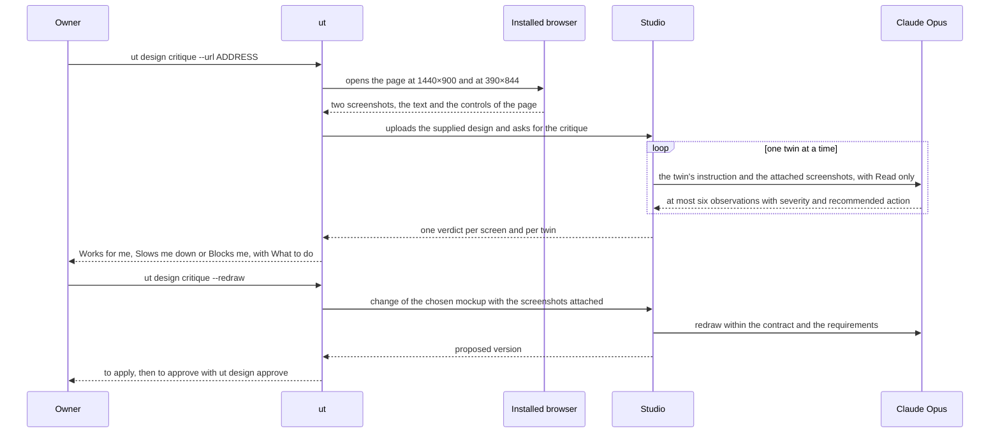
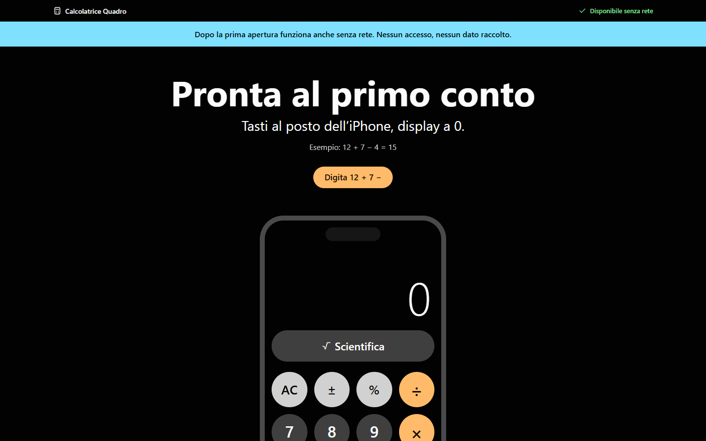

# Critique of an existing design

On 9 October 2026 I passed on a request that one of the supervisors had made in person: the system should be able to critique a design that already exists, taken from a website or from an image. Until that day the twins judged only the Studio's own mockups. Sprint 44 started in the afternoon, and by the evening the critique was running on two projects.

## How it works

A design comes in one of two ways. It can be a PNG or JPEG image of up to 5 MB, with sides from 16 to 8,000 pixels. Or it can be an address: `ut` opens the site in the installed browser at 1440×900 and at 390×844 pixels, takes a screenshot and also collects the text and the controls of the page. The web accepts only images.

The Studio passes the screenshots to `claude --print` as attachments, and the only tool the model gets is Read, limited to those files. Each twin judges in a call of its own, screen by screen, from its own role. It gives at most six observations, each with a recommended action, and invents no screens, data or behaviour that the images do not show. The verdict on a screen comes from the severity of the observations. One critical or major observation is enough for "Blocks me"; otherwise a moderate or minor one gives "Slows me down"; with neither, the verdict is "Works for me". Under the verdicts the web writes "They are hypotheses of the twins to weigh, not evidence."

The critique leaves the current design alone and stays in the Studio, outside the knowledge folder. What happens next is the owner's decision. "Redraw as a mockup" asks the model for a new version of the chosen mockup that reproduces "the layout, the colours, the hierarchy of the content and the kind of controls" of the supplied design. The redraw stays within the project's contract, screens and requirements. The result is a proposed version, which you apply and which then goes through the gate like any other.

The diagram follows the critique of a website requested from `ut`, up to the redraw.

## From the command line and from the web

| Command | What it does |
|---|---|
| `ut design critique --image FILE` | uploads a PNG or JPEG image and asks for the twins' opinion |
| `ut design critique --url ADDRESS` | takes screenshots of the site at 1440 and at 390 pixels and asks for the twins' opinion |
| `ut design critique` | lists the critiques from the most recent, with the count of the verdicts |
| `ut design critique --redraw N` | redraws the chosen mockup like the design of critique N in the list; without N, the latest |

Before asking for the opinion, `ut` warns that "The current design does not change." At the end it says how long it took and, on the subscription, "no credit spent". In the web, the "Critique of an existing design" block sits in the Design step: you upload an image, "Ask the twins for their opinion" estimates about 3 minutes, and "Redraw as a mockup" about 7. The options are in [ut design](../ut/design.md), the web block in [After the design](../web/after-design.md).

## The runs of 9 October

On the Calcolatrice iPhone, the iPhone-style calculator, there were four trials, all in the afternoon. The screen of the DES-001 mockup, uploaded as an image, got its opinion in 2 min 04 s. The twins "Chi passa da iPhone" (switching from an iPhone) and "Chi fa conti veloci" (quick sums) answered "Blocks me", and "Utente con una mano sola" (the one-handed user) "Slows me down". They left eight observations, each with its "What to do". The Italian home page of apple.com, given as an address, was judged in 1 min 49 s. It got three "Blocks me" on both screens, because a product showcase is no use for doing sums, together with what to take from it: black background, thin white type, no blue and no light sections. From the web, a screen at 390 pixels got its opinion in 109 s, with 37 to 44 seconds of model time per twin.

The redraw, requested from the web on the apple.com critique, succeeded on the first attempt in 5 min 41 s, with 44,493 output tokens and eight changes described by the model. Among them are a thin line with the name, a coloured band, a large title on black with pill buttons, and the calculator inside an iPhone frame in place of the product photo. Apple's blue was not among the tokens and became the accent colour. At 17:36 the proposal became version 13 of the design, and at 17:46 I approved it, with Dossier 15. The twins' review of version 13 still flagged the "⌫" key between "," and "=" as major.

<figure markdown="span">
  
  <figcaption>Calcolatrice iPhone, design 13, approved on 9 October 2026: the redraw from the apple.com critique. It is the current design of the project. "Apple-style" here means redrawn from apple.com: the apple-hig system arrived the next day and this design does not use it. The texts and the worked example are written by the model.</figcaption>
</figure>

In the evening, for a video for the supervisors, I took a second project, Bottega Vicina (a neighbourhood online shop), from the brief to the design in the terminal. The critique of the amazon.it address came out blank: the site serves an empty page to Chrome under automation, the twins said they could not judge, and the verdict shown was "Works for me". Uploaded as images, two screenshots of the same site got three "Blocks me" each. The redraw from the wide screenshot was rejected on the first attempt after 9 min 23 s, because the first text describing the changes went over 300 characters. The second attempt succeeded and became design 3, approved, with Dossier 5. From the next day on, the Studio shortens a text that is too long instead of throwing the response away. The whole project took 30 generations and 54.6 minutes of model time.

## Limits

The verdict comes from severity, so a twin that finds nothing to judge comes out as "Works for me". That is what happened with the blank capture of amazon.it, and `ut` does not block a page that cannot be captured. On a project whose design was supplied by the owner the critique is refused, like every other operation on the design. In the list of saved critiques the cost is always zero, and the wait for a critique requested from `ut` is not among the command's recorded waits. The model judges the supplied design from the project's point of view, so a page that has nothing to do with the project gets "Blocks me". The twins who critique and the designer who redraws are the same model: their opinions remain hypotheses to check with people.
