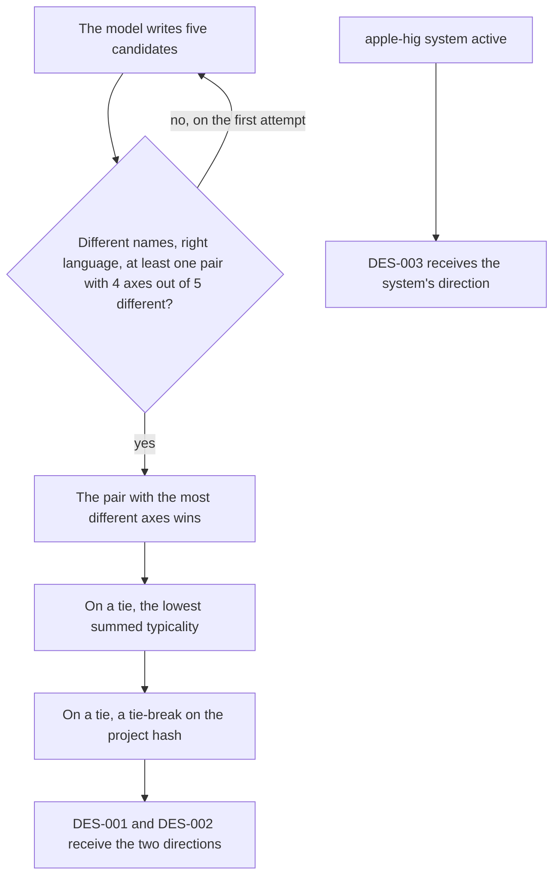
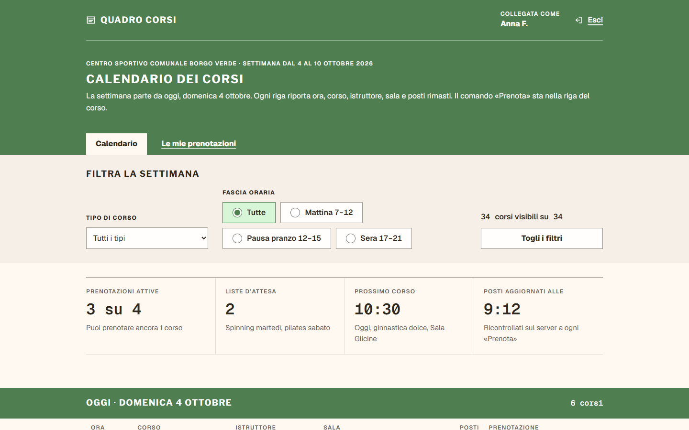
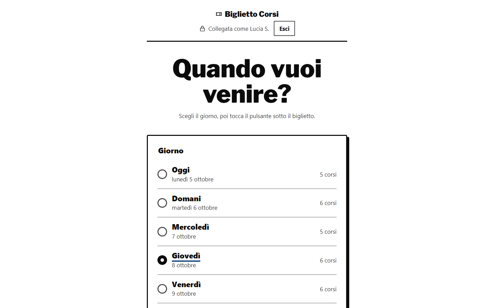
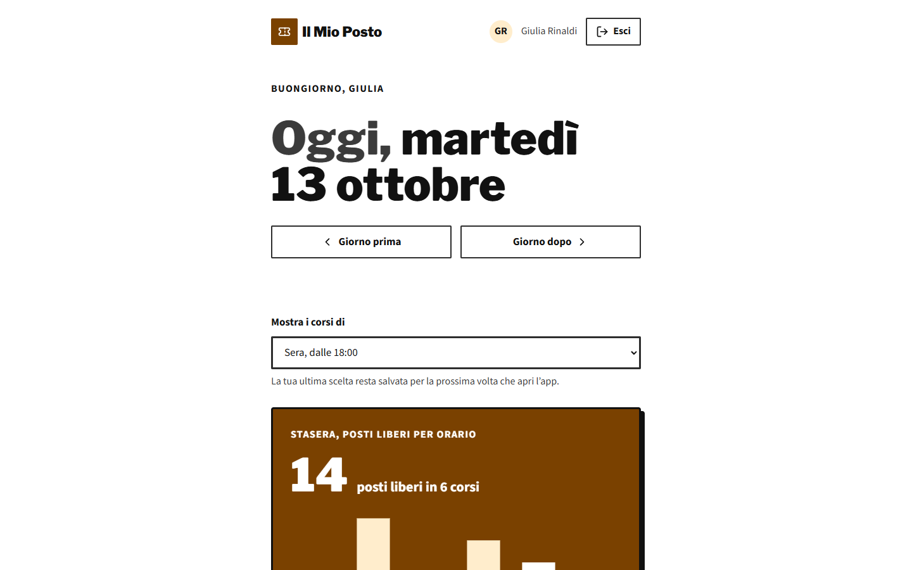
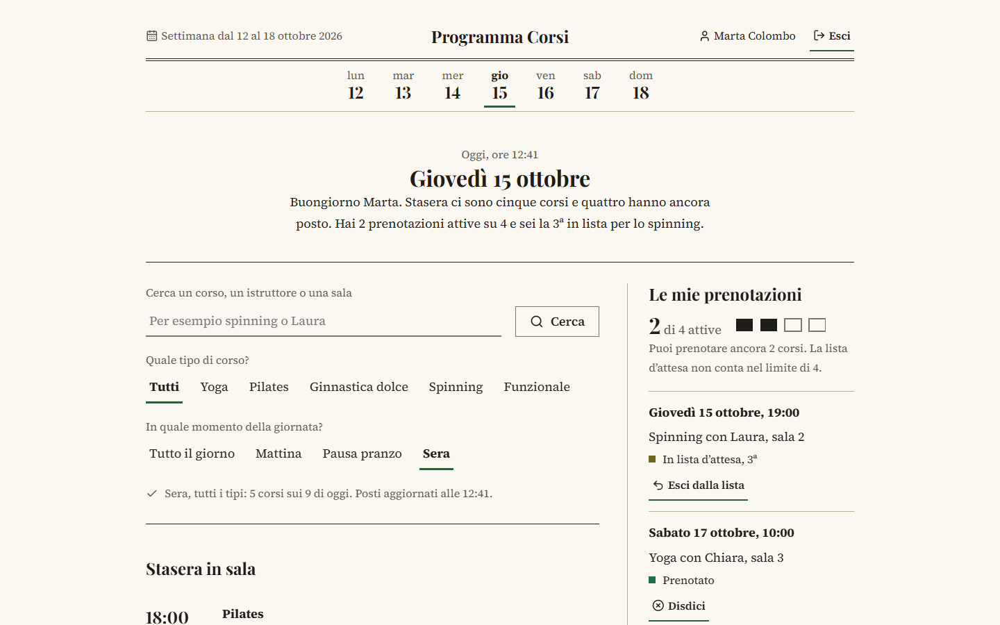
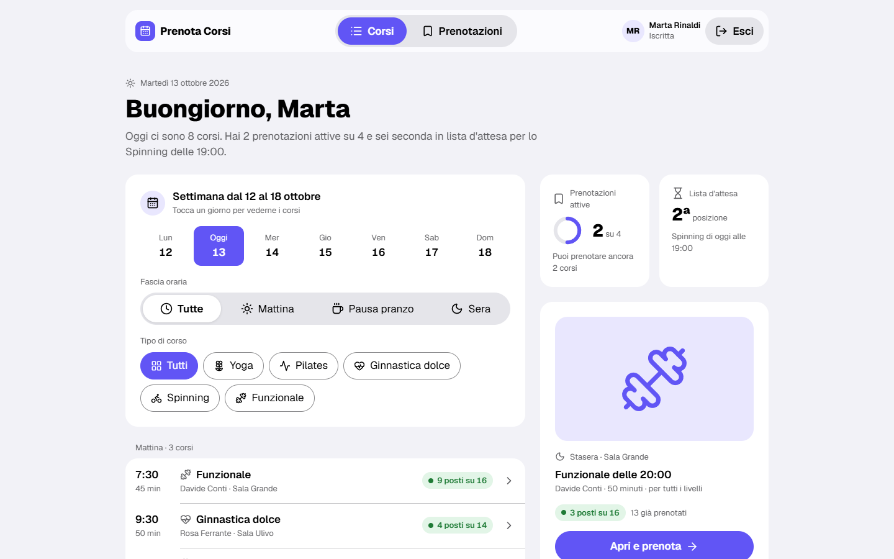

# Visual directions and the Apple HIG system

Between 25 September and 10 October 2026 the variety of the designs went through three ideas: a catalogue of visual choices, directions written by the model and chosen by the Studio, and a design system taken from Apple's guidelines. The first two look for distance between the alternatives. The third looks for consistency, and the two pulls go in opposite directions.

## The catalogue of 25 September

The first visual catalogue had 22 dimensions and 136 values, from layout archetypes to typefaces, and 5,472 palettes that met the contrast thresholds by construction. The model picked one value per dimension and the internal renderer drew. In the five projects measured that day, the two alternatives of a project differed in 14–22 dimensions out of 22. From one project to the next, though, the model repeated itself: a single card (`SINGLE_CARD`) in every project, the same humanist typeface for body text in eight alternatives out of ten, light mode in seven.

Since 27 September the Studio assigns different groups of the catalogue to the two alternatives, drawn deterministically from the project's identifier. Part of the variety has been imposed ever since: the critical review of 1 October called it "largely imposed".

## The single instruction of 3 October

On 3 October, after choosing between the two alternatives of the calculator, I said: "the styles all look identical to me". The diagnosis in the code was simple. The same model wrote every mockup from a single instruction that prescribed one look: header, navigation, title row, panels, one radius, a border and a shadow. What came out was one visual language with different parameters. Measured later with the distance of sprint 38, the pairs of the earlier sprints sat between 8 and 39 out of 100 in drawn style.

## Directions written by the model, chosen by the Studio

Since 4 October the model writes five candidate visual directions before the alternatives. A direction decides how the page is composed, the shape language, the type scale, the use of colour and the density; it does not decide flows, functions or texts. It has a name, an idea in two sentences, three to five rules you can check by looking at the result, and a value on five axes. It also has a typicality: the probability that a designer without that instruction would propose the same thing.

The instruction asks for "five different answers, not five variations of one answer". At most one candidate may resemble the usual safe direction, with the bar at the top and rounded cards in a grid. For the others the model looks to graphic traditions, such as a magazine page, a poster, a timetable, a ticket or a receipt, and never to a brand or a designer. Every direction has to serve all the twins: if one of them declares a visual or motor impairment, or uses the product in a hurry or with one hand, no candidate is compact. At least three candidates have a typicality below 0.15. Typefaces and colours are not named at this stage; they come later.

| Axis | Values, as the web and `ut` write them | What it sets |
|---|---|---|
| Layout | Panels, Bands, Editorial page, Stage, Workbench, Mosaic | the width of the content, from 640 px (Stage) to 1,600 px (Workbench), and the kind of header |
| Shapes | Rounded outlines, Square corners and rules, Heavy frames, Filled surfaces, Pills | radius 0 with the rules, a 3 px border and a hard shadow with the frames, a 28 px radius with the pills |
| Type | Restrained scale, Very large titles, Upper-case labels, Reading | a 72 px title, spaced 12 px labels, 18 px text on 66-character lines |
| Colour | Colour on the action only, Fields of colour, Almost monochrome, Tinted surfaces | the catalogue's emphasis and background, no colour value |
| Density | Compact, Comfortable, Spacious | the space between sections, 24, 48 or 88 px |

The two chosen directions differ on at least four axes out of five. The diagram shows how the Studio gets there from the five candidates, without asking the model anything.

`ut design regenerate` discards the candidates that repeat the five values of a direction in the current version, as long as a valid pair is left. Of the five candidates, the design package keeps only their number. In the web, the origin of a free direction reads: "Proposed by the model among {n} candidates; chosen by the Studio because it is far from the other."

<figure markdown="span">
  
  <figcaption>The gym project, 4 October 2026, DES-001 with the direction "Quadro orari" (timetable board, typicality 10). Names, dates and figures are invented by the model.</figcaption>
</figure>

<figure markdown="span">
  
  <figcaption>The same project, DES-002 with the direction "Biglietto d'ingresso" (entry ticket, typicality 7). Of this pair I wrote "I like the latest generation of the gym a lot". Names and dates are invented by the model.</figcaption>
</figure>

## Typefaces, icons and contrast

Sprint 38 brought into the mockups five font families under the OFL licence that I already had on disk: Geist, Geist Mono, IBM Plex Mono, Libre Franklin and Lexend Zetta. On 10 October nine more joined them: Source Sans 3, Nunito, Archivo Narrow, Source Serif 4, Lora, Playfair Display, Zilla Slab, Bricolage Grotesque and Caveat. That makes fourteen families in 37 files, checked against their hashes and embedded in the mockup document from the disk, never from the network. The model picks the pair for titles and text by reading one line about the character of each.

The same day 237 Lucide 1.54.0 icons arrived, under the ISC licence. The model writes an empty placeholder with the name of the icon and the Studio fills it in. The placeholder photo is a flat background, a tint of the design's colour, with the icon drawn large.

The model writes the palette too, fifteen colours per alternative. The primary is never "the usual blue of a template", and the primaries of the alternatives differ by at least 30 degrees of hue or in saturation. If a colour misses the contrast threshold, the Studio shifts only its lightness. WCAG AA contrast is a rule of the Studio: 4.5:1 for text, 3:1 for large text and for control borders, 7:1 and 4.5:1 in the high-contrast modes. In my Studio every mockup also receives, as attachments, two of the twenty-one interface examples I had chosen, which stay private.

The first round of that day had higher distances than sprint 38 and zero violations reported by axe, and yet I judged it less beautiful. The numbers are in [Measures](measures.md).

## The apple-hig system

After that judgement I decided to try Apple's guidelines. Twenty-seven pages of the Human Interface Guidelines, captured on 10 October, became the `apple-hig` system. The San Francisco typefaces and SF Symbols are under an Apple licence and stay out; Geist and the Lucide icons take their place. The text for the model fits in 2,800 characters. It asks for glass bars, a large left-aligned title, grouped lists and a single capsule-shaped primary action per view. Colour goes only on interactive elements and on the selection, gradients are out, targets are at least 44×44 px, the grid is 8 px, and copying Apple's symbols is forbidden. The tokens set titles of 40, 34 and 28 px, text of 17, labels of 13 and radii of 12 and 20 px. The palette takes the nine iOS system colours and the light and dark neutrals.

Shortly after noon I asked for flat colours only, Apple's palette and rounded corners; since then the instruction allows no gradients and the placeholder photos are flat as well. In the afternoon, having seen the flat-colour round, I wrote "perfect, the Apple style becomes the standard", and the system became the Studio's default. Shortly afterwards I asked for three designs, "one with Apple's guidelines".

With the system on, the proposal has three alternatives. DES-001 and DES-002 follow the two free directions, which the instruction wants "free of that system". DES-003 follows the fixed direction "Apple Human Interface Guidelines" (Panels, Filled surfaces, Restrained scale, Colour on the action only, Comfortable), and for it the Studio rejects a primary, an accent or a pair of typefaces from outside the system. The web marks it with "Apple guidelines". Leaving the `ORCHESTWIN_DESIGN_SYSTEM` variable empty, or setting it to `none`, turns the system off and brings the alternatives back to two; a name the Studio does not know stops it from starting, with `DESIGN_SYSTEM_UNKNOWN`.

<figure markdown="span">
  
  <figcaption>The gym project, 10 October 2026, DES-001 "Biglietto d'ingresso" (entry ticket), recommended by the model. Names and figures are invented by the model.</figcaption>
</figure>

<figure markdown="span">
  
  <figcaption>DES-002 "Programma di sala" (theatre programme), from the second free direction. Names and figures are invented by the model.</figcaption>
</figure>

<figure markdown="span">
  
  <figcaption>DES-003 with the apple-hig system. Names and figures are invented by the model.</figcaption>
</figure>

## What does not add up yet

The free directions do not avoid the axes of the system's direction: only the instruction asks them not to imitate the system. The DES-003 mockup of the gym project does not follow its direction on shapes and colour, and the Studio measures this without stopping it. The same ideas keep coming back: "timetable" and "ticket" in two projects out of four in the first round of 10 October, "Biglietto d'ingresso" three times in the gym project in a single day. The system applies to the whole Studio and not to one project, and `apple-hig` is the only system with its texts written. The "Why?" of a free direction still says "far from the other" even with three alternatives. Icons can only be added, because a saved mockup that names an icon that is no longer there would stop loading.
