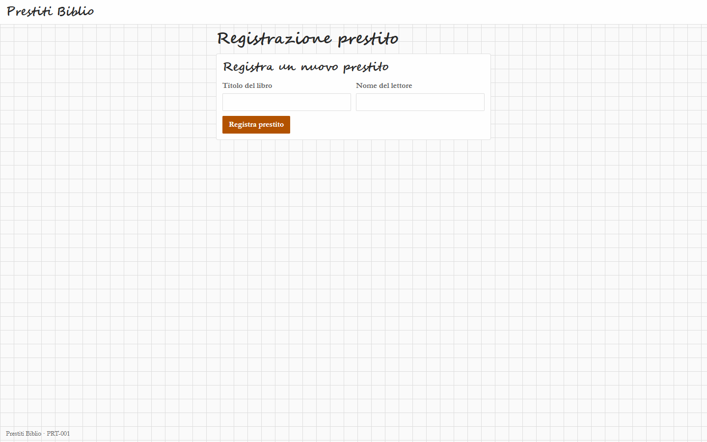
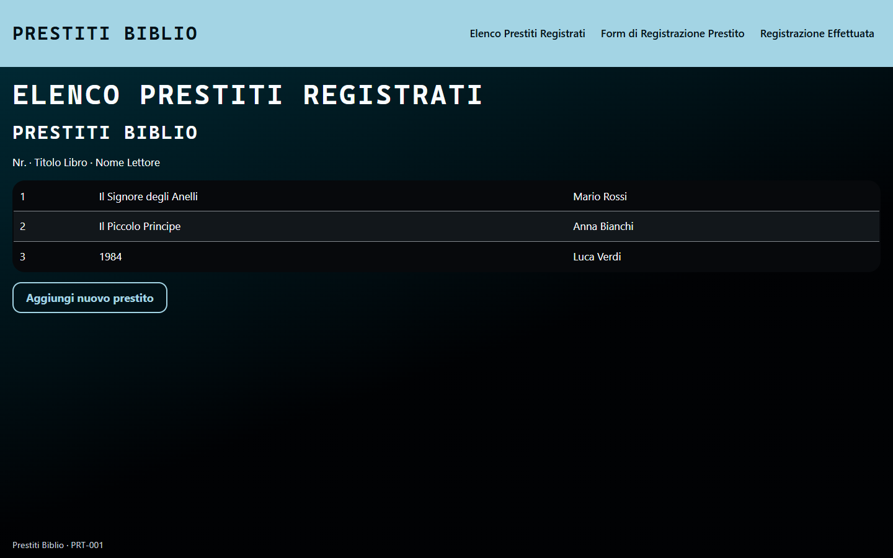
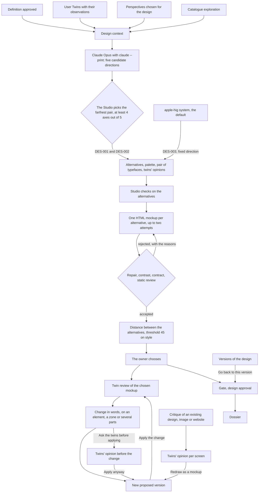

# Design quality and variety

OrchesTwin Studio asks an AI model, which the framework calls and never trains, to carry an idea all the way to a good design with real alternatives. I changed course on this part many times, from the visual catalogue of September to the Apple style of 10 October 2026. The Studio's measures say whether two alternatives differ. Whether a design is beautiful is still a matter of judgement, and for now the judgement is only mine.

## Why variety matters

The Design step proposes alternatives so that the owner chooses between different answers to the same Definition, with every twin's opinion on each one. When the alternatives share a single look, there is nothing to choose. That is why the mockup instruction lists "The same look on both designs" among the mistakes to avoid, and why the Studio measures how far apart the alternatives are and suggests regenerating them when they come out too close.

The problem was there from the start. On 24 September 2026, after the review with the supervisors, the plan recorded a request of mine: "the generated designs all look alike". The design proposal was only structural, and a fixed renderer in the frontend drew the mockup. The plan concluded that variety needed a visual dimension in the schema and in the renderer, "not training", and set the goal of "design alternatives that are truly different, of high quality and truly beautiful". The next day, approving sprint 21, I said it plainly: "the thesis is centrally focused on this".

On 28 September I tried the Studio with the real models and found the designs "really ugly to look at". The same day one of the supervisors pointed out that designs, like code, can come from an external AI that the framework calls. From then on no model is trained here: the resources were not there, and variety had to stay explainable and reproducible. Claude Opus 5.5 writes the mockups in HTML, inside a contract. The training package started on 2 September stayed in the repository as thesis material until 11 October, when I deleted it.

<figure markdown="span">
  
  <figcaption>The loan register, alternative DES-001, 28 September 2026. The model that ran on a rented server at the time chose the catalogue entries, and the internal renderer did the drawing. The texts, the product name included, are written by the model.</figcaption>
</figure>

<figure markdown="span">
  
  <figcaption>The second alternative of the same project. The books and the readers' names are examples invented by the model.</figcaption>
</figure>

That was the starting point: few elements per screen, the content squeezed at the top above an empty page, patterned backgrounds, calligraphic or monospaced titles. Sprint 24 removed those backgrounds and those titles from new designs.

The two mockups above already came from the visual catalogue of 25 September, which had the model pick one value for each of 22 visual dimensions. From 4 October the model writes five candidate visual directions and the Studio keeps the two farthest apart. On 10 October icons, placeholder photos, new typefaces and AA contrast arrived, and I liked that round less than the designs of sprint 38. The same day a design system drawn from Apple's guidelines became the Studio's default. [Visual directions and the Apple HIG system](directions.md) tells each attempt, and [Measures](measures.md) gives the numbers.

## How a design is made today

The Design step starts once the Definition is approved. The Studio builds a context from the Definition (requirements, stories, criteria, scenarios, risks, needs, journey), from every User Twin with its observations and their epistemic status, and from the considerations of the perspectives chosen for the design. It adds the part of the visual catalogue assigned to each alternative and a description of the fourteen typefaces available. The brief reaches the model through the Definition. The model is Claude Opus 5.5, called with `claude --print` on the subscription.

Before the alternatives, the model writes five candidate visual directions and the Studio keeps two, the farthest apart. With the `apple-hig` design system, which is on by default, a third alternative joins them: DES-003, which follows Apple's guidelines. The details are in [Visual directions and the Apple HIG system](directions.md).

In a single response the model writes the alternatives and every twin's opinion of each one. An alternative carries its texts (summary, rationale, flows, information architecture, accessibility, security, advantages, trade-offs) and a visual block. The block holds the 22 catalogue dimensions, the product name, one sentence per twin, a palette of fifteen colours and a pair of typefaces. A twin's opinion is a verdict of at most five words with one sentence in the first person. The Studio rejects a response with duplicate codes, texts in another language, visual choices that are not distinct, primaries that are too close or a DES-003 outside the system.

Then comes one HTML mockup per alternative, from 2 to 8 screens, with at most 48,000 output tokens; `ut design` draws up to three at once. If the Studio rejects a mockup, the second and last attempt receives the rejected response and the reasons. With the mockups ready, the Studio measures how much the alternatives resemble each other in drawn style ([Measures](measures.md)).

The owner chooses. Each twin reviews the chosen mockup in a call of its own, with eight questions and at most six observations. The web presents these reviews as "Synthetic pre-validation": "they are design hypotheses to weigh, not evidence from real users". The observations the owner confirms go into the next mockup.

You can ask for a change in words, up to 1,000 characters, with rules that must stay true in later versions. You can also point at the mockup and ask for a change there alone: at one element, at a zone such as a section or a group of cards, or at up to eight parts of the same screen. Before anything is applied, the twins can give their opinion on the request. Each one reads it with the palette, the contrast thresholds and the ratios the Studio computed for the colours the request names, and says whether the change helps, slows down or blocks. Then you apply it anyway, change it or cancel it. Every change is a proposed version that you apply or discard. From "Versions of the design" you can go back to an older version: the Studio creates a new, identical one for you to approve. Next to the gate the web reminds you that "Owner approval is governance, not empirical validation."

The diagram follows a design from the context to the Dossier; the critique of an existing design comes in from the side and reaches the same proposed version.

The commands are in [ut design](../ut/design.md), the buttons in [Design and evaluation](../web/design.md).

## What the instruction forbids and what the checks reject

The mockup instruction asks for "a finished product that a person could use tomorrow", not a wireframe and not a style guide. It wants realistic content in the language of the requirements, plausible names for people, figures that agree from one screen to the next and a single primary button per view. It treats 390 pixels as a design of its own. It forbids gradients ("Colour is flat: no gradient anywhere"), patterned backgrounds, empty screens and placeholder text. Among the mistakes to avoid it lists "The same look on both designs".

Whatever the model writes goes through five checks, in the order of the table.

| Check | What it does |
|---|---|
| Repair | removes, and records, what the contract does not allow but is not deceptive: scripts, images, frames, `style` attributes, links that do not lead to another screen, style declarations with colours outside the tokens or with `url()` |
| Contrast | replaces the colour of a text, or of a control's border, that falls below the threshold with the nearest token that clears it, and tells the owner under "Corrections made by the Studio": the colour before and after, both ratios and the threshold |
| Contract | rejects a response outside the limits: 2 to 8 screens, 40,000 characters per screen, 250,000 in all, 1,500 elements, 60,000 characters of style |
| Static review | rejects a control without a requirement, a table with fewer than 3 rows, a screen with fewer than 150 characters or 6 elements, a screen without a requirement, placeholder text, a screen that cannot be reached from SCR-001, text below the contrast threshold, a control border below 3:1 |
| Language and coverage | rejects texts in another language, fewer screens than the archetype's minimum, coverage of less than half the declared requirements |

One gap remains. The instruction forbids every gradient, but the contract allows them among the tokens, and the checks reject only backgrounds with repeating or conic gradients.

## Where it stands

The judgement on quality is mine, one person's, given on synthetic projects with one generation per condition, and the measure's verdict looks only at drawn style. There are favourable judgements, such as "I like the latest generation of the gym a lot" on 4 October and "perfect, the Apple style becomes the standard" on 10 October, but they remain one person's opinion. My judgement on the three alternatives of the gym project, generated in the late afternoon of 10 October, is not recorded. The quality and variety goal is not declared reached. One of my working rules sets the criterion: "Until Alex says the mockups are beautiful, no chat writes that the quality goal is reached."

Checking with other people is future work. The protocol of the quality test calls for independent raters working blind, and the tests with people are planned for sprint 49 ([Validation with people](../validation.md)). The other three pages cover the [visual directions](directions.md), the [critique of an existing design](critique.md) and the numbers of the [measures](measures.md).
