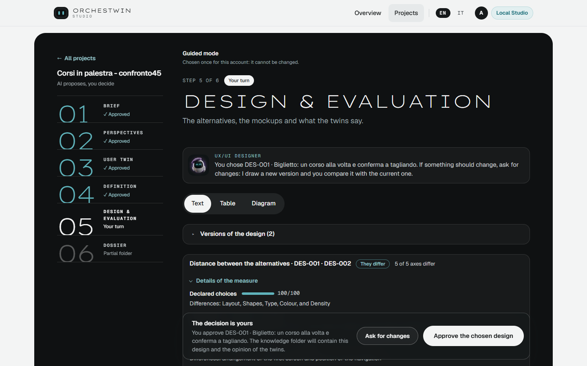
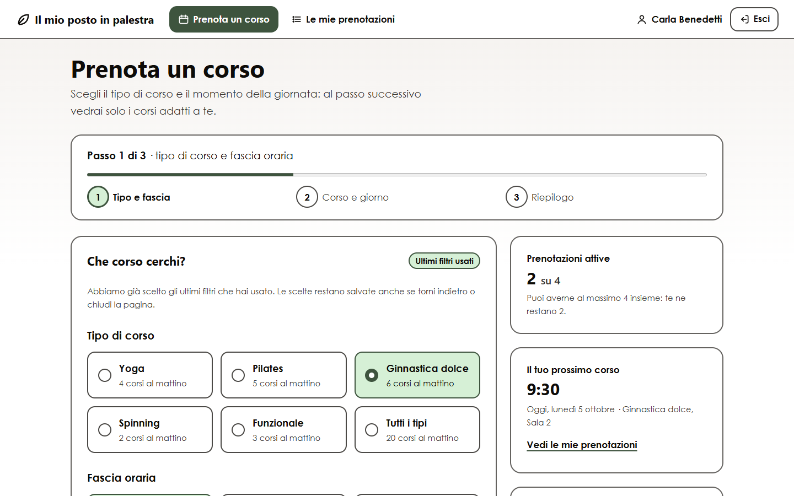
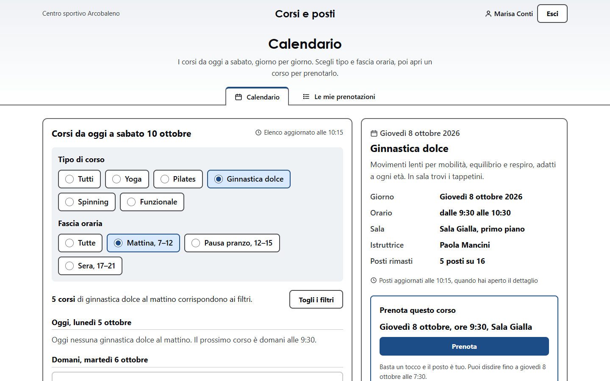
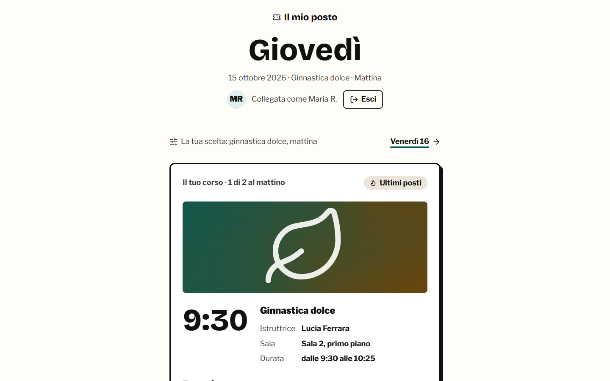
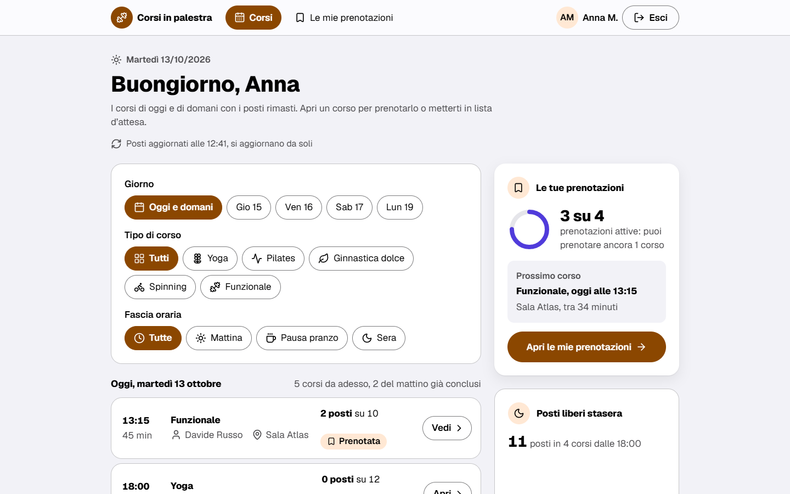
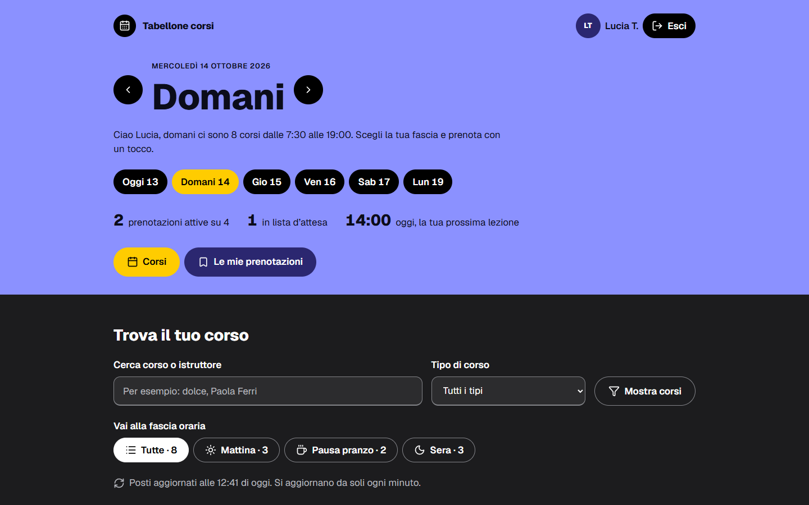

# Measures

The aesthetic judgement stays mine. The measures are there to say, without my eye, whether the alternatives of a project differ, whether the mockups pass an accessibility check and how long you wait for them. None of them says whether a design is beautiful.

## The distance between the alternatives

The Studio compares every pair of alternatives on three levels. You can read the result with `GET /api/v1/projects/{id}/design/distance`, in the Design step of the web, in `ut design show` and next to the "Why?".

The "Declared choices" count the axes that differ between the two directions, scaled to 100; if one of the two has no direction, they count the catalogue dimensions that differ, out of 22. Next to them sits the distance between the two primary colours in the OKLab space. The "Drawn style" is read from the CSS and the HTML of the mockups: twelve differences, each worth 0, 1 or a fraction, with weights that add up to 100. The "Structure of the screens" compares the outline of the screens down to the third level (weight 30), the elements used (25), tables, cards, side column and navigation (10 each) and forms (5).

| Style difference | Weight |
|---|---:|
| boxes or rules | 18 |
| title size | 14 |
| width of the content | 12 |
| borders | 10 |
| corner radius | 10 |
| columns | 8 |
| hard shadows | 8 |
| upper-case text | 6 |
| fixed-width type | 4 |
| gradients | 4 |
| fields of colour | 4 |
| tinted surfaces | 2 |

The verdict looks only at style. Below 45 the alternatives are "Too close", from 45 up "They differ", and while a mockup is missing the measure says "Complete measure when both mockups are ready". With two alternatives that are too close, the message "The two alternatives look alike in drawn style. You can regenerate them." appears; with three, the sentence names the pair. The Studio also checks whether a mockup follows the axes of its direction, density excepted, and always closes with "Measure computed by the Studio: it does not replace your judgement."

The threshold comes from sprint 38. It separated the pairs from before the directions, at 39 at most, from four exemplars of the gym project made outside the product, between 55 and 70, apart from two pairs with a soft variant, at 32 and at 46. The measure barely tells filled tiles from tinted surfaces, does not weigh serif against sans-serif type and ignores how the text is laid out. That is why the calculator of sprint 38 stays below the threshold with serif typography, a second column of text and a look that is different to the eye. A wrong "Too close" is a cautious error: it invites you to regenerate. The sprint 38 evidence calls the final measure "revision 2", while in the code `DESIGN_DISTANCE_VERSION` is still 1.



## The history in numbers

The first row measures something else, the catalogue dimensions chosen differently; the other rows measure drawn style out of 100. The projects are synthetic, rebuilt from the same answers, and each condition has a single generation: the numbers have no statistical value.

| Date | Condition | Distance |
|---|---|---|
| 25 September 2026 | catalogue and internal renderer, five projects | 14–22 dimensions out of 22 differ |
| 4 October 2026 | pairs from before the directions, sprints 24, 25, 29, 32 and 38 | 8–39 |
| 4 October 2026 | with the visual directions | gym 15 → 66, canteen 15 → 47, object lending 8 → 59, calculator 39 → 43, still too close |
| 10 October 2026 | first round with icons, placeholder photos, new typefaces, AA contrast | gym 78, canteen 81, object lending 66, calculator 69, Bottega Vicina 54 |
| 10 October 2026 | apple-hig system with gradients | gym 25, too close; Bottega Vicina 50 |
| 10 October 2026 | apple-hig system in flat colours on both alternatives | gym 36, canteen 27, object lending 46, calculator 11, Bottega Vicina 49: three pairs out of five too close |
| 10 October 2026 | three alternatives, DES-003 with the system, gym | 92 between DES-001 and DES-002, 71 between DES-001 and DES-003, 39 between DES-002 and DES-003, too close |

In the gym project of 4 October the earlier pair sat at 15. The images with the directions, at 66, are in [Visual directions and the Apple HIG system](directions.md).

<figure markdown="span">
  
  <figcaption>The gym project, 4 October 2026, DES-001 generated with the code from before the directions. Names, dates and figures are invented by the model.</figcaption>
</figure>

<figure markdown="span">
  
  <figcaption>DES-002 of the same round: the panels, the radius and the border are the same, and mostly the colours change. Style distance 15. Names and figures are invented by the model.</figcaption>
</figure>

<figure markdown="span">
  
  <figcaption>The gym project, first round of 10 October 2026, DES-002 "Biglietto d'ingresso" (entry ticket): distance 78 from the other alternative. Names and figures are invented by the model.</figcaption>
</figure>

The flat-colour round shows how much the drawn style weighs. All five declared axes were different, and still the style stopped at 36. Here is the result `ut design show` printed on 10 October at 13:30, shown with the English messages of `ut`.

```text
Distance between the alternatives
=================================
Too close · 5 of 5 axes differ
Declared choices 100/100 · Drawn style 36/100 · Structure of the screens 33/100
The two alternatives look alike in drawn style. You can regenerate them.
DES-001 · The mockup does not follow the direction on: Colour
DES-002 · The mockup does not follow the direction on: Shapes
Measure computed by the Studio: it does not replace your judgement.
```

<figure markdown="span">
  
  <figcaption>The gym project, flat-colour round of 10 October 2026, DES-001 "Pannelli chiari" (light panels). Names and figures are invented by the model.</figcaption>
</figure>

<figure markdown="span">
  
  <figcaption>DES-002 "Tabellone orari" (departures board) from the same round. For the measure the two alternatives are too close, at 36. Names and figures are invented by the model.</figcaption>
</figure>

## My judgements

| Date | What I had in front of me | My judgement |
|---|---|---|
| 28 September 2026 | the Studio with the real models | "really ugly to look at" |
| 29 September 2026 | the mockup of a showcase website for a gym, my own project | "I like the design but it seems a bit thin on content" |
| 3 October 2026 | the two alternatives of the calculator | "the styles all look identical to me" |
| 4 October 2026 | the gym project with the directions | "I like the latest generation of the gym a lot" |
| 4 October 2026 | canteen, object lending and calculator with the directions | "I like all three, the calculator less" |
| 10 October 2026, early morning | the first round of sprint 45 | "honestly I like the sprint 38 ones better", "aesthetically sprint 38 is more beautiful" |
| 10 October 2026, shortly after noon | the round with the Apple system and the gradients | "for now the ones generated in the Apple style win" |
| 10 October 2026, afternoon | the flat-colour round | "perfect, the Apple style becomes the standard" |
| 10 October 2026, late afternoon | the three alternatives of the gym project | not recorded |

The first round of 10 October had higher distances than sprint 38, from 66 to 81 on the four projects in common against 43–66, and zero axe violations, yet I liked it less. The added richness (icons, placeholder photos, tiles and charts) did not improve my judgement, and choosing for maximum distance had brought in styles such as the timetable, the ticket, heavy frames and capitals, far from the examples I had chosen. The judgement that made the Apple system the default came with the flat round, where three pairs out of five were too close.

## Generation times

| Date | Generation | Time |
|---|---|---|
| 28 September 2026 | one HTML mockup, Claude Opus 5.5 through the API | 277–621 s |
| 1 October 2026 | alternatives with `claude --print` on the subscription | 108 s |
| 1 October 2026 | two mockups in parallel | 285 and 342 s |
| 4 October 2026 | directions and proposal together | 3.2–5.9 min, the directions alone about a minute |
| 4 October 2026 | one mockup with its direction | 3.2–17.1 min, two second attempts out of eight |
| 9 October 2026 | critique of an image, of a website | 2 min 04 s, 1 min 49 s |
| 9 October 2026 | redraw as a mockup | 5 min 41 s |
| 10 October 2026 | three alternatives with the directions | 6 min 38 s |
| 10 October 2026 | three mockups drawn together | 10 min 35 s |

In the first round of 10 October a mockup of the object-lending project took about 50 minutes across several attempts, and one of them went past the 1,200 s allowed to the design entry in my configuration. `ut design` waits 30 minutes at most; the work carries on in the Studio, and the command finds it again when you run it once more.

## Accessibility measured with axe

The Studio checks the contrast of the mockups with its static review and does not run axe on them. The sprint 45 tool did, outside the product: axe-core 4.13 in Chrome 151, at 1440 and at 390 pixels. It ran the WCAG 2.0 and 2.1 rules at levels A and AA, the WCAG 2.2 rules at level AA and the contrast check. In the first round the ten alternatives of the five projects had zero violations. In the flat-colour round axe found 11 contrast nodes, counted per width, in two mockups: 3 in the canteen and 8 in the object-lending project. The static review does not see them, because it resolves the colour pairs declared in the same rule and not the cascade, nor texts on backgrounds inherited from a `color-mix`. The three alternatives of the gym project have zero violations and zero contrast nodes in all 34 combinations of alternative, screen and width. The same tool counts the targets smaller than 44 pixels at 390: 0, 14 and 7 in the three alternatives, up to 11 in the flat round.

## Limits

Quality and variety were judged by one person, on synthetic projects, with one generation per condition and no independent raters. The critical review of 1 October asked for a rubric with at least two blind raters and a comparison with a direct prompt to the same model. The protocol of the quality test provides for it, with three conditions and a rubric of ten criteria, but the material for the case has not arrived and no evaluation has been done ([Validation with people](../validation.md)).

The verdict still rests on style alone. Part of the variety between the alternatives is imposed by the catalogue exploration, and the rule that picks the directions can keep the most typical candidate: it happened in two projects out of four in sprint 38. Consistency and variety pull in opposite directions. With the Apple system on both alternatives the distances fell to 11–49; with three alternatives the editorial and Apple pair stays at 39, and the three-way round was run on one project only. Adherence to the direction is measured, not enforced. The twins' critiques of the alternatives come from the same call that writes the alternatives, and twins and designs come from the same model. The quality and variety goal is not declared reached.
