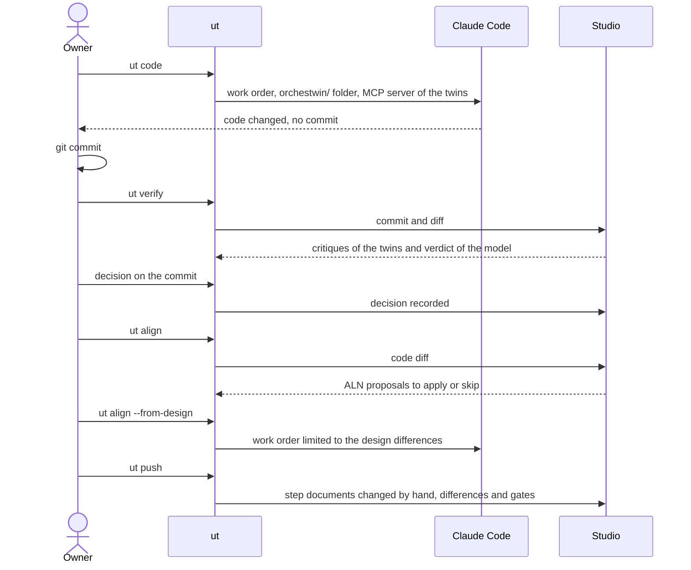

# After the design

On 24 September 2026, in the review with the supervisors, I asked that after the design the project be developed outside the Studio, with the usual tools. I also asked for the twins to become proactive: to check the work and criticize it, and to learn when the project changes. On 28 September one of the supervisors gave that idea a shape and called it "the icing on the cake". It was a terminal command with `ut init`, `ut design`, `ut test` and `ut align`, inside a framework that keeps code and design aligned. The Studio neither writes nor runs code. Whoever develops the project writes it, alone or with a coding agent, and the `ut` command keeps the repository and the Studio connected.

## The cycle

The diagram follows one full round: the agent writes the code, the person commits it and the twins examine it. Then the knowledge or the code is realigned, and the changes made by hand in the folder go back to the Studio.

## ut code

`ut code` hands development to an external agent, Claude Code or a command of your own, with the knowledge folder as context and the open tasks as the work order. Through the MCP server the agent reads the twins and the approved knowledge. Questions to the twins, reviews and tests are paid operations in the Studio, and they stay closed to the agent unless you open them with `--spend`. It makes no commits: you look at the changes and record them yourself. After a successful round, `ut` notes which version of the design the code came from. The Calcolatrice iPhone, the iPhone-style calculator, is the project of the video of 4 October and of the demo planned for 15 October. On 6 October its code was rebuilt from scratch with `ut code` in 8 minutes and 21 seconds, with 38 passing tests.

## ut verify

For every commit after the aligned point, each twin writes a critique and the model picks one of four verdicts. The code may be aligned (`ALIGNED`), or it may be drifting away, and then the code is what has to change (`CODE_DRIFT`). The change may also be a legitimate evolution that the design or the requirements do not describe, in which case they are the ones that need a new version (`DESIGN_OUTDATED`, `REQUIREMENTS_OUTDATED`). The verdict is a proposal. The owner decides, and can mark the commit as aligned, record tasks for the code, ask for a new version of the design or of the requirements, or leave it for later.

The command has existed since 29 September, and it used to be called `ut align`. On 6 October the supervisors proposed calling it `ut verify`, next to `ut test`, because its job is to make the twins say what they think of what has been developed. Sprint 40 renamed it and left no alias behind.

## ut align, from the code to the knowledge

The name went to a new command, one that does what the supervisors meant by that word: "ut align starts from something that diverges and changes the other part so that it lines up." Going from the code to the knowledge, the new `ut align` reads the diff of the commits after the aligned point. With one gesture it asks the model for up to twelve proposals, ALN-nnn, for the Definition, the Design and the test plan. Each proposal cites commits, files and an excerpt copied verbatim from the diff, together with the sentence "A hypothesis of the model drawn from the code diff: no person has verified it." The proposals are decided one at a time. Applying one goes through the same revisions and gates as a change asked for in words, and the model writes nothing on its own.

The supervisors had described the case themselves: a scientific mode added by hand to the calculator. On 6 October the mode was written outside `ut`, the way a person would have done it; in that round a subagent of the chat that was running the sprint wrote it, 181 lines with 64 passing tests (commit `30694ab`). Then `ut align --since 5157efa` examined the commit in 1 minute and 27 seconds and proposed seven changes. Four concerned the Definition. Among them was a new requirement for the scientific mode, which came with two questions for the owner. Was the feature wanted? And was saving the mode in the browser compatible with the note saying that no data is collected? Another one pointed out that the scientific keys had a smaller touch area than the one required. In that round the answers came from the chat itself, which made cautious choices: three proposals applied, one skipped, three left pending.

## ut align --from-design, from the design to the code

In the same comment the supervisors described the opposite direction: the design changes, and `ut align` makes the code follow. With the `--from-design` option, available since sprint 42, the command compares the design version the code is aligned with against the approved one. Then it writes a work order limited to the differences and, with one gesture, starts the agent the way `ut code` does.

On 7 October, with a gesture of mine, the design of the Calcolatrice iPhone received a request in words: a ⌫ key that deletes the last digit typed. The model worked for 1 minute and 57 seconds, and design 7 was approved. The first dry run from design 3 to design 7 counted 157 differences, because the model had renumbered the elements of the screens. Pairing the elements by fingerprint, a fix decided on the spot, brought them down to 20, all of them real. Claude Code then worked for 2 minutes and 57 seconds on four files (commit `05d1fad`).

## A real conflict

Then `ut verify` examined that commit in 1 minute and 51 seconds and said that the code was drifting away. It was right. The ⌫ key had removed the wide zero, which requirement REQ-001, asking for the same look as the iPhone calculator, still demanded: a conflict between the changed design and a requirement, brought to light by the cycle. The chat did not decide, because the step cannot be undone and the choice belongs to whoever is responsible for the project.

That evening, during the dress rehearsal of the demo, I recorded the four tasks the model had proposed, TSK-005 to TSK-008, which take the code back to the wide zero and remove the ⌫ key. The design still had the ⌫, though, and carrying out those tasks would have pulled code and design apart again: a change to the design had to come first. On 9 October, on version 13 of the design, the twins were still flagging the key. No decision that closes the conflict is recorded.

## ut push, ut test, ut watch, ut mcp

When the knowledge is changed by hand in the folder, `ut push` brings it back into the Studio. It sends only the five step documents (`brief/brief.json`, `team/team.json`, `twins/twins.json`, `requirements/requirements.json`, `design/design.json`) and goes through differences, approval and gates; derived files, such as the `.md` ones, are regenerated by the Studio. It never calls the model. On 6 October a sentence added by hand to requirement REQ-012 became Definition 4 and Dossier 8 without a single generation. It was one of the answers to the comment the supervisors made that same day, when they asked for the project folder to be the single source of truth.

For the acceptance criteria there is `ut test`, which checks them against the application in the installed browsers, Chrome and Firefox, without downloading anything. The model writes the test plan from the criteria and the page, and the twins critique the results. While you work, `ut watch` follows the commits and records them; it has the twins examine them only with `--twins`. The approved knowledge reaches the agents in the editor through `ut mcp`, with the `orchestwin-twins` server and fifteen tools, and the operations that generate start only with `--spend`. Nothing that runs on its own generates. The options and messages of every command are in [Development](../ut/development.md).
