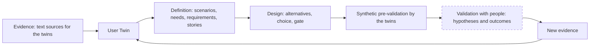

# The idea and the framework

OrchesTwin Studio takes an idea written in two lines to an approved design and to a knowledge folder that lives in the project's repository. In between come six steps: Brief, Perspectives, User Twin, Definition, Design & Evaluation, Dossier. At every step the model proposes and a person decides with a gesture, either approving or saying in words what should change. No generation starts without a gesture from that person, and each one records the model, the tokens and the time it took. What goes into each step and what comes out is described in [The six steps](steps.md).

## Who writes and who decides

The proposals are written by Claude Opus 5.5, which the Studio invokes through the Claude Code command line (`claude --print`) on the subscription of whoever runs it. The model is neither trained nor fine-tuned. What the framework controls is the context: the approved brief, the twins, the requirements, the chosen perspectives, the visual catalog.

It was not always the plan. In September 2026 I tried to train a small model to act as an evaluator for the twins, and no candidate passed the checks set before the trials. On 28 September 2026 one of the supervisors told me that training was not what the project was for, not least because the resources were not there. The design, like the code, can come from an external AI that the framework invokes. On 11 October 2026 the training package left the repository. The story is told in [September, training and measuring](../journey/september.md) and in [The cut of 24 September](../journey/the-cut.md).

The one who decides is the project owner, who works in one of the two modes, [Guided or Expert](modes.md), chosen once for their account.

## The twins give an opinion, not proof

User Twins are synthetic users: profiles of kinds of user that the model derives from the brief and the owner approves. They judge every design alternative, review the chosen mockup, answer questions and examine commits. What they say is a hypothesis to be checked with real people, never proof, and the Studio says so next to their answers: "The twins' answers are simulated: hypotheses to weigh, not opinions of real people." What a twin represents, what it does not, and where each of its statements comes from is explained in [Archetypes, User Twins and persona](twins.md).

## After the design

Approving the design does not close the project. The code is written outside the Studio, with the usual tools or with a coding agent that `ut code` starts with the knowledge folder as its context. The Studio neither writes nor runs code. The twins stay active: with `ut verify` they examine the commits, and the model says whether code, Definition and Design are still aligned. With `ut align` the part that fell behind is brought back in line with the other, from the code to the knowledge or from the design to the code. The owner always decides. [After the design](development.md) follows the cycle through a real example.

## A chain to keep connected

On 1 October 2026, the same morning the comments on the demo video arrived, the second supervisor sent me a proposal for how the system should evolve. It summed the system up as a chain:

> Evidence → User Twin → UCD artifacts → Design decisions → Synthetic evaluation → Human validation → New evidence

This is how I read it. You start from what is known about the users, and the twins gather it while declaring what they do not cover. From the twins come scenarios, needs, requirements and stories, the artifacts of user-centred design (UCD), and the design is decided on those. The twins evaluate the design, but their evaluation is synthetic, a pre-validation that helps you ask better questions. Validation is done by people, and what they say comes back as new evidence.

In that proposal the value does not lie in generating artifacts, which a model can do on its own. It lies in keeping them connected, so that you can say what you know about the users, why you believe it, which decision came out of it and what is still to be verified. The mockup generator, the model, the command line and the diagrams become components rather than what defines the system. Sprints 30 to 36 built the links one at a time, and the ["Why?"](why.md) makes them queryable on every artifact.

The diagram shows the chain with the name each link has in the Studio. The dashed border marks the link that exists in the software but that no person has gone through so far.

No session with people has taken place. The hypotheses to verify exist, the protocols of the two tests are written and the tests are planned for sprint 49; where things stand is described in [Validation with people](../validation.md).
