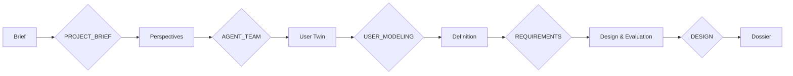

# The six steps

Only what a person has approved moves forward. Each step works on the approved version of the step before it: the Definition is written on the approved twins, the design on the approved Definition. Between one step and the next sits a gate, the owner's decision, which approves one exact version through its identifier, its number and the hash of its content. If that version changes, the gate becomes `STALE` and a new decision is needed.

The diagram shows the six steps in a row, with the gate that closes each of the first five and the name that gate has in the code. The Dossier has no gate, because it collects what is already approved.

The first five steps end with the person's approval. The table shows what is there before that gesture and what comes out of it.

| Step | Goes in | The model proposes | The person decides | Comes out |
|---|---|---|---|---|
| Brief | the idea in two lines | the questions, then the fifteen fields | accepts the proposals or leaves them open | the brief |
| Perspectives | the brief | a rationale and the optional roles | switches security and the technical aspects on or off | the applied perspectives |
| User Twin | brief and perspectives | the archetypes, then the twins | confirms, corrects, discards | 1 to 8 twins |
| Definition | brief, perspectives, twins | scenarios, needs, requirements, stories, criteria | asks for changes in words | the Definition |
| Design & Evaluation | Definition, twins, perspectives, visual catalog | alternatives, the twins' opinions, mockups | chooses, asks for changes | the design package |
| Dossier | the approved steps | nothing | prepares the folder | the `orchestwin/` folder |

## Brief

The brief comes out of a dialogue, as the supervisors had asked in the review of 24 September 2026. You write the idea in two lines and the "Requirements analyst", which is the model, asks one question at a time: twenty at most, plus three follow-ups, starting with the essential details. Then it composes the fifteen fields of the brief. It proposes whatever is missing, and a proposal stays a proposal until you accept it: "This was missing from the brief. It is used only if you accept it."

An "I don't know" answer takes precedence over the model. That field never receives a generated value. It stays unknown, and at most the model's proposal turns into a point for you to decide. In Expert mode you write the brief directly in the form.

## Perspectives

Until 1 October 2026 this step was called Team and proposed specialist agents. The first supervisor remarked that it looked cosmetic, because "in the end it is the model that does the work". In sprint 30 it became a step about perspectives, the competences through which the project is looked at: user experience, accessibility, software engineering, product and security. Each applied perspective adds two fixed sentences, written by hand, to the context in which the model writes the Definition and the alternatives. The accessibility one, for example, asks that every action be reachable from the keyboard with visible focus.

Only security and the four technical aspects can be switched on and off: web interface, services and data, mobile, connections to other systems. The other four perspectives, user experience and accessibility among them, always apply. Their effect has not been measured. On the iPhone-style calculator of 1 October 2026, security was on and produced no security requirements, which is what its sentence asks for in a project with no data and no access control.

## User Twin

Before the twins come the archetypes, that is, the people the project means to represent. The model proposes them from the brief, and the owner confirms, corrects, adds or discards them, up to eight active ones. From the confirmed archetypes the model creates the twins, which the owner approves with "Confirm the twins and continue". What that approval means, and what it does not, is explained in [Archetypes, User Twins and persona](twins.md).

## Definition

Until 1 October 2026 this step was called Requirements. Since sprint 32 (2 October 2026) it starts from scenarios, each tied to a twin and described by a context of use, a goal, the event that triggers it, the steps and the possible difficulties. From the scenarios it derives the needs; from the needs, the functional and non-functional requirements and the stories; then acceptance criteria, risks and completion conditions. Requirements and stories cite the needs they come from, so the chain Twin → Scenario → Need → Requirement lives in the data and the ["Why?"](why.md) can follow it. Journeys come only if you ask for them.

The brief sets how many items the model may write. Take F functional requirements, N expected qualities and C technical constraints in the brief. The requirements are at most the larger of F and 3 plus the smaller of N + C and 4, that is max(F, 3) + min(N + C, 4). There are never more scenarios than twins. The limit is a ceiling, not a target. On the calculator shown in the video of 30 September 2026, with no limits, there were 17 requirements; when it was redone on 1 October 2026 with the limits, there were 10, and `requirements.md` went from 6,895 words to 1,789. No person has validated these formulas.

A change requested in words produces a new version with the differences, which you apply or discard. Then you approve with "Approve the definition".

## Design & Evaluation

The model receives the Definition, the twins, the perspectives and the visual catalog, and proposes the alternatives. There are two, or three when the Apple design system is active (it has been the default since 10 October 2026): the third follows the Human Interface Guidelines. In the same answer the model writes each twin's opinion of each alternative, so the alternatives and the twins' opinions come from the same call. That is a limit to keep in mind. Then it draws one HTML mockup per alternative. The Studio checks each mockup before showing it and, if it fails, sends it back to the model with the reasons.

You choose with "Choose this one". The twins review the chosen mockup, and you confirm their observations or set them aside. You can ask for changes in words, even on a single element of the mockup, with rules that must stay true in later versions. You approve with "Approve the chosen design", and the Studio reminds you what that gesture is worth: "Owner approval is governance, not empirical validation." Visual directions, mockups and measures are covered in the [Design](../design/index.md) section.

## Dossier

The sixth step does not call the model. It gathers the approved steps, from the brief onwards, into the `orchestwin/` knowledge folder: JSON documents with Markdown views, CSV tables, Mermaid diagrams, JSON schemas, the chosen mockup and the state of development. Each version has a number and the fingerprints of its files, which `ut` checks before replacing the folder on disk. The second supervisor called this step Package; I chose Dossier. You prepare it with "Prepare and download the folder" or with `ut package publish`, and its structure is described in [The knowledge folder](../architecture/knowledge-folder.md).

## After the first pass

In Guided mode the steps are done in order the first time; in Expert mode they are open from the start. After the first pass they become sections you can reopen, as the second supervisor had asked, each with its own state: "Waiting", "Your turn", "Up to date", "Update available", "To update". If something changes upstream, a twin for example, the sections that depend on it become "To update". When their content can stay as it is, the "Update and confirm" gesture re-anchors them to the new versions without generating them again. On the calculator, on 1 October 2026, a change to the requirements requested in words arrived in 110 seconds, and the design was re-anchored without redoing the alternatives or the mockups.
