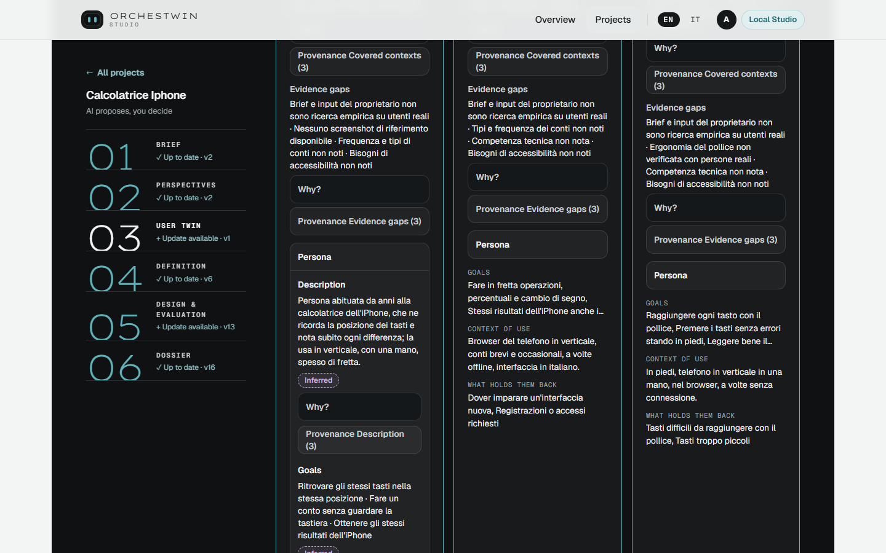

# Archetypes, User Twins and persona

"A user twin is a model of a kind of user, not a person: its observations are assumptions with a declared epistemic status and confidence." The Dossier writes that sentence into the `twin.md` of every twin, and every rule about twins follows from it.

## Archetypes first

On 1 October 2026 the second supervisor asked me to declare whom the project means to represent before creating any twin, and to keep what the model proposes apart from what the evidence supports. Archetypes arrived with sprint 31. Each one has a name, a description, a role, goals and a context of use. The model proposes them from the brief, and the owner confirms or discards them, edits them, adds new ones, removes others. Every change creates a version, and a removed archetype stays in the history. Like the twins, active archetypes are capped at eight.

From the confirmed archetypes the model creates the twins, with a role, goals, recurring tasks, a context of use, pain points, accessibility needs and other fields. The owner approves them, and the interface spells out what that gesture means: "Your approval allows the project to use these profiles. It does not mean their assumptions have been verified with real users."

Before archetypes existed, twins were born from profiles that the model proposed straight from the brief. On 29 September the gym website I had created from the interface had six twins. Going by their names, they stood for people looking for pilates, people looking for cardio, people aged 16 to 65, people looking for bodybuilding, people looking for mixed training, and the residents of the city. While reviewing the design they pointed out what was missing, such as who coaches each session and where the gym is, and they put it down to the brief, which did not contain that information. The same day the tip calculator, created from the terminal, had two twins, the floor manager and the seasonal waiters.

## What a twin declares

Besides the profile fields, every twin carries four declarations: a description, whom it represents, whom it does not represent, and the gaps in the evidence. They are there so that the twin is read for what it is, a representation with a boundary. Next to them sits the basis, "Provisional" or "Evidence based". A twin drawn from the brief stays provisional, because "The brief and the owner's choices are not evidence about real users." It becomes evidence based only when at least one field is supported by an empirical research source and no field claims empirical support it does not have.

## The Persona is a view of the twin

Persona and twin are not synonyms, and the second supervisor was explicit on this point. The twin is the representation that lasts, with its versions and its approval. The Persona is the readable view of it: description, goals, needs, behaviours, pain points, constraints, contexts. The Studio does not generate it. It derives it from the twin's fields, and every entry has its own status and a "Why?" with the rationale and the sources. From the terminal, `ut twins persona` shows it, and `--why` gives the sources of each field. A word of warning about the code: `PersonaProfile` is something else, the profile the twin is born from, which today holds the archetypes.

## Five words

The Studio must not present everything it generates in the same way, and that was another request of 1 October. Every claim of a twin carries one of five words, derived from the recorded epistemic status (`twins/epistemics.py`, `twins/representation.py`). In sprint 31 the first word of the Italian interface was "Evidenziato"; since 5 October, after the review of the texts, it has been "Documentato". In English it reads "Evidenced".

| Word | When | State in the code |
|---|---|---|
| Evidenced | the claim is supported or validated and cites an empirical research source | `EMPIRICALLY_SUPPORTED` or `HUMAN_VALIDATED`, with an `EMPIRICAL_RESEARCH` source |
| Inferred | the model derived it | `MODEL_INFERRED` |
| Hypothesized | it is an unconfirmed assumption, or an empirical source is missing | `UNSUPPORTED_ASSUMPTION` and the other states without an empirical source |
| Contested | evidence contradicts it or the owner contests it, with a rationale | `CONTESTED` |
| Unknown | there is no value, or the model abstained | value `UNKNOWN` or `ABSTAINED` |

An inferred, hypothesized or contested claim must have a rationale, and it always calls for human validation. The owner's approval does not turn it into evidence.

## A twin's opinion is a hypothesis

Everything a twin says is a hypothesis to be checked with real people, and the Studio does not leave that implicit. In the code every twin finding is simulated feedback, because `is_simulated_feedback` is always true. The interface says so again on the matrix of the twins' opinions ("Simulated feedback, not evidence"), in the mockup review ("Synthetic pre-validation") and in `ut`, before every list of findings. Approving a twin, confirming one of its observations and approving a design are project decisions, and none of them becomes evidence about users. The first test with people, planned for sprint 49, will also ask whether the people using the Studio have understood this difference.

## Text evidence

A twin stops being only a hypothesis drawn from the brief when evidence comes in. Since sprint 33, on 2 October, texts such as interview notes can be added as versioned sources, from the web interface or with `ut evidence add`. The model reads the text with numbered lines and proposes what it supports, contradicts or adds in the twins, quoting the passage word for word along with its line. The Studio checks that the quotation is there and can be found without ambiguity, and rejects the change otherwise. Then the owner decides, one change at a time: keep, correct or discard. Only the approval creates the new version of the twin, and at that point the Definition, the design evaluation and the Dossier need a review.

An exact quotation proves that the passage exists in the source, not that the interpretation is right. The trial of 2 October used a text declared non-empirical, written on purpose with hostile instructions. The proposal came back in 22.4 seconds with four verified quotations, and the model did not carry out the hidden instructions. No real research text has gone in yet, because the material for the eBRT case study, an interface for operators, has not arrived.

## Talking to a twin

A twin can be asked questions, from the web with "Talk to the twin" or with `ut twins ask`. Each answer is a small generation grounded in the approved profile, and it comes with a reminder that it is a hypothesis. On 29 September, during the measurement on the tip calculator, the floor manager was asked what it needed to see first with the restaurant full. The answer, in Italian, opened like this: "Let me say first that my profile does not describe how I would use the page during service." The twin had declared the limit of its own profile without being asked.

## Twins that learn

During development the approved profile of a twin does not change, because the requirements and designs tied to that version would turn out outdated. Twins learn in a separate layer. From their critiques of commits and tests the model proposes learned observations, each with an OBS-nnn code. The owner keeps, corrects or discards them one by one, and the twin moves to a development version, 1.1, then 1.2. An observation that contradicts the profile gets flagged.

On 30 September, on the tip calculator, the floor manager moved to version 1.1 with five observations and the seasonal waiters with four. In the next critique one of the two wrote, again in Italian: "Now the percentage is chosen with the three buttons 5, 10 and 15, as I had asked." Learned observations go into the critiques of commits and tests and into the chat with the twin, not into the design generations. `ut twins update` proposes them, and the cycle they come from is described in [After the design](development.md).
