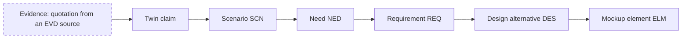

# The Why? and traceability

On 1 October 2026 the second supervisor singled out traceability as the trait that sets the system apart from an ordinary artifact generator: from every meaningful element you must be able to go back to whatever made it exist. There was no need to show the graph all the time, the supervisor wrote; one simple function on every artifact would be enough. Since sprint 34, on 2 October, that function has been the "Why?" button.

## What it shows

The "Why?" sits on a twin's claim and on the Persona, on scenarios, needs, requirements and stories, on design alternatives and design choices, on mockup elements and on the findings of the synthetic evaluation. It reads in two directions, "Where it comes from" and "What depends on it". For every link in the chain it gives the status with the five words described in [Archetypes, User Twins and persona](twins.md), the version and the hash, and the exact quotation when there is a source.

Gaps are not papered over. If the linked need, the source or the rationale is missing, the chain declares itself interrupted ("Interrupted chain") and the gap gets its own name. Three short answers sum up the path: whether it reaches the twin, whether it reaches active evidence, whether all paths reach evidence. A separate section, "To verify with real people", lists the links that are still waiting for a check.

The diagram shows the full chain that the "Why?" walks backwards, from a mockup element down to the evidence. The dashed border marks the link that is missing in the trial projects.

## Deterministic, without the model

The "Why?" asks the model nothing. The Studio derives it from the versions and links it has already recorded: who cites whom, with which version, with which hash. The same data always give the same answer, and the "Why?" cannot make a weak chain look stronger. If a link was never recorded, it says so. On the calculator used for the measurement of 2 October, each of the 384 answers of the API was compared with the computation run on the same document, and they all matched.

## Generated and derived

Two things of different origin live side by side in the "Why?", and the Studio keeps them apart. The chain, meaning links, statuses and gaps, is derived: the Studio computes it. Rationales are another matter, since they are texts that someone wrote. A rationale generated by the model keeps its label, "Model-generated rationale", along with version and hash, and is never rewritten. Next to it there may be an "Owner rationale", a system rationale or an unknown origin; in the code the four origins are called `MODEL`, `OWNER`, `SYSTEM` and `UNKNOWN` (`why_builder.py`). The perspectives that were active during a generation show up as "Declared context", not as rationales.

## Where to find it

The same "Why?" can be read in five places. In the web it is a button on every artifact, and since 5 October the tables of the Definition and of the Design open it in a full-width row under the entry. From the terminal, `ut why REQ-001` prints it: `--all` adds quotations, versions and hashes, `--json` returns the complete answer, `--offline` reads it from the local Dossier without the Studio. The `ut mcp` server hands it to the agents in the editor through the `get_why` tool, and the Visual Studio Code panel runs `ut why` in offline mode. In the Dossier the graph lives in `traceability/why.json`. When a Dossier is imported, the Studio rebuilds the graph from the data it has just written and compares it with the exported one before saving; if the two differ, it rolls everything back.

## 384 artifacts and no evidence

On 2 October the "Why?" was measured on the calculator used for the measurements of those days. There were 384 current artifacts: 42 twin claims, 2 scenarios, 5 needs, 10 requirements, 4 stories, 2 alternatives and 319 prototype elements. All of them reach the twin. None reaches active evidence, and every one of them has the `MISSING_SOURCE` gap.

The result is correct, and it is a limit to be stated plainly. That calculator has no research sources: its twins come from the brief, and the brief is not evidence about users. The chain stops at the twin because that is where the project's knowledge stops. The "Why?" does not hide it, nor does it make up for it with a well-written rationale. No trial project has an empirical research source yet, so for now the first link of the chain, the evidence, is never there.

There is a second limit, known since sprint 37. "Reaches active evidence" counts any active quotation, even one from a non-empirical source, so it can answer yes when the source is a test text.
