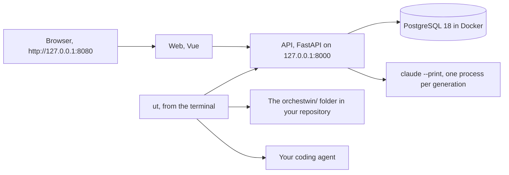

# What is OrchesTwin Studio

OrchesTwin Studio is a tool that runs on your computer and takes a software project from an idea written in two lines to an approved design. Along the way it builds the project's knowledge, who will use it, what it has to do, how it should look, and saves it as a versioned folder inside the repository. Once the design is approved, development goes on with your own tools and the Studio stays next to the code: it checks the commits, says when code, requirements and design drift apart, and proposes how to bring them back in line. You use it from the browser or from the terminal, with the `ut` command.

The proposals are written by Claude Opus 5.5, which the Studio runs through Claude Code and your subscription. The decisions are yours, one at a time: every step is approved with one gesture, every generation starts only when you ask for it, and every generation leaves a receipt with the model, the tokens and the time.

## What you can do with it

A project goes through six steps. In the Brief a dialogue asks you one question at a time until the idea is complete; what you do not say arrives as a proposal, and stays a proposal until you accept it. Perspectives are the competences the project is looked at with, such as user experience, accessibility and security. User Twins are simulated profiles of the people who will use the product: you confirm them, correct them, and you can ask them questions. The Definition lines up scenarios, needs, requirements, stories and acceptance criteria, and every item has a "Why?" that traces back to what made it exist. The Design proposes three alternatives with mockups drawn in HTML, the opinion of each twin on each one, the changes you ask for in words or by pointing at an element, and a final review. The Dossier is the `orchestwin/` folder with everything you approved, ready for the repository and for the tools you develop with.

After the design the work moves to the terminal. With `ut code` you hand development to a coding agent that receives the knowledge folder as its context. With `ut test` you check the acceptance criteria against the application, in the browsers you already have installed. With `ut verify` the twins review your commits and the model tells you whether the code is still aligned with the Definition and the Design; you decide what follows. With `ut align` you realign the part that fell behind, from the code to the knowledge or, with `--from-design`, from the design to the code. With `ut push` you bring back into the Studio the changes made by hand in the folder. If you already have a design, made by you or taken from a website, you can have the twins critique it before you start.

A concrete example is the iPhone-style calculator, the project that accompanies this documentation: born from a two-line brief, it has three twins, a Definition at version 6, thirteen versions of the design, a Dossier of 72 files and five commits reviewed by the twins, one of which opened a real conflict between a requirement and a key added to the design.

## How it works

The Studio is made of three parts that run locally: an API written in Python, a PostgreSQL database inside Docker and a web interface. The `ut` command talks to the API and never calls the model on its own. The API calls the model, one `claude --print` process per generation, with a schema for the answer and the tools switched off; the answer is validated before it becomes a version of anything. Nothing is trained and nothing leaves your computer, apart from the context that Claude Code sends to the model.

Everything you approve is a version with a number and a fingerprint, and the steps are tied to each other: the Definition is born from the approved twins, the design from the approved Definition. If you change something upstream, the sections downstream do not break: the Studio marks that an update is available and leaves the gesture to you. The opinion of the twins is never presented as the voice of real people. The Studio calls it synthetic pre-validation, keeps it apart from the evidence, and what people will actually say is recorded separately, as the outcome of a hypothesis.

The diagram shows who talks to whom.

## Who it is for

For people who have an idea and have never done user-centred design: the guided mode goes one step at a time and explains what it asks. For people who design for a living: the expert mode opens every section and lets you supply your own perspectives, twin profiles, a Definition or a prototype. For developers: `ut`, the Visual Studio Code panel and the MCP server bring the same knowledge into the repository and inside the editor. The mode is chosen once, at registration; if you are the only one using the Studio, it can start without registration or login.

You need Windows 11 with PowerShell for the start scripts, Python 3.12 or later, Node 26, Docker Desktop and Claude Code signed in to a subscription. Without Claude Code the Studio works with deterministic generators, good for looking at the interface but not for choosing a design.

## How to read this documentation

If you want to install it and try it, start from [Requirements and installation](installation/index.md), then the [web guide](web/index.md) with a screenshot of every step, and the [ut reference](ut/index.md), where the syntax of every command is copied from its own help. If you want the ideas before the buttons, [The framework](framework/index.md) explains the six steps, the two modes, the twins, the "Why?" and the cycle after the design. If you need to read or change the code, [Architecture](architecture/index.md), [API](api/index.md) and [Quality and verification](quality/index.md) say where everything is and how it is tested. [Design](design/index.md) tells how the alternatives are born, how their distance is measured and what remains to be shown; [Validation with people](validation.md) says what is planned and what has not been done yet. [The journey from day 0](journey/index.md) is the story of the project, sprint by sprint, with the decisions and the changes of course. At the end you find the [glossary](glossary.md) and the known [limits](limits.md).

Code terms stay as they are in the code; interface words are the ones you see on screen. The screenshots were taken with the Studio running, and the numbers come from the code, the commits and the recorded trials.
