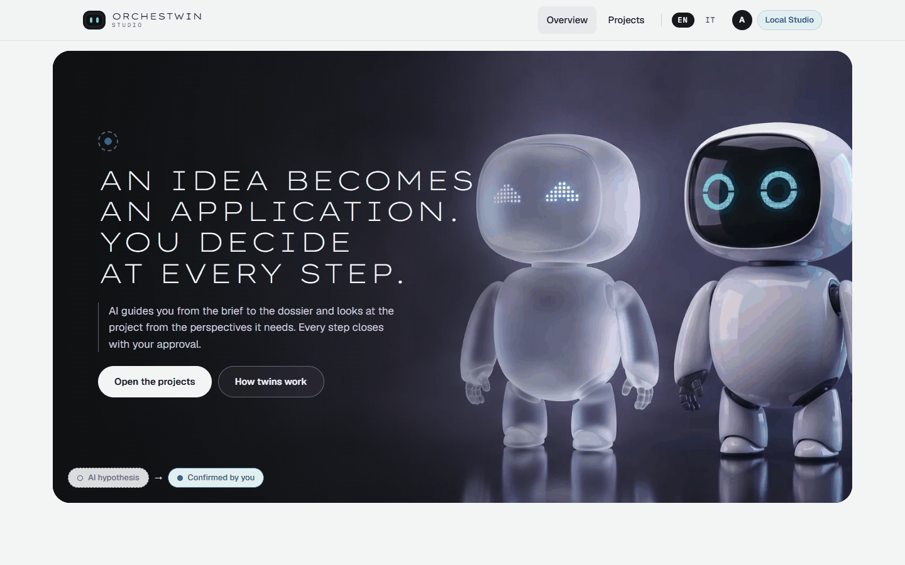

# Local mode and accounts

The Studio started out with accounts: registration, a password, a signed access token and a cookie that renews it. Accounts make sense when several people use the same Studio. If you are the only one using it, on your own computer, they are just one more step between you and the work.

The question came up twice. On 1 October 2026 the first supervisor asked why you should need a login to use the command line. On 6 October 2026 the supervisors described the Studio they had in mind, "more like docker", with the command-line tool and an interface on top of it, like Docker Desktop. The answer was sprint 41, closed the same day. The Studio stays a local server with its own database, because versions, gates and approvals have to stay on record, but it can start without registration or login.

You choose the mode when you start the Studio. The default is `ACCOUNTS`; the other one, `LOCAL_OWNER`, is called "Local Studio" in the web interface.

## Starting the Studio in local mode

Add two keys to the settings file you give to `start-studio.ps1`.

```json
{
  "node": "C:\\Program Files\\nodejs\\node.exe",
  "providers_config_file": "C:\\...\\orchestwin-studio\\var\\studio\\model-providers.json",
  "access": "local",
  "local_owner_email": "<your email>"
}
```

The script turns them into `ORCHESTWIN_ACCESS_MODE=LOCAL_OWNER` and `ORCHESTWIN_LOCAL_OWNER_EMAIL`, the two variables to set if you start the API some other way. At start-up it confirms with "Local access: the Studio works with the account of this computer, without sign-in."

The email picks the implicit account. If an account with that address already exists, the Studio uses it, along with all its projects. If not, the Studio creates it at the first start, with a random password that nobody ever sees. Without an email it falls back to a sample address, and so to a separate account that is empty at the first start.

## The safeguards

Without a login, any page open in your browser could call the API on 127.0.0.1:8000 as if it were you. That is why a request without a token counts as yours only under three conditions. The `Host` header must be a loopback address, that is `127.0.0.1`, `localhost` or `[::1]`. The `Origin` header must be missing or among the allowed origins, which with the start script are the web interface on 8080 and the development server on 5173. And `Sec-Fetch-Site` must not say `cross-site`.

The `Host` check stops DNS rebinding; the other two stop pages from other sites. On top of that, the API listens only on 127.0.0.1. On 6 October 2026, on the real Studio, a request with `Origin: http://evil.example` or with `Host: attacker.example:8000` got a 401.

## The web interface and ut without sign-in

The web interface asks the Studio for its mode (`GET /auth/mode`) and opens the session of the implicit account on its own. "Log in", "Register" and "Log out" disappear. In their place you find the "Local Studio" badge, with the explanation "The account of whoever uses this computer, no registration".



The choice between "Guided" and "Expert" stays tied to the account. If the implicit account has not made it yet, the Studio takes you to "How do you want to work?" as soon as you open the projects, here without the "Log out" button. The two modes are explained in [Guided and expert](../framework/modes.md).

The `ut` command asks the Studio for its mode too. If the Studio is local and sits on a loopback address, `ut` sends its requests without `Authorization` and does not ask you to sign in. In that case `ut login` answers "The Studio {studio} is local and needs no sign-in: the commands work without `ut login`.", while `ut status` prints "Studio: {studio} (local, no sign-in)".

There is an open defect, found on 11 October 2026. If your profile still holds a saved sign-in for the same address, `ut` uses it instead of the local account, and `ut status` replies that the Studio cannot find the project. Remove it with `ut logout`, giving the address of that sign-in.

```powershell
ut logout --studio http://127.0.0.1:8000
```

## When you need accounts

You need accounts when other people use the Studio. The tests with people, planned for sprint 49, will work that way: one participant at a time, in person, on the author's computer, each with a pseudonymous account. The subscription that runs the generations cannot serve other people from a server. To go back to accounts, remove `access` from the settings file and restart: without that key, the script uses accounts.

With accounts, the home page leads to "Create your account". The password must be 8 to 1,024 characters long, with at least one uppercase letter and one special character. The web interface reminds you of this: "At least 8 characters, with an uppercase letter and a special character." The Studio keeps only its Argon2 hash. Right after that comes "How do you want to work?", a choice that cannot be changed once you confirm it. A sign-in lasts 15 minutes and renews itself through a cookie valid for 30 days.

From the terminal, you sign in with `ut login`.

```powershell
ut login --studio http://127.0.0.1:8080
```

The command asks for your email and password, or reads the password from the first line of standard input with `--password-stdin`. It does not save the password. It does save the sign-in, in a `sessions.json` file inside `%APPDATA%\orchestwin` on Windows, `~/Library/Application Support/orchestwin` on macOS and `~/.config/orchestwin` elsewhere, never in the project. The `ORCHESTWIN_CONFIG_DIR` variable moves that folder. For an address that is not loopback, `ut` accepts only HTTPS. The rest is in [Access and status](../ut/access-and-status.md).
