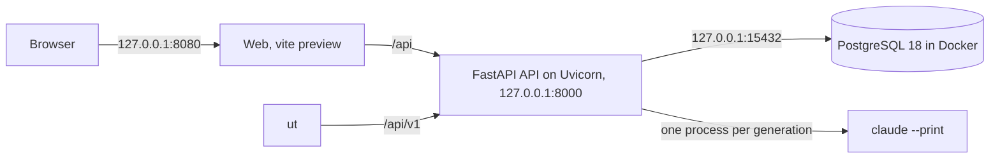

# Starting and stopping the Studio

A running Studio is made of pieces that start in order: the database before the migrations, the migrations before the API, the API before the web interface. One script starts them one after the other, checks that the API answers and writes down which processes it launched. That way a second script can stop those processes and nothing else.

The diagram shows who talks to whom, and on which port. These are the addresses to check when something does not answer.



The browser talks only to the web interface, which forwards everything that starts with `/api` to the API. The `ut` command uses the API too, either directly on port 8000 or through the web interface on 8080. The model has no port: for each generation the API launches a `claude` process and reads its answer.

## The first time

Once `compose.env` is written, start the database container.

```powershell
docker compose --env-file compose.env -f compose.yaml -f compose.studio.yaml up -d --wait database
```

The `compose.studio.yaml` file publishes the database on 127.0.0.1:15432 only, and `--wait` holds until the container's health check gives the go-ahead. Then apply the migrations.

```powershell
python scripts/studio_runtime.py migrate
```

The schema moves up to the latest migration, currently 0075. The start script repeats both steps every time it starts the Studio, so from here on it takes care of them for you.

## Starting

```powershell
./scripts/start-studio.ps1 -Configuration var/studio/local-settings-hosted.json
```

The settings file tells the script where Node and the providers file are ([Generating with claude --print](generation.md)) and, if you want, which access mode to use ([Local mode and accounts](local-mode.md)). Without `-Configuration` the script looks for `var/studio/local-settings.json`. At the first step that fails it stops, with the sentence in the last column.

| Step | What it does | What it prints if it fails |
|---|---|---|
| Checks | verifies Node, the providers file and ports 8000, 8080, 8787 and 8788 | "Port 8000 is already in use. Stop the previous Studio session first." |
| Database | starts the container | "PostgreSQL could not start. Check Docker Desktop." |
| Migrations | brings the schema to the latest version | "Database migrations failed." |
| Web | builds the frontend | "Frontend build failed." |
| Models | checks Claude Code without generating anything | "Real model readiness failed." |
| Services | starts the API and the web interface, then waits up to 60 seconds for `GET /api/v1/health` | "API startup timed out." or "A Studio service stopped. See var/studio/logs." |

When everything answers, the script records the processes in `var/studio/active-session.json` and prints "Studio ready: http://127.0.0.1:8080. Stop with ./scripts/stop-studio.ps1." The logs are in `var/studio/logs`, and if the start goes wrong, `api.stderr.log` is the first one to read. Every start also gets a folder of its own, for example `var/studio/session-20261006-212752`, with the model manifest and the outcome of the readiness check in `readiness.json`. If a step fails after the processes have started, the script closes them before it stops.

## Stopping

```powershell
./scripts/stop-studio.ps1
```

The script closes only the processes it recorded at start-up. It also checks when each of them started, so it never touches a program that has since been given the same process ID. At the end it prints "Studio processes stopped. PostgreSQL and all saved projects are retained."

The database stays up. The container has `restart: unless-stopped` and the data live in the `postgres-data` volume, so your projects, versions and approvals are still there at the next start. To stop the container as well, use Docker Desktop.

## Without a model

You do not need the model to work on the interface. The API can use the deterministic generators (`DEVELOPMENT_FIXTURES`): you go through the steps, but you cannot choose or approve a design. With the database running, start the API in a first terminal.

```powershell
$env:ORCHESTWIN_DATABASE_URL = "postgresql+psycopg://orchestwin:<password>@127.0.0.1:15432/orchestwin"
$env:ORCHESTWIN_AUTH_JWT_SECRET = "<secret>"
$env:ORCHESTWIN_MODEL_RUNTIME_MODE = "DEVELOPMENT_FIXTURES"
npm run start:api
```

The third variable is not optional. Without it the API starts in `REAL_REQUIRED` and stops with `REAL_MODEL_CONFIGURATION_REQUIRED`, because nobody gave it a models file. In a second terminal, start the development web server.

```powershell
npm run dev:frontend
```

The development server answers on http://127.0.0.1:5173 and forwards `/api` to the API. In this setup the API uses accounts, so the first time you register from the web interface.

## With Docker

The `compose.yaml` file puts everything into containers. It builds the API image from the `Dockerfile`, with Python 3.14 and an unprivileged user, and the web image, in which nginx forwards `/api/` to the API. Then it starts the database on an internal network, runs the migrations, and brings up the API on 127.0.0.1:8000 and the web interface on 127.0.0.1:8080. A script runs the whole smoke test.

```powershell
npm run test:compose
```

The script, `scripts/smoke_compose.py`, builds the images, brings the platform up with throwaway ports and credentials, checks HTTP, the database and the container restrictions, then takes it all down again. It left the CI on 10 August 2026 and has been run by hand ever since.

Before you choose this setup, keep two limits in mind. Inside the container the API starts in `REAL_REQUIRED` and reads the model manifest from `/models/models.json`, that is, from the `ORCHESTWIN_MODELS_ROOT` folder, `./var/studio/models` by default. And the image does not contain Claude Code, so generating on the subscription goes through the start script.

For a public server you need a TLS proxy in front of the web interface, `ORCHESTWIN_CORS_ALLOWED_ORIGINS` set to the public origin, `ORCHESTWIN_AUTH_REFRESH_COOKIE_SECURE=true` and the models folder mounted on `/models` with the manifest. A Claude subscription, however, serves only the person who holds it: a Studio open to other people generates with API keys, as [Generating with claude --print](generation.md) explains.
