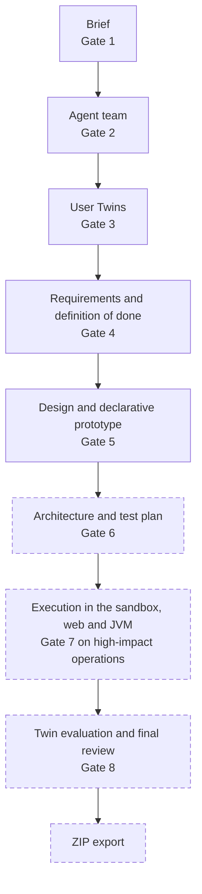

# August, the foundations

Between 4 and 31 August 2026 I ran ten sprints. The first README described a multi-agent platform, governed by a person, that would carry a project from the idea to the evaluation of the running software. In August I built exactly that road, one step after another, and by the end of the month there were eight human gates, from the brief to the export. No step used a model. Every proposal and every evaluation came from deterministic adapters behind typed ports, interfaces ready to take a model that was not there yet. The first adapter to a served model arrived on 2 September.

Most of that work is gone. On 24 September I deleted the architecture, the sandbox, web and JVM execution, the final review with Gate 8 and the export, as [The cut of 24 September](the-cut.md) explains. What stayed is the brief, the team, the twins, the requirements, the design with its prototype, and the gate mechanism, on which the Studio still rests.

The diagram shows the path as it stood on 31 August, with the gate that closes each step; the dashed boxes are the parts deleted on 24 September.

## Foundation and project intake

The first sprint, from 4 to 7 August, had nothing of the product in it yet. The README called it the "foundation sprint", and the home page of the frontend said so plainly: "Project workflows will be introduced in later sprints." In 40 commits I laid down a base in which the backend and the frontend are each verified on their own. The repository had the Apache-2.0 licence, Node pinned to 26.6.0, commit messages checked by commitlint through husky hooks, semantic releases, and Renovate for the dependencies. The backend was a Python package with a FastAPI API that answered nothing but `GET /api/v1/health`; the frontend was Vue 3 with TypeScript, Vite and Pinia. The compose file brought together PostgreSQL 18, the API and a frontend served by nginx without root, and the API and the frontend were exposed only on 127.0.0.1. The CI had three jobs: test, build and release.

The second sprint, from 7 to 10 August, brought in the person who owns the project. Accounts were local, with Argon2 passwords, and at the time the rule looked only at length, from 15 to 1,024 characters. The refresh token was 48 random bytes, stored only as a SHA-256 digest and rotated on every use; the access token was a JWT valid for 900 seconds. Each project was visible to its owner alone. The brief was a document of 15 fields, 6 of text and 9 lists, in which "unknown" is a different answer from "missing". Every version was immutable and carried the SHA-256 hash of its canonical JSON, and a trigger in the database refused UPDATE and DELETE. I changed the password rule only on 28 September, after trying the Studio as a user. Today it asks for at least 8 characters, a capital letter and a special character.

## The first governed flow

Sprint 3, on 12 and 13 August, introduced the mechanism that still holds the Studio up: the human gate. A gate is tied to the project and to the type, version and hash of the artifact. It has 9 states, 7 owner actions and at most 3 iterations, and it turns STALE when the artifact changes, so an approval never carries over to the next version. Its events are written append-only. Gate 1 approved the brief, Gate 2 the team. An incomplete brief was filled in through deterministic clarification rounds drawn from a catalogue of 15 questions, with at most 5 questions per round and 3 rounds. The team came from a fixed catalogue of 17 roles, 6 platform roles that were always there and 11 specialists, picked by rules that searched the brief for keywords.

The port for the team proposal was already waiting for a model. The configuration knew the value MODEL_ADAPTER, but the runtime turned it down with "use FAKE_DETERMINISTIC until a model adapter is implemented". The reason for this choice is written down only in the code. The adapter proposes the mandatory roles "without network or model inference", and a test from the next sprint asks to keep the runtime "free from API secrets". I removed the clarification rounds on 25 September, when the brief became a dialogue with the model. The role catalogue stayed, and it still holds roles for steps that no longer exist, such as SANDBOX_CONTROLLER.

Sprint 4, between 13 and 17 August, brought the User Twins, and with them a rule that is still in place: every statement says where it comes from. An observation has one of 5 epistemic states, a confidence between 0 and 1 and a provenance that cannot be left out, and anything the model infers calls for human validation. A twin's profile had 17 fields and a lifecycle of 5 states, up to EMPIRICALLY_VALIDATED_UT. Candidate personas came only from the target users written in the brief. When evidence was missing the adapter abstained, and the code says it in these words: "The deterministic fake adapter abstains instead of inventing unsupported User Twin attributes". Gate 3 approved the twins, from 1 to 4 per project; the limit went up to 8 on 24 September. Since 17 August the CI has run on ubuntu-24.04, macos-14 and windows-2025.

One limit of this sprint surfaced only later. The twins' router entered the application only on 8 September, and their flow reached the project page on 18 September. For a month the twins lived in the code and in the tests, not in the running Studio. The application had no way to reach the empirical states of the lifecycle until 2 October, when sprint 33 connected evidence to the twins.

Sprint 5, on 18 and 19 August, closed the first block with the requirements. An immutable specification, tied to the exact versions of brief, team and twins, held requirements, stories, acceptance criteria with 5 verification methods, scenarios, risks and definition-of-done items. A traceability graph with 7 node types and 6 link types showed what was still uncovered. The deterministic adapter turned only the explicit statements of the brief into requirements. The owner changed the specification through a diff to approve or reject, and Gate 4 approved the requirements. On 18 August, half an hour after the first commit of this sprint, v0.1.0 came out with the first four sprints; v0.2.0 followed on 21 August with the fifth and the sixth. These five sprints contain no measurement with a model. There was no model to measure.

## Design, architecture and sandbox

On 20 and 21 August, with sprint 6, the design arrived. A design package held from 2 to 4 alternatives, each with its own approach (GUIDED_WORKFLOW, DASHBOARD_FIRST, TASK_FOCUSED, INFORMATION_RICH), the twins' synthetic critiques and a declarative prototype made of data alone. The prototype had 9 element types, 4 states and views for phone, tablet and desktop, and a fixed renderer in the frontend drew it. The reason is in the docstring: "Trusted data-only prototype with no generated executable code". Gate 5 approved the design. Gate 6 approved the architecture and its test plan; the architecture, in the MODULAR_MONOLITH style, also came from a deterministic adapter. An artifact graph linked 5 phases, with 30 node types and 16 link types.

The architecture disappeared on 24 September. Design, prototype and graph survived, the graph cut down to three phases. That same day I pointed to that fixed renderer as the reason all the designs looked alike. The work on design quality and variety started there, and it became the heart of the thesis ([Design quality and variety](../design/index.md)).

Sprint 7, from 24 to 26 August, was already looking past the design: taking in the code of an existing project and running it in a sandbox. A ZIP archive got in only within 25 MiB, 250 MiB uncompressed and 10,000 entries, with 15 rejection codes. Commands were structured plans with no shell and 25 allowed executables, and the Docker adapter ran without root, read-only, with `--cap-drop ALL` and `--pull never`. The 10 built-in execution profiles were all DESIGN_ONLY_LEVEL_C, designed but not yet tried. Gate 7 approved high-impact operations, with 6 reasons to block and 6 to approve. After 24 September, all that was left of this sprint was migrations 0017 to 0019.

## Web and JVM execution

On 27 August, in a single day and 30 commits, sprint 8 brought web execution. There were 5 targets: static, Vue, Node with Express, PHP, and Vue with Express. The runners were pinned by digest, with Playwright 1.62.1, Node 26.7.0 and PHP 8.4.24, and the browser evidence came from Playwright and axe. A profile reached level D only with 9 kinds of recorded evidence. Repairs stopped after 5 attempts on the same error signature or after 2 identical repetitions. At the end of the sprint, though, no real execution was on record, and the profiles stayed at level C. They became VALIDATED_LEVEL_D in the campaign of 12 and 13 September, eleven days before they were deleted.

Sprint 9, between 28 and 30 August, walked the same path for the JVM. It had Java 21 and Kotlin with Gradle, Scala 3 with sbt, the Gradle 9.5.0 and sbt 1.12.14 runners on JDK 21, and three fixtures, among them a Kotlin calculator meant to be the first formal case. Here too level D came later, on 13 September. On 21 September I hid the JVM panels from the interface, and on 24 September a single commit removed the whole path, touching 208 files and taking out 39,200 lines.

## Workflow, evaluation and export

Sprint 10, on 30 and 31 August, closed the month by holding the whole path together. A durable run with 10 states and 25 phases could be paused, resumed and recovered from checkpoints. LangGraph 1.2.11 was only a shell, as the code puts it: "Explicit LangGraph shell around deterministic workflow-domain transitions". The approved twins evaluated the artifacts one by one, with a fake evaluator and an aggregation "without fabricated consensus". A final review with 10 checks came before Gate 8 and a deterministic ZIP export. The export warned that the twins' feedback "is not empirical evidence of real-user behaviour".

Gate 8 and the export had APIs and components, but no screen you could reach from the project page. On 24 September all of it was deleted except the migrations and four files at the core of the evaluation, namely artifacts, findings, validation and the evaluator, which the Studio still uses. The names ARCHITECTURE, HIGH_IMPACT_OPERATION and FINAL_OUTPUT remain in the HumanGateType enumeration, for the historical rows in the database.

## August in numbers

The table gives the size of the ten sprints. The added lines leave out the package-lock.json files. Functions and tests are counted in the code at the end of each sprint, so they are not run results. There were 15 Python test functions at the end of sprint 1 and 1,159 at the end of sprint 10, not counting the 8 integration tests on PostgreSQL.

| Sprint | Commits | Files touched | Lines added | Python test functions | of which integration | Frontend tests | New migrations |
|---|---|---|---|---|---|---|---|
| 1 | 40 | 57 | 3,625 | 15 | 0 | 6 | none |
| 2 | 20 | 90 | 11,095 | 89 | 1 | 23 | 0001 to 0005 |
| 3 | 19 | 76 | 26,028 | 215 | 1 | 34 | 0005a to 0008 |
| 4 | 18 | 47 | 25,554 | 343 | 1 | 45 | 0009 and 0010 |
| 5 | 19 | 55 | 18,990 | 424 | 2 | 60 | 0011 and 0012 |
| 6 | 29 | 117 | 37,839 | 619 | 3 | 100 | 0013 to 0016 |
| 7 | 29 | 83 | 25,043 | 804 | 4 | 109 | 0017 to 0019 |
| 8 | 30 | 134 | 20,517 | 917 | 5 | 122 | 0020 and 0021 |
| 9 | 32 | 110 | 17,582 | 1,055 | 6 | 134 | 0022 and 0023 |
| 10 | 36 | 94 | 20,852 | 1,167 | 8 | 148 | 0024 to 0029 |

In August the CI started 326 times: 204 runs succeeded, 80 failed and 42 were cancelled. In September the first goal was to put a real model behind those ports, and that is the story of [September, training and measuring](september.md).
