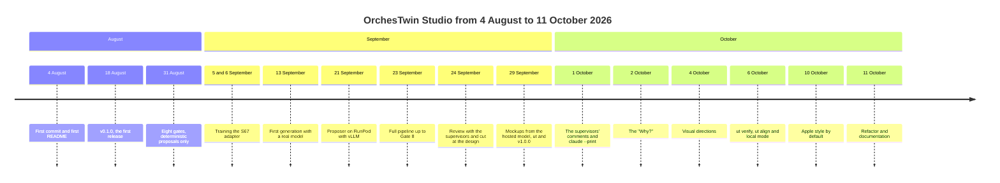

# The journey from day 0

I made the first commit of OrchesTwin Studio on 4 August 2026 at 11:34, and all it added was a `.gitignore`. The README came an hour later, with the idea I started from: a multi-agent platform governed by a person, taking a project "from project intake to executable software evaluation". That promise no longer holds. Today the Studio stops at the design, the code is written outside it, and the twins examine that code commit by commit, as [the framework](../framework/index.md) explains.

As of 12 October main has 871 commits. In 70 days I opened 48 numbered sprints and one sprint T, which has no commits. The sprints were short, from a few hours to a few days; the longest, the twelfth, ran for two weeks.

Every sprint had its own branch and ended with a pull request into develop, merged with a rebase. Sprints 12 and 13 are the exceptions, because they came in through a merge commit, and so are sprint 22, which never had a branch of its own, and sprint 47, whose pull request went into main by mistake. Releases went from develop to main, numbered by semantic-release from the commit messages: fourteen versions, from v0.1.0 on 18 August to v1.3.0 on 11 October. Every commit carries my name, apart from the 32 made by the bot that updates the dependencies.

No written plan survives for the first seventeen sprints; the earliest is the plan of sprint 18. On the evening of 24 September I changed the way I worked. For each sprint I opened a new chat, which proposed the plan in blocks, waited for my approval before changing anything and, at the end, wrote the handoff for the next chat. The Git commands I always ran myself.

## Four stages

In August I worked through ten sprints. First came the foundations, then a complete pipeline: brief, agent team, User Twins, requirements, a design with a prototype made of data, architecture, execution in a sandbox, twin evaluation, final review and export. Each step closed with a human gate tied to the exact version of the artifact, and by 31 August there were eight of them. Not one proposal came from a model, though. Behind the typed ports there were only deterministic adapters. The full account is in [August, the foundations](august.md).

Between 2 and 23 September I tried to put real models into the Studio and to measure them. On the 8 GB card in my PC I used QLoRA to train an evaluator for the twins on top of Qwen3-4B. The comparison with the base model came out mixed, and the retraining runs, on RunPod as well, never produced a candidate worth promoting. The first generation with a real model was recorded on 13 September, and from 21 September the code proposer ran on RunPod with vLLM. In the rounds on the five measurement briefs, taken all the way to execution in the browser, the best result was 3 projects passing out of 5. The details are in [September, training and measuring](september.md).

On 24 September the review with the supervisors stopped the Studio at the design. That evening I decided to delete, rather than shelve, the JVM path and everything that came after the design gate. Commit `8f04811` is still the last one with the full pipeline, and the tracked files went from 1,760 down to 841. Over the following week the brief turned into a dialogue with the model, the design got a visual catalogue, and brief, twins, requirements and design moved into a knowledge folder. On 28 September one of the supervisors pointed out that the design, too, can come from an external AI, and that the aim is not to train models. On 29 September the code gained mockups written by a hosted model, the `ut` command line with v1.0.0 and the first proactive twins. On 30 September came `ut test`, `ut code` and the panel for Visual Studio Code. That week has its own page, [The cut of 24 September](the-cut.md).

On 1 October the first supervisor's comments on the demo video arrived, together with the second supervisor's proposals. The first asked me to generate with `claude --print` on the subscription, to show people less text and to run two tests with users. The second proposed a guided and an expert mode, archetypes, the Persona as a view of the twin, renamed steps and a "Why?" on every artifact. Between 1 and 4 October those requests became sprints 29 to 37, with sprint 38, on design variety, in the middle. I added that one on 3 October, when the styles of my calculator all looked identical to me. The comments of 6 October led to `ut verify`, a new `ut align` that realigns whichever part has drifted, the local mode without login, and `ut push`. Then came `ut align --from-design`, "point and ask" and the critique of an existing design, on 7, 8 and 9 October. On 10 October the Apple style became the default, after the previous run had looked less beautiful to me than sprint 38. On 11 October the refactor took out the training package, and sprint 47 started this documentation. The story goes on in [The supervisors' direction](october.md) and [The last sprints](last-sprints.md).

## The timeline

The timeline lines up the main milestones, each with the date of the commit or the document that records it.

## The 48 sprints

The table follows the order in which I ran the sprints, so 38 comes before 37 and sprint T sits between 42 and 43. The dates are the author dates of the first and the last commit. From sprint 22 on I made the commits at the end of the sprint, which means the date says when I closed it, not how long the work took. The version is the first release that contains the sprint. Release v1.3.0 came out on 11 October 2026, once the pull request of sprint 47 had gone into main, and it holds sprints 40 to 47. Sprint 48 is in progress on its branch, with no commits yet. The commit column does not add up to the 871 commits of main, because it leaves out the 32 commits of the dependency bot, 19 merge commits and a few other commits made between one sprint and the next.

| Sprint | Name | First commit | Last commit | Commits | Version |
|---|---|---|---|---|---|
| 1 | Foundation | 4 August | 7 August | 40 | v0.1.0 |
| 2 | Project intake | 7 August | 10 August | 20 | v0.1.0 |
| 3 | Brief clarification and team | 12 August | 13 August | 19 | v0.1.0 |
| 4 | User Twins | 13 August | 17 August | 18 | v0.1.0 |
| 5 | Requirements and definition of done | 18 August | 19 August | 19 | v0.2.0 |
| 6 | Design and architecture | 20 August | 21 August | 29 | v0.2.0 |
| 7 | Sandbox and execution | 24 August | 26 August | 29 | v0.3.0 |
| 8 | Web execution | 27 August | 27 August | 30 | v0.4.0 |
| 9 | JVM execution | 28 August | 30 August | 32 | v0.4.0 |
| 10 | Workflow, evaluation and export | 30 August | 31 August | 36 | v0.5.0 |
| 11 | Dataset and evaluator training | 2 September | 5 September | 65 | v0.5.0 |
| 12 | Case studies and real models | 7 September | 20 September | 118 | v0.6.0 |
| 13 | Remote proposer | 20 September | 21 September | 10 | v0.7.0 |
| 14 | Governed execution in the interface | 21 September | 22 September | 11 | v0.7.0 |
| 15 | An interface for business users | 22 September | 22 September | 13 | v0.7.0 |
| 16 | Final screen and measurement | 22 September | 22 September | 5 | v0.7.0 |
| 17 | Chat with the twins | 22 September | 22 September | 5 | v0.7.0 |
| 18 | Twin evaluation and demo | 23 September | 23 September | 11 | v0.7.0 |
| 19 | Cut at the design | 24 September | 24 September | 11 | v0.8.0 |
| 20 | Brief as a dialogue | 25 September | 25 September | 5 | v0.8.0 |
| 21 | Design quality and variety | 25 September | 26 September | 5 | v0.9.0 |
| 22 | Twin feedback on the design, on the branch of sprint 21 | 26 September | 27 September | 20 | v0.9.0 |
| 23 | Knowledge folder | 28 September | 28 September | 22 | v0.10.0 |
| 24 | Design from an external AI | 29 September | 29 September | 15 | v0.10.0 |
| 25 | The `ut` command line | 29 September | 29 September | 12 | v1.0.0 |
| 26 | Proactive twins | 29 September | 29 September | 12 | v1.1.0 |
| 27 | Checking the criteria | 30 September | 30 September | 12 | v1.1.0 |
| 28 | Coding agent and VS Code panel | 30 September | 30 September | 20 | v1.1.0 |
| 29 | Subscription and less text | 1 October | 1 October | 13 | v1.1.0 |
| 30 | Perspectives and sections | 1 October | 1 October | 18 | v1.1.0 |
| 31 | Archetypes and Persona | 2 October | 2 October | 3 | v1.1.0 |
| 32 | Definition | 2 October | 2 October | 5 | v1.1.0 |
| 33 | Evidence | 2 October | 2 October | 3 | v1.1.0 |
| 34 | The "Why?" | 2 October | 2 October | 4 | v1.2.0 |
| 35 | Evaluation and validation | 3 October | 3 October | 3 | v1.2.0 |
| 36 | Guided and expert | 3 October | 3 October | 12 | v1.2.0 |
| 38 | Design variety | 4 October | 4 October | 13 | v1.2.0 |
| 37 | Preparing the tests with people | 4 October | 4 October | 8 | v1.2.0 |
| 39 | Mode chosen once | 5 October | 5 October | 11 | v1.2.0 |
| 40 | `ut verify` and `ut align` from the code | 6 October | 6 October | 7 | v1.3.0 |
| 41 | Local mode and `ut push` | 6 October | 6 October | 8 | v1.3.0 |
| 42 | `ut align` from the design | 7 October | 7 October | 10 | v1.3.0 |
| T | Tests with people, phase 1 | none | none | 0 | none |
| 43 | Point and ask, design versions | 8 October | 8 October | 5 | v1.3.0 |
| 44 | Critique of an existing design | 9 October | 9 October | 6 | v1.3.0 |
| 45 | Accessible design, then the Apple style | 10 October | 10 October | 6 | v1.3.0 |
| 46 | Refactor | 11 October | 11 October | 24 | v1.3.0 |
| 47 | Documentation | 11 October | 11 October | 13 | v1.3.0 |
| 48 | Point and ask, second round | in progress | in progress | 0 | none |

## What is missing

As of 11 October no session with people has taken place. What the twins report is still simulated, and the two tests prepared in sprint 37, one on usability and one on the quality of the result, have moved to sprint 49. I do not claim to have reached the goal that matters most for the thesis, the quality and variety of the generated designs ([Design quality and variety](../design/index.md)). My judgement changed from one sprint to the next, and my verdict on the three alternatives the gym project got on 10 October has not been recorded yet.

Two dates lie ahead. On 15 October I will show the supervisors the demo on the Calcolatrice iPhone, the iPhone-style calculator, with no live generation. By 13 November 2026 I will hand in the thesis.
