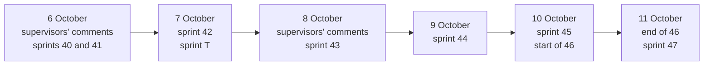

# The last sprints

On 6 October 2026 new comments came in from the supervisors. The command in which the twins review the commits, `ut align` until then, was to be called `ut verify`. A real `ut align` had to start from whatever diverges and change the other side, from the code to the project's knowledge and from the design to the code. The example was a scientific mode added by hand to the calculator. The web was to be thought of like Docker Desktop on top of a command-line tool, with no login and with the `.orchestwin` folder as the single source of truth. And it had to be made clear what the tests with people measure.

I answered the same day. The Studio stays a local server with a database, because that is where the facts are recorded and traced, but a local mode without login would come, and so would `ut push`. A mockup edited by dragging its elements would not fit before the thesis is handed in, and in its place I promised "point and ask" after the demo. For the tests with people I needed the eBRT material, the participants and the consent from the supervisors.

The plan of that day put sprint 42 between 11 and 14 October, the tests with people in the second half of the month and 43 after the demo. Things went faster, and in a different order, as the diagram of the six days shows.

## Verify, and align from the code (sprint 40)

The old `ut align` is now called `ut verify`, with no alias. The new `ut align` reads the commits after the last aligned point and, after a gesture, asks the model for up to twelve proposals for the Definition, for the text of the chosen alternative and for the test plan. Each proposal carries the commit, the files and an excerpt copied verbatim from the diff. It also carries the sentence "A hypothesis of the model drawn from the code diff: no person has verified it." The proposals are decided one at a time, through the reviews and gates that already exist.

The real run started from the supervisor's example. On Calcolatrice iPhone, the iPhone-style calculator, a scientific mode was written by hand, outside `ut`, and in 1 minute and 27 seconds `ut align` drew seven proposals from it. Two of them, once applied, took the requirements to version 3 and the design to version 5; three were left pending. The commands are described in [Development](../ut/development.md).

## No login, and `ut push` (sprint 41)

Sprint 41, that same evening, overturned my 1 October decision on the login. The Studio now has two access modes, chosen at startup, and the one with accounts, which is the default, stays for the tests with people. In the local mode the account of the configured email applies, and a request without credentials goes through only if it comes from the loopback. The `ut` command works without login too. The new `ut push` brings back into the Studio the step documents edited by hand in the folder, and asks for a gesture for each step without ever calling the model. In the real run a sentence added by hand to requirement REQ-012 entered the Studio as Definition 4. How to start the Studio this way is explained in [Local mode and accounts](../installation/local-mode.md).

## From the design to the code (sprint 42)

I opened sprint 42 on the evening of 6 October on another account, because the first one had used up its weekly limit. The new command, `ut align --from-design`, computes the differences between the design version the code is aligned to and the approved one, and after a gesture starts Claude Code on a work order limited to those differences.

On the morning of 7 October a change asked for in words, launched by a gesture of mine, added to the calculator a ⌫ key that deletes the last digit, taking the design to version 7. The first dry run found 157 differences, because the model had renumbered the elements. With matching by fingerprint, decided on the spot, they came down to the 20 real ones. Claude Code worked for 2 minutes and 57 seconds. Then `ut verify` reported that the code was drifting away: the ⌫ key had removed the wide zero that requirement REQ-001, "Same look as the iPhone calculator", still called for. It was a real conflict between the changed design and a requirement, and the decision was left to me.

## The dress rehearsal (sprint T)

Sprint T was meant to be the one for the tests with people and for demo day; what remains of it is phase 1, with no commits. The protocols moved to version 2, together with a page on what each test measures. In the dress rehearsal for the demo, on the evening of 7 October, I settled the conflict from sprint 42 with four tasks that bring the code back to the wide zero. Then came a technical trial without people, on an account declared synthetic: the chat went through the seven tasks of the protocol, with twenty generations and 34 minutes spent waiting for the model. The conflict did not close, though, because the design still had the ⌫, and no source says it was resolved.

## The comments of 8 October and "point and ask" (sprint 43)

On 8 October more comments came in. The video had arrived at 144p over WhatsApp and could not be watched. The command line was fine, as long as the web does the same things or something more, such as going back. The tests with people must not be automated: at most, "a pass of UT over the project you developed". And interaction with the design was missing: selecting an element of the mockup as in the browser's inspector, giving a prompt, letting the system make the change and the twins have their say.

Sprint 43, planned as optional after the demo, started right away. The mockup dialogue now lets the owner point at an element and write what to change, and the twins give their opinion on that element. Every version of the design can be brought back, with `ut design restore` or with "Go back to this version" in the web. On Calcolatrice iPhone the "=" key, requested as "dark blue with the white symbol, taller than the others", arrived in about five minutes. The same day, with my go-ahead, the chat made the pass the supervisors had asked for on the project I had actually developed, the Studio itself, all the way to a `ut verify` with verdict ALIGNED.

## Critiquing a design that already exists (sprint 44)

The first supervisor had asked in conversation, and I wrote it down on 9 October, that the system should be able to critique a design that already exists, taken from a website or from an image. Sprint 44 made it possible the same day. A design comes in as an image or as a website captured with the installed browser, and each twin gives a verdict per screen, "Works for me", "Slows me down" or "Blocks me", with a "What to do". From there, "Redraw as a mockup" redoes the project's mockup in the manner of the design provided.

On Calcolatrice iPhone the critique of apple.com came back in 1 minute and 49 seconds, with three twins on "Blocks me", because a product showcase is no help for doing sums. The Apple-inspired redraw took 5 minutes and 41 seconds, and that same evening I had it applied and approved: it is design 13, the calculator's current design. The rest is in [Critique of an existing design](../design/critique.md).

## Sprint 45 and the Apple style

I decided on sprint 45 on the evening of 9 October, with one sentence: "what matters is that there is creativity and that the design is eye-catching". The mockup instruction was rewritten around 21 examples I had picked myself, with icons, placeholder photos, nine more font families, WCAG AA contrast enforced by the Studio and palettes written by the model. The first run, early on the morning of 10 October, took the style distance to between 66 and 81, where sprint 38 had been between 43 and 66, with zero axe violations. I did not like it, though: "honestly I like the sprint 38 ones better". I asked to try Apple's guidelines, which gave rise to the "apple-hig" system, and then flat colours.

With the Apple system on both alternatives, the proposals looked more alike: in the flat-colour run three pairs out of five were too close. In the afternoon I wrote "perfect, the Apple style becomes the standard", and shortly afterwards "let the proposed designs be 3, and then the user decides; one with Apple's guidelines". Since then every proposal has two free directions and a third one with the Apple system, because coherence and variety pull in opposite directions. On the gym project, regenerated with three alternatives, the distances are 92, 71 and 39. My judgement on that comparison was not collected, and the quality goal is not declared reached. Directions and the Apple system are described in [Visual directions and the Apple HIG system](../design/directions.md).

## The refactor (sprint 46)

On 10 October I decided what would come next: 46 for the refactor, 47 for this documentation, 48 for the tests with users, "at the end (not before)". Sprint 46 had few rules: identical behaviour, existing tests left untouched, leaner code, unused files deleted. In the evening I added: "Yes, delete the training package too". It had been born on 2 September and went out without ever producing a promoted model. Thirty coder subagents working on disjoint files took the Python sources in `src/orchestwin` from 215,104 to 181,794 lines, with the OpenAPI identical after every unit, and 295 files were deleted.

On the morning of 11 October I made the commits, and the live trial on the new code found two defects born in sprint 45. The first was fixed straight away with one more commit; the second is still open. The CI test job on Windows was running right up against the 45-minute limit, and I raised it to 75, as [CI/CD](../quality/ci.md) tells.

## This documentation (sprint 47)

Sprint 47 is this one. On 11 October I asked for complete documentation with MkDocs, starting from an introduction I would read first and telling the story from 4 August. The first version came out in Italian, in the morning; when I read the introduction I asked for two changes, that it describe the tool rather than the thesis, like Docker's documentation, and that the whole site be in English, so every page was rewritten in English the same afternoon. A `docs` job in the CI builds the site on every pull request, and a `deploy-docs` job publishes it on GitHub Pages after a release on main.

## Where I stand on 11 October

Develop is at commit `a850cd6`. The Studio runs locally, with or without login, `ut` realigns code and knowledge in both directions, and the Apple system is the default, with three alternatives per proposal. Calcolatrice iPhone has design 13 and Dossier 16. The latest release is still version 1.2.0 of 5 October. The CI run on main of 8 October, which carried the sprints up to 43, was cancelled at the 45-minute limit, and sprints 44 to 46 exist only on develop.

Some things that matter are missing. No session with people has been held, so there is no usability or quality data, and the eBRT material and the consent have not arrived. My judgement on the three alternatives of the gym project is not recorded, and the goal of quality and variety in the designs is not declared reached.

Three milestones lie ahead. On 15 October comes the demo for the supervisors, ten minutes on Calcolatrice iPhone with no live generations, with the thesis almost ready. Then sprint 48, with the tests with users. By 13 November 2026 the thesis has to be handed in. The journey from the start is in [The journey from day 0](index.md).
