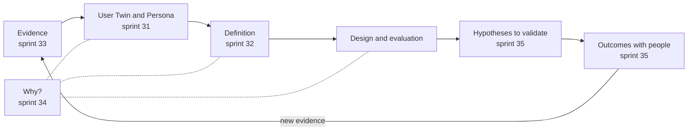

# The supervisors' direction

The plan approved on 1 October 2026 lined up eight sprints up to 14 October, and in its calendar sprint 36 fell around 10 October. I did them in four days, from the afternoon of 1 October to the afternoon of 5 October, together with two sprints the plan did not have: 38, slipped in before 37, and 39. Where that plan came from is told in [The cut of 24 September](the-cut.md).

## Who wrote the code

From sprint 31 to sprint 36 the code was not written by the Claude subagents I had been using, but by those of another coding assistant, Codex. The reason went into the plan on 3 October: the Claude plan had run out. I granted the exception sprint by sprint, and when sprint 33 opened I extended it to the sprints that followed. Reasoning, review and full verification stayed with the main chat, and the Studio's generations always remained `claude --print` on the subscription. After 36 I went back to the usual method, with the Claude chat planning and verifying and the `opus-coder` subagents writing the code on disjoint files. Sprint 38 was the first one done that way again.

## The second supervisor's cycle

The cycle proposed by the second supervisor set the order of these sprints. The diagram puts it next to the sprints that built its links; the last link exists in the code, but no session with people has gone through it yet.

## Perspectives and sections (sprint 30)

Sprint 30, on the afternoon of 1 October, answered two comments at once. On the team, the first supervisor had seen right: the contexts the model received for requirements and design contained nothing from the team. In its place came five perspectives on top of the catalogue of specialists, which stayed as it was: user experience, accessibility, software engineering, product and security. Each perspective that is applied brings two fixed sentences, written by hand, into the context of the requirements and of the alternatives. The steps took the names the second supervisor had proposed, "Brief", "Perspectives", "User Twin", "Definition", "Design & Evaluation" and "Dossier". For the last one the chat suggested keeping "Package", and I chose "Dossier".

After the first pass the steps become sections with a state: "Up to date", "Update available" or "To update". A single gesture, "Update and confirm", re-anchors twins, Definition and design to whatever changed upstream, as long as their content stays the same. In the measurement a change to the requirements went through in 110 seconds, and the design was re-anchored without regenerating anything.

## Archetypes, Persona and Definition (sprints 31 and 32)

During the night between 1 and 2 October the profiles became archetypes, with a name, description, role, goals and context, which can be edited before the twins are born. Each twin states whom it represents and whom it does not, and what gaps its evidence has. The Persona is a view of the twin, with no extra generation, and every claim in it carries one of five words: Evidenced, Inferred, Hypothesized, Contested, Unknown. A twin born from the brief alone does not reach "Evidenced", which requires a real research source.

On 2 October sprint 32 turned the requirements into the Definition. First come the scenarios, then the needs that emerge from them, then stories and requirements that cite the needs. Together they form the chain Twin → Scenario → Need → Requirement, which can be read in the web, in `ut definition` and in the Dossier. On the calculator used for the measurements the chain had 2 scenarios, 5 needs, 4 stories and 10 requirements, and after a change all 39 identifiers stayed the same. I had left journeys out that morning and brought them back at midday, only on request. Archetypes, twins and Persona have a page of their own, [Archetypes, User Twins and persona](../framework/twins.md).

## Evidence and "Why?" (sprints 33 and 34)

With sprint 33, on the afternoon of 2 October, a twin can change for a reason other than the brief. Texts can be added to the project, such as interview notes or observations, and the model proposes what each one supports, contradicts or adds, with a word-for-word quotation that the Studio checks. The owner keeps, corrects or discards, and only the owner's approval creates the new version of the twin. The real material of the eBRT case did not arrive, so the measurement used a test text declared non-empirical, containing hostile instructions and a canary. The proposal came back in 22.4 seconds with four verified quotations, and the model did not carry out the hidden instructions. It is a single trial, and it does not prove a general immunity.

That same night sprint 34 brought the "Why?", the traceability the second supervisor had asked for. It is derived without a model from the versions and links already recorded. For a twin's claim, a requirement or an element of the mockup, it shows where it comes from and what depends on it, with the epistemic state, the exact quotation and the gaps. It is the same in the web, in `ut why`, in the MCP server and in the VS Code panel. The measurement on the calculator produced a number that says a lot: all 384 current artifacts traced back to the twin, and none to an active piece of evidence. How to read it is explained in [The Why? and traceability](../framework/why.md).

## Hypotheses to validate (sprint 35)

On 3 October sprint 35 closed the cycle, in the code at least. The twins' critiques become candidate hypotheses, which turn operational only when the owner writes the question or the task that will test them. The outcomes of sessions with people, "Confirmed", "Refuted" or "Uncertain", are recorded with the exact quotation and go back into the twins as evidence through the review built in sprint 33. A synthetic exercise does not confirm a hypothesis the way a test with people would. On the calculator the candidates went from 47 to 57 after the only evaluation by the twins, while operational hypotheses and outcomes stayed at zero. In that sprint I chose alternative DES-001, "Full-screen calculator for the thumb", and approved the design with a separate gesture.

## Guided and expert (sprint 36)

The second supervisor had asked to treat the expert in user-centred design as a first-class user, in a single interface that changes how much guidance it gives. Sprint 36, on the evening of 3 October, did exactly that. Guided stays the default. In Expert every section is open, every generation asks for a gesture, and the owner can supply perspectives, twin profiles, a complete Definition and a prototype directly. A synthetic measurement, from the perspectives to the approved Definition, counted 6 gestures in Guided and 10 in Expert, with no real generations: it describes how the path works, not how easy it is to use. The mode was a browser preference, and the following evening I would ask for that to change. The two modes are described in [Guided and expert](../framework/modes.md).

## Sprint 38 before 37

On 3 October, after choosing between the calculator's two alternatives, one dark and one light, I said the styles all looked identical to me: "we'll add design variety as a sprint and I'll do it with you". Numbering it 38 avoided renumbering 37, which plans and prompts already pointed to. The chat proposed doing it before 37, because the demo and the tests with people had to see the final designs, and that is what happened. The diagnosis that day was simple. Every mockup was written by the same model following a single instruction that prescribed one look, and what came out was one visual language with different parameters.

With sprint 38, on 4 October, the model writes five candidate visual directions for each proposal, each with rules tied to the twins and the domain and a value on five axes. The Studio picks the pair furthest apart, the mockup instruction follows the direction, five font families under the OFL licence go into the document, and the software measures the distance between the alternatives against a threshold of 45. The pairs made before had sat between 8 and 39 out of 100; with the directions, on four synthetic briefs, they sat between 43 and 66, and the calculator was still below the threshold. About the gym project I wrote "I really like the latest generation of the gym", and about the other three pairs "I like all three, the calculator less". I did not declare the variety goal reached, and I do not declare it here. The story of the design goes on in [Design quality and variety](../design/index.md).

## Preparing the tests (sprint 37)

Sprint 37 came on the evening of 4 October, with 38 already in place. It had to respond to the two tests the first supervisor had asked for, and what the opposing examiner's report considered necessary for them to hold up. Two things went into the product: the project timeline, derived from facts already recorded, and a log of the trial session with a closed vocabulary and no free text. The `ut activity` command exports both as JSON and CSV, and a clearly visible notice now says that the twins' findings are simulated. Outside the repository the protocols took shape: for usability, seven tasks, the SUS in Italian and eight comprehension questions; for quality on the eBRT case, three conditions, a ten-criterion grid and blind assessment. The sessions will be held in person on my computer, with pseudonymous accounts, because the generations use my subscription. No session with people has been held, though: the eBRT material and the consent had not arrived. Where things stand today is in [Validation with people](../validation.md).

## One choice per account (sprint 39)

On the evening of 4 October I recorded another video for the supervisors, on a new project, Calcolatrice iPhone (the iPhone-style calculator), which would become the demo project. Once the video was done I asked for four things. In my own words, the first was "if I choose guided mode I can't switch to expert mode and vice versa". The second was "I'd like the user who signs up to have a screen where they can choose between a guided or an expert visit, and never be able to change it again". Then the tables, where "the icons have no image and the text wraps", and a label with a missing letter, which led to a reread of every text.

On 5 October sprint 39 put the "How do you want to work?" screen right after registration. The choice goes into an append-only table, with a trigger that refuses updates and deletions, and a second choice gets a 409. The selector from sprint 36 is gone. In the tables, the "Why?" of a row opens in a full-width row instead of being squeezed into the code column. The reread went through 13,155 strings, with 530 flags and 299 replacements in 52 files, and in the Italian interface the label for Evidenced changed from "Evidenziato" to "Documentato". I never answered the chat's three questions, whether the blocked switch was a defect or the rule I wanted, which tables and which sentence: the interpretations are the chat's own. That same afternoon develop went into main as version 1.2.0. Then I waited for the supervisors' comments, which arrived on 6 October and are told in [The last sprints](last-sprints.md).
