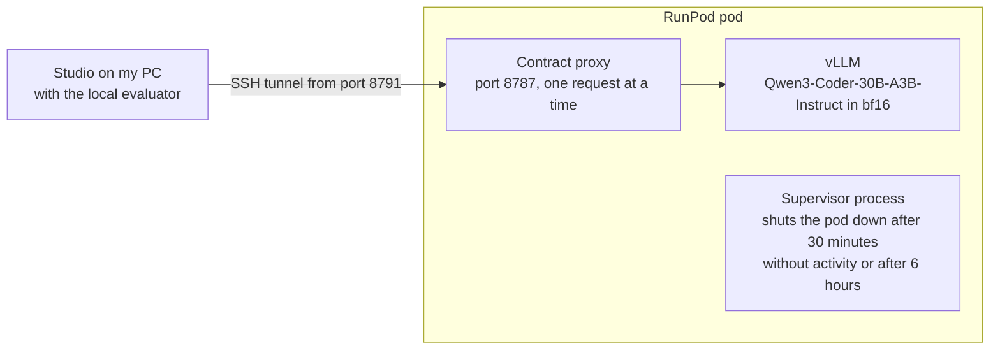

# September, training and measuring

September is the month in which I tried to put real models behind the ports built in August, and to measure what came out. Sprints 11 to 18 ran from 2 to 23 September 2026 and followed two roads. The first was to train a small model as the twins' evaluator, first on my PC and then on RunPod: no candidate was promoted. The second was to connect the steps to served models and carry projects all the way to execution in the browser, and the best result was 3 projects passing out of 5. Almost all the work of those three weeks was taken out later.

## An evaluator trained on my PC

Sprint 11, from 2 to 5 September, started from one question. Could I use QLoRA on the 8 GB RTX 4060 in my PC to train a small model as a shared evaluator for the User Twins? It had to give structured judgements and abstain when evidence was missing.

There were three candidates: IBM Granite 3.3 2B, Qwen3-4B-Instruct-2507 and SmolLM3-3B. Phi-4-mini was ruled out on 4 September, because its official example needs remote code and the runner forbids it. On the 12-task benchmark, half in English and half in Italian, no candidate cleared the thresholds. On a second reading of the same answers, Qwen3-4B gave schema-valid JSON 9 times out of 12, against 1 and 0 for the other two. On 5 September I approved Qwen3-4B as the base, because it was the only one that had completed an eight-step trial training, a resume from checkpoint and local serving with its exact identity. The final dataset was synthetic: 24,000 examples, half of them in Italian, declared as project hypotheses and not as user data.

The final training, the S67 adapter, started on the evening of 5 September and ended on the morning of 6 September. It took 22,143 seconds and 4,814 steps, with 8,058 MB of reserved memory at peak on an 8 GB card. The exported adapter is the one from step 1,000, the best on validation. The comparison with the base model on 7 September, over the same 12 tasks, came out mixed. Valid JSON went from 9 to 12 out of 12, but the required references it found fell from 15 out of 15 to 4 out of 18. The report counts 7 metrics better and 4 worse, closes with DESCRIPTIVE_MIXED and warns that the comparison says nothing about how real users behave.

## The longest sprint

Sprint 12 ran from 7 to 20 September, with 118 commits, and changed direction halfway. During those two weeks an agent conducted the experiments and recorded decisions and outcomes in the reports of the experiments folder; the commits I created myself.

The first half was meant to prepare a formal evaluation. On 7 September three case studies were frozen, each with eight factual criteria: a static web calculator, a hotel management system and a weather comparison built with Vue and Node. Alongside them sat a protocol for a blind expert evaluation, with four reviewers labelled E1-E4, 60 pairs of answers from the base model and the adapter, and an 11-item rubric. Neither reached the end. The calculator case started between 10 and 12 September and stopped at the IMPLEMENTATION step, with no sources. For the expert evaluation, neither the package nor the pairs were ever created. Meanwhile, on 13 September, the web and JVM execution profiles passed the level D campaign.

The second half began on 13 September with an audit: the proposals for profiles, requirements, design and architecture still had only the FAKE_DETERMINISTIC mode. The same day commit `8bedba7` connected every step, sources included, to models served locally in WSL. From then on every generation leaves its evidence in the database. The first recorded inference is a team proposal by Qwen3-4B, with 1,517 input tokens, 94 output tokens and 8.5 seconds.

From 14 to 18 September the evaluator was retrained several times, on RunPod as well, under a campaign cap of 200 USD. The largest curriculum, v3, had 63,420 examples and 15,855 steps. No candidate passed the gates set before inference. The rule, written in the reports, was never to promote an adapter just because its aggregate score improved: "Aggregate improvement does not override the frozen per-case gates". Even so, on 19 September the Studio's evaluator was the adapter from the last pilot of 17 September, which had not passed its gate. Between 16 and 18 September the RunPod balance fell from 176.56 to 119.62 USD, spent on the qualification runs and pilots of the evaluator. The reports warn that the drop includes storage and is not an invoice.

For the code the road was shorter. On 14 September Qwen3-4B published 4 sources out of 4, none of them qualified, and Qwen2.5-Coder-7B published 1 out of 4. The proposer training pilot of 19 September, 240 rows and 120 steps, was rejected. Its report asked to measure a stronger code model before spending the rest of the budget on a bigger training run, and from 20 September the proposer became Qwen3-Coder-30B-A3B-Instruct, with no adaptation. The calculator in the demo of 19 September passes 16 checks in the browser, but it is an assisted fix made at my request, not something the model achieved on its own.

## The proposer on RunPod

Qwen3-Coder-30B-A3B-Instruct in bf16 takes up 56.9 GiB of weights, and the card in my PC has 8 GB. Sprint 13, between 20 and 21 September, made the proposer stable on a RunPod pod. vLLM serves it in bf16, with a 32,768-token context and structured outputs. In front of it sits a proxy that accepts only requests matching the Studio's contract, one at a time, and never falls back on fake answers. A supervisor process shuts the pod down after 30 minutes without activity or after 6 hours, and sends an email with the estimated cost when the pod starts and when it stops. It is one of my rules in concrete form: pods are always switched off when the work is done.

The diagram shows how the remote proposer connected to the Studio from 21 September.

## Rounds all the way to the browser

From 21 to 23 September I ran five sprints of a few hours each, all built around one measure, the round. A round took the five measurement briefs, always the same ones, and carried them through the API from the brief to the sources, to execution in the sandbox and to a browser path derived from the approved design. The briefs were Lista ospiti workshop, Convertitore chilometri miglia, Calcolo della mancia, Registro prestiti biblioteca di quartiere and Contatore presenze corso serale. In English they would be a guest list for a workshop, a kilometre-to-mile converter, a tip calculator, a loan register for a neighbourhood library and an attendance counter for an evening class. They were static web applications with three functional requirements each, and a script approved every gate. A round cost about 1.5 USD and took between 25 and 35 minutes.

A project passed when it got through both the tests written by the same model and the browser path, at most 8 actions long. That does not prove the application met all its requirements. The table gives the outcomes in time order. Code and instructions changed between one round and the next, so the numbers do not add up to a sample.

| Sprint | Days | Projects passed, round by round |
|---|---|---|
| 14 | 21 and 22 September | 0 of 5, 0 of 1, 0 of 5, 1 of 5, 1 of 5, 1 of 5, 2 of 5, 0 of 2, 0 of 3 |
| 15 | 22 September | 0 of 5, 0 of 1 |
| 16 | 22 September | 2 of 5, 1 of 5 |
| 17 | 22 September | 2 of 5, 2 of 5 |
| 18 | 23 September | 2 of 5, 0 of 5, 3 of 5, 3 of 5 |

In the first round, on 21 September, all five projects stopped at source generation with SOURCE_JAVASCRIPT_SYNTAX_INVALID. After the fourth, the written diagnosis said that what held the projects at about one in five on app.js was the quality of the proposer, not the checks of the platform. That same evening, at 21:40, the model started writing app.js in parts, which the platform puts together. Sprint 14 also set the JVM aside, leaving only the web targets in the interface.

Sprint 15, on 22 September, rebuilt the interface for someone with no technical skills and a business profile. It brought new design tokens and an axe check on every view in the tests. Two labels kept what the model proposes apart from what the sandbox observes: "AI proposal, not validated" and "Observed in the sandbox". The same day a second proposer adapter was trained on RunPod, on the parts of the module, in 120 steps and 454 seconds. On the static checks its answers passed 4 times out of 4 for each file, against 4, 1 and 1 out of 4 for the base model. The tests it had generated, though, were never run, and the adapter remained an unselected candidate.

Sprint 16 added the final screen, the service that led to Gate 8 and the README with the brand mark this site still uses. Sprint 17, on the evening of 22 September, brought the chat with an approved twin. The twin answers in the first person, in at most 120 words, grounded only in its profile and the brief, and then lists a few insights to check with real people. The instruction to the model is explicit: "Insights are hypotheses for the team, not findings".

Sprint 18, on 23 September, is the first one with a written plan. The approved twins evaluated the executed prototype through the proposer, with at most 8 insights each, tied to the evidence of the run. Five evaluations were recorded, each with 2 twins and 16 insights, in 30 to 32 seconds. Every twin had written the maximum allowed, and shared insights and conflicts were always zero, so the aggregation was never put to the test. On top of that, the same model generated the sources and evaluated the prototype.

The plan for sprint 18 included a deployment on a Hostinger VPS, but the VPS was not part of the Hostinger plan. A local demo with a public tunnel took its place: a script started the pod, launched the Studio and printed a temporary address. Sprint 19 was to start once a supervisor had approved the demo, but no file records a session of the supervisors through the tunnel. On 23 September the RunPod balance stood at 83 USD. At 13:43 the same day, v0.7.0 brought sprints 13 to 18 into main, and with them commit `8f04811`, the last one with the full pipeline.

## What remained

No trained adapter was promoted. The evaluator stayed in the Studio for a few more days. After the diagnosis of 27 September the twins' review moved to the proposer, and from sprint 24 the LoRA served only an optional static check, as [The cut of 24 September](the-cut.md) describes. On the evening of 27 September I had the RunPod volume with the pilots of 16 to 19 September deleted. On 28 September one of the supervisors told me that the aim was not to train models, not least because the resources were not there. Since then the designs have been generated by an external model with no training. On 11 October the refactor of sprint 46 removed the training package from the repository ([The last sprints](last-sprints.md)).

Of the execution path only the migrations in the Alembic chain remain, and of the case studies nothing at all: their code can be read in the Git history, up to `8f04811`. The tunnel demo script was removed on 11 October, in the clean-up of that same refactor. What stayed is the chat with the twins, the brand mark and the evidence recorded for every generation, which began on 13 September. The model task the twins used to evaluate the prototype stayed too, and today it serves their reviews of the design and of the commits.
