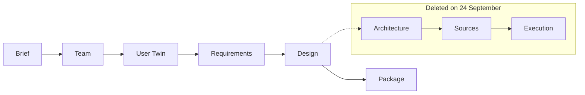

# The cut of 24 September

On 24 September 2026 the Studio was at its largest. It had eight steps and eight gates, and after the design came the architecture, the generation of the sources, execution in a sandbox with repairs, the twins' evaluation of the running prototype, a final review and the export. How I got there is told in [September, training and measuring](september.md). That day I held the review with the supervisors.

## The eleven decisions

The decisions went into the sprint plan, which was revised that same evening. Eight came from the supervisors, and the first decided all the rest: the Studio stops at the design, that is, at the brief, the team, the User Twins, the requirements and the alternatives with their mockups and diagrams. The brief had to come out of a dialogue with the model, requirements and design also had to be shown as tables and Mermaid diagrams, and the twins had to become a continuous source of feedback. The framework became a knowledge base, a folder with a schema inside the project. Then came an Acceptance Criterion Tester, which checks the acceptance criteria on the application developed outside the Studio. The other two were the freedom to choose the model instead of staying tied to RunPod and an automatic proposal of the twins' first profile.

I added the other three myself. After the design the project is developed outside the Studio, in Visual Studio Code for example, and the twins become proactive: they check the work, criticise it and update their knowledge when the project changes. The generated designs all looked alike and had to become more varied. And there had to be room for more than four twins.

## Delete, don't park

The first direction written after the review still said that architecture, sources and execution "are being parked". The plan revised that evening carries my decision: delete, don't park. The JVM path and everything that followed the design gate left the repository, and today they can be read only in the Git history. I did not want a tag. The reference is commit `8f04811`, the last one with the full pipeline.

Between that commit and the end of sprint 19 the diff touches 1,018 files and removes 218,345 lines. Migration 0052 drops 25 tables. Its downgrade recreates the schema but not the data, which survive in a database backup taken beforehand. The training package stayed, as thesis material, until 11 October.

The diagram shows the steps before and after that day: the three that followed the design were deleted, and the Package, a zip to download, became the sixth.

## The brief and the visual catalogue (sprints 20 and 21)

On 25 September the brief became a dialogue, with at most twenty questions and three follow-ups, and the essential fields asked first. In the first round the model never stopped. After the fixes, in the second round, every project got 14 or 15 questions, and 13 fields out of 15 came out the same as in the reference brief (12 in one project). The owner answering, though, was a script: the measurement says whether the model covers the fields, not whether its questions help a person.

Sprint 21 started the same day. I said that the heart of the thesis is the quality and variety of the alternatives, and I asked for palettes, styles and options to "explode". What came out was a visual catalogue of 22 dimensions and 136 values, with 5,472 palettes and WCAG contrast checked by construction: 498,820,072,476,672 valid combinations, among which the model chooses the visual language and gives its reasons. On training I closed the matter with "perfect, let's stick to this line". Within a project the two alternatives were very different; from one project to the next, on the other hand, the model repeated itself. Contrast and coherence were guaranteed. Beauty was not, and I would notice three days later. What followed is in [Design quality and variety](../design/index.md).

## Twins on the design, and the folder (sprints 22 and 23)

Sprint 22 has no branch of its own. I did it from 25 to 27 September in the same chat as sprint 21, and its 20 commits sit on `sprint/21-design-quality`; the reason for that choice is not recorded. It brings the twins' loop to the design. Each twin reviews the chosen design with observations anchored to real screens and elements of the mockup, and the owner confirms or rejects them. A suggestion can go into the brief, the requirements or the design, which is then regenerated.

Sprint 23, between 27 and 28 September, gave shape to the fifth decision. The knowledge folder has an index, `ORCHESTWIN.md`, a manifest with SHA-256 fingerprints, and CSV tables and Mermaid diagrams generated without a model. Exported and imported again on five projects, it did not show a single difference.

On the night of 27 September an H200 pod stayed on for six hours after I had switched off my PC with a measurement still running: 27.89 USD instead of the 2 or 3 I had expected. The next morning I tried the Studio on my own. Twelve suggestions carried into the brief created versions 4 to 15 in 33 seconds and blocked the publication of the folder, and the mockups were, in my own words, "really ugly to look at".

On 28 September I also wrote two pointers from one of the supervisors into the plan. Designs, like code, can come from an external artificial intelligence, and the goal is not training, partly because the resources are not there. And then "the icing on the cake": a command-line tool that runs the steps, with commands such as `ut init`, `ut design`, `ut test` and `ut align`, and keeps everything aligned when the code changes the design. The plan from sprint 24 onwards was rewritten around these two pointers.

## The design from an external model (sprint 24)

From the afternoon of 28 September the Studio began calling hosted models, with three spending caps checked before every call: 2.50 USD per generation, 10 per project, 60 in total. For the design I chose Claude Opus 5.5 through the API, and after the first example I wanted it for everything ("always use opus"). The model writes the mockups in HTML and CSS inside a contract, without scripts, images or external resources. The interface changed in the same sprint: I had redesigned it with Claude Design, and the new look was carried over into the Vue components.

Generating cost money. A mockup took 277 to 621 seconds and 0.75 to 1.58 USD, a complete project 5.0 to 6.2 USD. On the morning of 29 September I built the showcase website of a gym by myself, in 28 minutes and for 4.01 USD. My verdict stayed on record in these words: "I like the design but it feels a bit thin on content".

During the night between 28 and 29 September I fixed the dates the work still rests on. The thesis is due by 13 November 2026, by 15 October I need a working demo and a thesis that is almost ready, and instead of a trial with the supervisors there will be a trial with real users.

## The command line and proactive twins (sprints 25, 26, 27 and 28)

The `ut` command was born on 29 September, in Python with only the standard library, because the project was already in Python and every other language I considered would have cost extra hours. There were seven commands, from `login` to `package`, and they talk to the Studio's API without ever calling a provider. A tip calculator created entirely from the terminal took 13 commands and 4.47 USD for 24 generations. With `ut` the Studio went to version 1.0.0.

Sprint 26, the same afternoon, gave substance to my ninth decision: the Studio records the commits, has the twins examine them and gives an alignment verdict. Back then the command was called `ut align`; since 6 October it has been `ut verify`. In the measurement, the third commit of the same tip calculator moved the result below the fields on purpose and added bill splitting. The twins defended the approved design ("this commit abandons the approved design"), and the owner chose the opposite. The twins criticise, the owner decides: how this works today is explained in [After the design](../framework/development.md).

During the night between 29 and 30 September came `ut test`. It drives the Chrome and Firefox already installed on the machine through a WebSocket client written with the standard library, without downloading anything. On the "Mancia Subito" page (roughly "instant tip") it made 26 runs across the two browsers without a single failure, with 7 criteria passed and 5 not covered, each with its reason. The twins' critiques found what the tests could not see, such as a sentence that gave the rounding rule as "pending confirmation from management".

On 30 September `ut code` closed the circle. It starts Claude Code with a work order and the twins as an MCP server, and the Studio neither sees the repository nor runs code. On task TSK-006 the agent worked alone for 6 minutes and 4 seconds and brought the design's three buttons, 5, 10 and 15%, into the app. Twins that learn were born too, and so was the panel for Visual Studio Code. With the pull request already merged, it turned out that `ut` would not start at commits 7 and 8 of the sprint, because of a mistake in the order of the commit plan. Since then the commit commands are written only after the check has passed on every one of them.

## The video and 1 October (sprint 29)

On the evening of 30 September I stopped sprint 29 and asked only for the script of a video for the supervisors: an iPhone-style calculator, first in the web and then in the terminal. Then I decided to record it myself. Halfway through the recording the Team step got stuck, because the brief said "no server" and the team rules did not understand negations.

The first supervisor's comments arrived on the morning of 1 October, in five points. Generation should go through `claude --print` and the subscription instead of the paid API. The team looked cosmetic, because in the end it is the model that does the work. For a person there was too much text and there were too many diagrams, a product "from machine to machine". The supervisor saw no reason for a login to a service. And two tests with users were needed, one on usability, with participants bringing an idea of their own, and one on the quality of the output in the case of the interface for the eBRT operator. Where they stand is in [Validation with people](../validation.md).

I made up my mind within an hour: the tests with users happen on my computer, so all generation goes through `claude --print` with my subscription. With the same calculator made again, 15 generations out of 15 succeeded at the first attempt, at no cost, against the 9.17 USD spent on the API for the video. The limits on requirements are now computed from the brief: from 17 requirements down to 10, and `requirements.md` from 6,895 to 1,789 words. I kept the diagrams. On the login I held my ground, and I would revisit it five days later.

The second supervisor's proposals had also arrived that morning, and they touched the method. They covered a guided and an expert mode, archetypes before the twins, the Persona as a view of the twin and the chain Twin → Scenario → Need → Requirement. Then came renamed steps, sections that reopen and a "Why?" on every artifact. They asked to keep evidence, inference, hypothesis, contested and unknown apart, and to treat synthetic evaluation as pre-validation, never as validation. The second supervisor wrote down the cycle that held it all together like this: Evidence → User Twin → UCD artifacts → Design decisions → Synthetic evaluation → Human validation → New evidence.

That morning I had also asked a read-only chat to act as opposing examiner, comparing the product with the paper and with the goal of the thesis. Its verdict: the work held up as an engineering prototype, not yet as a thesis with a research question and an evaluation. The first of the five most serious findings was the absence of any result with people, and with it of the paper's sixth step, human validation. The title chosen in August no longer described the work, with a team that does not act, no executable software and an evaluator that had been trained and never promoted. The paper's first step, empirical research on users, was missing. The measurements were single runs, judged by the same chat that was building the product. And the epistemic rules had got lost in sprints 26 to 28, down to a false "passed" from `ut test` on a page that showed "Error" instead of the Italian "Errore".

At 11:54 I approved the plan for sprints 30 to 37, with one change: "ut login must stay". Eight sprints, about 58 hours of chat up to 14 October, and a rule shared by all of them: every artifact is created only when it is needed, and it shows the summary first and the detail on request. How it went is told in [The supervisors' direction](october.md).
