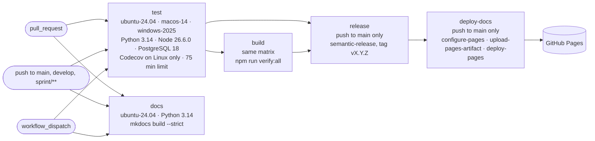

# CI/CD

Continuous integration lives in a single file, `.github/workflows/ci-cd.yml`, created on 4 August 2026 together with the repository. It has five jobs: `test` and `build` on three operating systems, `release` for the versions, and, since sprint 47, `docs` and `deploy-docs` for this site.

## When it runs

The workflow runs on every pull request, on pushes to `main`, `develop` and `sprint/**`, and by hand through `workflow_dispatch`. Its base permission is only `contents: read`. The `test` job adds `id-token: write` to send coverage to Codecov through OIDC, with no stored token. The `release` job writes contents, issues and pull requests in order to create tags and releases. The `deploy-docs` job has `pages: write` and `id-token: write`.

Runs are grouped by ref. On a sprint branch a new push cancels the run in progress; on `main` it waits for that run to finish. A push and a pull request for the same commit have different refs, so both run, as runs 635 and 636 did for `f8e4569` on 11 October.

## The pipeline

The diagram shows which job waits for which. The `test` and `docs` jobs start together on every event, `build` waits for `test`, `release` waits for `test` and `build` and runs only on pushes to `main`, and `deploy-docs` waits for `release`.

## The test job

The `test` job runs on `ubuntu-24.04`, `macos-14` and `windows-2025` with `fail-fast` turned off, so that a defect on one system does not hide the other two, like the absolute path of 29 September described in [The test suites](index.md). Its environment sets the three model modes to `FAKE_DETERMINISTIC`: no real model ever runs in CI.

1. Checkout, Node at the version in `.nvmrc`, Python 3.14 and the PostgreSQL 18 installed on the runner, with the npm and pip caches.
2. Installation of the frontend and the backend, then `pip check` and `npm ls`.
3. The Python tests without integration, with `PYTHONWARNINGS=error` and with coverage on Linux only.
4. The frontend tests with vitest and the extension tests with `node --test`.
5. `orchestwin-migrate upgrade head` and `orchestwin-migrate current` on the runner's database.
6. Integration on PostgreSQL, limited to the `integration/` folder.
7. On Linux only, the upload of `coverage.xml` to Codecov. If the upload fails, the job is red.

## Why 75 minutes

Until 11 October the limit was 45 minutes, and Windows barely fitted in it, because on the same code the time changes a lot from one runner to another. On 11 October the push of `f8e4569` finished green in 44 min 56 s, while the pull request for the same commit was cancelled at 45 min 15 s with the PostgreSQL suite halfway through. On Windows the time goes into the Python tests (between 19:54 and 29:00, in minutes and seconds) and the integration tests (between 7:03 and 10:00). Even the installation of PostgreSQL takes between 1:41 and 3:27 there, against under 34 seconds elsewhere.

On 8 October run 623, the merge of `develop` into `main` through pull request 107, was cancelled, and `release` never started. No version has come out since v1.2.0, although `main` has 31 more commits, 23 of them `feat`. On 11 October commit `a850cd6` raised the limit to 75 minutes. On that same commit Windows took 30 min 22 s in run 639 and 45 min 15 s in run 640: under the old limit the second run would have been cancelled.

The typical durations come from twelve runs between 5 and 11 October, read on 11 October from GitHub's public API. For `test` only the successful jobs are counted.

| Job | ubuntu-24.04 | macos-14 | windows-2025 |
|---|---|---|---|
| `test` | 18:32 to 32:48, median 30:14 | 19:02 to 28:00, median about 23:30 | 32:16 to 44:56, median about 38:15 |
| `build` | 1:08 to 1:56 | 1:28 to 2:16 | 2:04 to 3:39 |

The `release` job takes about thirty seconds: 32 for v1.2.0.

## The build job

The `build` job starts after `test`, on the same matrix, with a 45-minute limit and the husky hooks turned off. It installs tools and dependencies and runs `npm run verify:all`. That covers Ruff and the build of the wheel and the sdist, which `scripts/build_backend.py` checks together with the `orchestwin-api`, `orchestwin-migrate` and `ut` commands. Then come the syntax of the commitlint and semantic-release configurations and `renovate-config-validator --strict`, and finally eslint, prettier, vue-tsc and the Vite build. CI builds no Docker images.

## The release job and versions

The `release` job runs only on pushes to `main`, after `test` and `build`, and runs semantic-release on the `main` branch, with tags in the form `v${version}`. Under the default rules, `feat` brings a minor version, `fix` and `perf` a patch, and a `BREAKING CHANGE:` line in the commit body a major one. The `release.config.mjs` file adds `security` and `revert` as patches, while `docs`, `ci`, `chore`, `test`, `refactor` and `build` produce no version. No plugin updates any file: the version lives in the tag and in the GitHub release, and `pyproject.toml` stays at `0.0.0`.

The exclamation mark after the type is not enough. On 29 September a trial with the analyser configured in the repository showed that `feat(x)!:` alone produces no version. That morning 1.0.0 was supposed to come out of an empty commit carrying the `BREAKING CHANGE:` line, but GitHub's rebase merge drops empty commits, and pull request 82 produced v0.10.0 instead. Version 1.0.0 came in the afternoon, with the commit that introduces `ut`.

| Version | Date | Pull request |
|---|---|---|
| v0.1.0 | 18 August 2026 | 12 |
| v0.2.0 | 21 August 2026 | 15 |
| v0.3.0 | 26 August 2026 | 41 |
| v0.4.0 | 28 August 2026 | 54 |
| v0.5.0 | 7 September 2026 | 65 |
| v0.6.0 | 21 September 2026 | 67 |
| v0.7.0 | 23 September 2026 | 74 |
| v0.8.0 | 25 September 2026 | 77 |
| v0.9.0 | 27 September 2026 | 79 |
| v0.10.0 | 29 September 2026 | 82 |
| v1.0.0 | 29 September 2026 | 84 |
| v1.1.0 | 2 October 2026 | 92 |
| v1.2.0 | 5 October 2026 | 101 |

Release v1.1.0 brings together 58 `feat` commits and 7 `fix` commits; v1.2.0 has 40 `feat` and 11 `fix`. The `v0.0.1` tag of 17 August has no release.

## The documentation

The `docs` job runs on every event, alongside `test` and without waiting for any other job, on `ubuntu-24.04` with Python 3.14. It installs `requirements-docs.txt` (MkDocs 1.6.1, Material for MkDocs 9.7.7, pymdown-extensions 12.2) and runs `mkdocs build --strict`. In strict mode a broken link, a wrong anchor or a page missing from the navigation turns the job red.

The `deploy-docs` job runs only on pushes to `main`, after `release`, in the `github-pages` environment. It builds the site again, and `actions/configure-pages`, `actions/upload-pages-artifact` and `actions/deploy-pages` publish it at https://alextesta00.github.io/orchestwin-studio/. When none of the new commits calls for a version, semantic-release ends successfully without publishing anything. So the site is updated on every push to `main` with `test` and `build` green, even when there is no new version. The release, on the other hand, does not wait for `docs`: a broken page holds back the site, not the version.

To publish the first time, Pages has to use GitHub Actions as its source (Settings → Pages → Build and deployment → Source). A manual run on `main` does not publish the site, because `release` requires a push. Locally the documentation is built with Python 3.13, and the first result with 3.14 will be the one from CI.

## Commits, pull requests and messages

Alex Testa makes the work commits, one at a time, with the commands prepared when each sprint closes (see [Sprint tools and live trials](tools.md)). The other 32 commits come from Renovate, all of them in August. Sprint pull requests enter `develop` with a rebase, and `develop` enters `main` with a merge commit: that merge commit is the one `release` tags.

The `commitlint.config.mjs` file allows eleven types and 23 scopes. It requires a scope, a header of at most 100 characters and a subject that neither starts with a capital letter nor ends with a full stop. Husky 9.1.7 installs the hooks, and only `pre-commit` is left, which runs Ruff in check and format mode. The `commit-msg` hook with commitlint existed from 4 August, was emptied on 27 August and was deleted on 11 October; why it was emptied is not recorded. Today the messages are checked by the sprint commit plan, which reads the commitlint rules, and by `npm run commitlint` when someone runs it by hand. CI does not check them.

## Renovate and pinned actions

The `renovate.json` file extends Renovate's `config:best-practices` preset. Renovate works on `develop` on Mondays between midnight and five in the morning, Rome time, with at most five open pull requests and two an hour. Pins, digests and stable minor or patch versions are merged automatically, with a rebase and after CI; 0.x versions and major versions never are. Vulnerability alerts get the `security` label and wait for a person.

Between 4 and 31 August Renovate opened 47 pull requests, and 32 were merged, among them Python 3.14 in CI in place of 3.12 and Codecov at v7. Pull request 16 (`ci(ci): pin dependencies`), merged during the night between 21 and 22 August, pinned the actions to the SHA of a commit, with the version in a comment (`# v7`). The workflow file still uses that form, the three Pages actions added in sprint 47 included. After 31 August Renovate opened no more pull requests, and the reason is not recorded.
