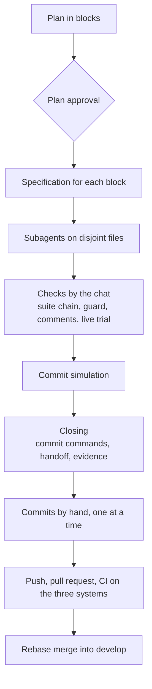

# Sprint tools and live trials

I built the Studio in sprints, one after another, as a rule with one chat per sprint. The tools on this page live outside the repository and travel from one sprint to the next with the number in their name: `run_checks46.py` is `run_checks45.py` copied and renamed. Many of the rules were born from one specific mistake, and each mistake is told next to the tool that enforces the rule.

## How a sprint runs

When a sprint opens, the chat presents me with a plan in blocks, each with its goal, activities, result, hours and dependencies, and it does not touch the code until I approve. Then it writes a specification for each block and hands it to subagents that work in parallel on disjoint files, never two coders on the same file. In sprint 46 there were thirty of them. The chat reviews, checks and talks to me, but it never runs a Git operation that writes. I make the branches, the commits and the pull requests myself, the commits one at a time, with the commands the chat writes for me in a single message.

On 29 September 2026 I turned down a plan with parallel lines in separate chats: the sprints stay in single file, with many subagents inside the same chat. The rules of three operating systems and two browsers, told in [The test suites](index.md), were born the same day. When a sprint closes, the chat leaves a handoff for whoever picks up the work, and the evidence of the sprint.

The diagram lines up the steps of a sprint, from the plan to the merge into `develop`; the tools described below belong to the steps in the middle.

## The evidence folder

Everything needed to reconstruct a sprint is in the `orchestwin-validation-evidence` folder, outside the repository.

| File | What it contains |
|---|---|
| `handoff-sprintNN.md`, for sprints 18 to 46 and for sprint T | the state of the repository, the commits to make, the checks, how to launch the tools, loose ends, lessons |
| `tesi-evidenze-sprintNN.md`, from the combined file for sprints 01-05 up to 46, and for sprint T | the method, what changed, the checks, what the sprint shows and what it does not |
| `mappa-codice-sprintNN.md`, from sprint 33, and `mappa-codice.md` | where in the code the work of the sprint lives |
| `testo-PR-sprintNN.md`, from sprint 33 | the text of the pull request |
| `prompt-prossima-sessione-Claude-*.txt` | the opening message of the next chat |
| `strumenti-sprintNN/` | API contract, specifications, reconnaissance, state, guard, commit plan and simulation, logs, browser drivers |

## The check chain

The `run_checksNN.py --suite <name> --run <label>` script runs one suite: `windows`, `linux`, `integration`, `frontend`, `quality`, `build`, `editor`, `ruff`, `comments`, `simulation` and a few others. It writes the output to `log/`, together with a result that records the exit code and the seconds, and it takes a SHA-256 snapshot of the files in `src`, `scripts`, `frontend/src` and `editors/vscode` before and after. A check is valid only when `source_unchanged` is true. With thirty coders on the same tree, a suite that runs while the files are changing says nothing about the final tree. The output goes through a filter that masks passwords, tokens and JWTs.

The chat closes a command after ten minutes, and the Windows suite takes more than twenty, so the suites start in detached processes. The `chainNN.ps1` script runs several suites in a row that way and writes a JSON summary. With `launchNN.ps1` a single suite starts in the background, without a word about the outcome; `waitNN.ps1` waits for the result and exits with its code. The final chain of sprint 46, on 11 October between 04:06 and 05:09, gave among other results Windows in 1,417.5 s, Linux in 1,260.6 s and PostgreSQL in 879.3 s, each time with the sources unchanged.

## The contract guard

Some files must not change by mistake: the model instructions and adapters, the evaluators, the schema and documents of the knowledge folder, the agent catalogue, the mockup review and two files of the extension. The `guard_contractNN.py` script compares their SHA-256 with a baseline taken from HEAD. Every changed file needs a declaration giving the reason, or the guard exits with 1. In sprint 46 it watched 84 files: 34 unchanged, 50 declared, none undeclared. Inside the repository the same work is done by the tests on the instruction hashes (see [Providers, model contracts and guard](../architecture/models.md)).

## The commit simulation

The `prepare_planNN.py` script assigns the changed files to commits by area and writes the commands. It refuses documentation files, the `.claude` folder, headers longer than 100 characters and any type or scope that commitlint does not allow. Then `simulate_commits_sprintNN.py` extracts HEAD with `git archive` into a temporary folder and applies the commits one at a time, checking the hash of every file. After each commit it imports `orchestwin`, runs Ruff, collects every pytest test and runs the relevant ones, with vue-tsc, eslint, prettier and vitest for the web and `node --check` and `node --test` for the extension. At the end it compares the simulated tree with the disk, without touching the repository. In sprint 46 all 22 commits passed, in 2,111 seconds.

The tool exists because of a mistake in sprint 28. I received the commit commands while the simulation was at the second commit, and two commits went into `develop` with a `ut` that would not start: they imported modules that only arrived later. The final tree was fine and CI was green, but any `git bisect` has to skip those two commits. Since then the commands arrive only after every commit in the plan has been checked.

## The comment check

No new comments or docstrings go into the files I produce. The `check_comments.py` script counts comments in the changed files, both in HEAD and on disk, with `tokenize` and `ast` for Python, the TypeScript parser for JavaScript, TypeScript and Vue, and regular expressions for HTML and CSS. A comment counts as new only if its text occurs more often across the changed files than before, so a comment that moves along with its code is not counted. In sprint 46, across 769 changed files, there were zero new comments.

## Browsers

The tools use the browsers installed on the computer; I turned down Playwright's own Firefox on 29 September. Chrome is driven by playwright-core on the `chrome` channel, headless, and that is how the design sprints measure the mockups with axe-core at 1440 and 390 pixels. Firefox has a driver written for the purpose. It starts the browser headless, with a temporary profile and with updates and telemetry off, reads the line "WebDriver BiDi listening on ws://…" and drives the page over BiDi, collecting failed requests and console errors. In the product, `ut test` and `ut design critique --url` use the same protocols: the DevTools Protocol for Chrome, BiDi for Firefox.

## Live trials

The suites do not see everything. After the checks I start the real Studio (API on 8000, web on 8080, PostgreSQL in Docker), or the chat starts it with my consent from the Terminal tab, using `riavvia-studioNN.ps1`. The trial covers the live OpenAPI, the pages of the existing projects in Chrome and in Firefox with no console errors, and the `ut` commands on the real projects. It records the time, the code running, numbers, screenshots and defects, and the defects are compared with the previous code to tell whether they are regressions. Real generations start only with a gesture of mine. Upgrading the schema of the Studio's database requires an authorisation variable and the trial on the isolated schema, and it compares a SHA-256 fingerprint of every row before and after.

On 11 October the refactor trial ran on the code of `cb44e32`. The live OpenAPI had 179 paths, 212 operations and 417 schemas: the same as before, minus the `training` routes. The Calcolatrice iPhone (the iPhone-style calculator) and the gym project opened in Chrome and in Firefox with no console errors, and `ut status`, `ut design show`, `ut activity`, `ut validation --json` and `ut why` answered on the calculator. The two defects found were not new: the sprint 45 code, on the same database, failed in the same way.

The first broke the gym project's "Hypotheses and outcomes" panel, which showed "The operation could not be completed." Two alternatives saved on 10 October with a null `design_system` no longer passed the reader, which rejected them as non-canonical. I had it fixed that same morning, with a test that fails without the fix: that is commit 23, `fix(artifacts)`. The second was `ut status` run from the gym project's folder, where the saved session belonged to an account from earlier sprints. The command answered "State read from this folder: the Studio http://127.0.0.1:8000 does not find this project for your account." When sprint 46 closed, it was still open.

## The refactor oracles

In the sprint 46 refactor the criterion was identical behaviour. Where the tests did not cover an output (persistence, gates, Dossier, folder schema, model adapters), the coders wrote oracles that compare the old code and the new one on the same inputs. The outputs came out identical on 1,143 adapter cases, 80,618 gate comparisons, 1,609 Dossier texts, 22 schema digests and 46,428 records, and the fake Studio kept the AST of 893 definitions identical. The OpenAPI and the route order had the same SHA-256 after every API unit. The story of the refactor is told in [The last sprints](../journey/last-sprints.md).
