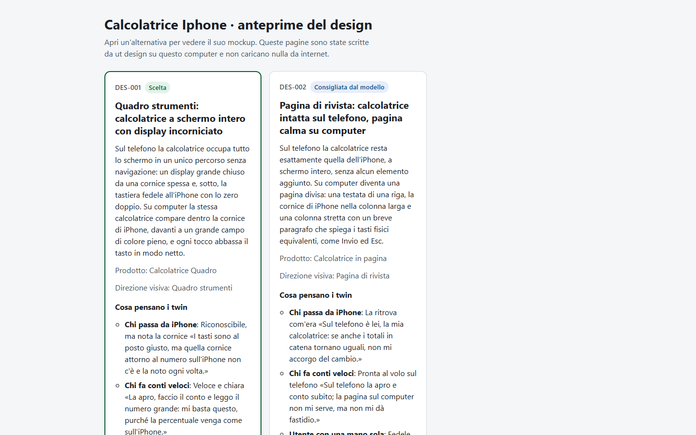
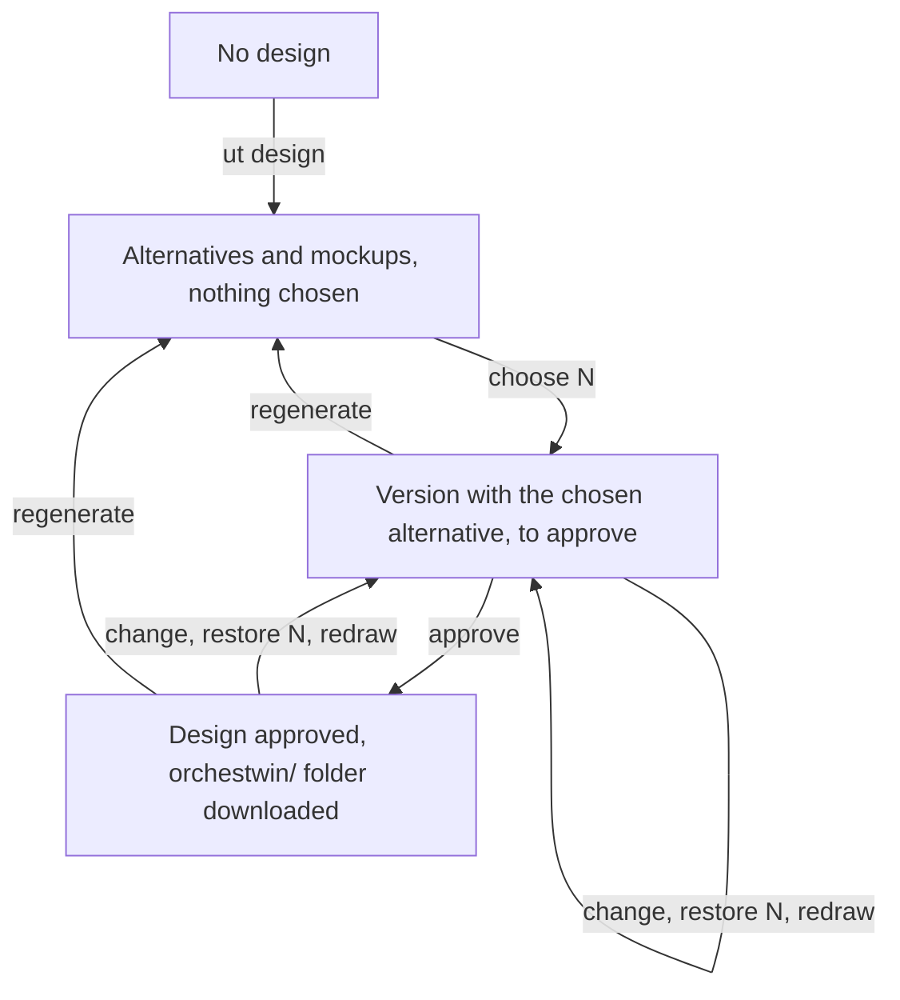

# ut design

The design is the step where the model does the most work and where your choices weigh the most. The `ut design` command brings the "Design & Evaluation" step of the web into the terminal: alternatives, mockups opened in the browser, what the twins think, changes asked in words, the choice and the approval. Run it without an action and it guides you; give it an action and it does only that.

```text
usage: ut design [-h] [--rule TEXT] [--screen SCREEN] [--element ELEMENT] [--no-review]
                 [--elements [SCREEN]] [--image FILE] [--url ADDRESS] [--redraw [N]]
                 [ACTION] [VALUE]
```

The `VALUE` argument is the code or the number of an alternative for `open` and `choose`, the change in quotes for `change`, and the number of a version for `restore`. Until the Definition is approved, the command answers "The design comes after the requirements, which are not approved yet. Complete the earlier steps with `ut init`, then come back here."

## Actions and options

| Action | What it does | Model |
|---|---|---|
| none | guides you with a menu | when needed, after the estimate |
| `show` | alternatives, distance, what the twins think, chosen design | no |
| `open [N]` | writes the previews and opens them | no |
| `choose N` | chooses an alternative, then the twins review it | yes |
| `change "…"` | changes the chosen design as you describe it in words | yes |
| `review` | review by the twins | yes, if there is none yet |
| `approve` | approves and downloads the knowledge folder | no |
| `regenerate` | new alternatives from the approved steps | yes |
| `restore N` | a new version identical to version N | no |
| `critique` | what the twins think of a design that already exists | yes, except the list |

| Option | Meaning | Default |
|---|---|---|
| `--rule TEXT` | a rule that stays valid in the later changes; repeatable | none |
| `--screen SCREEN` | the screen the change aims at, such as SCR-002 | the whole mockup |
| `--element ELEMENT` | an element of that screen, such as ELM-012; needs `--screen` | the whole screen |
| `--no-review` | no review by the twins right after the change | review right away |
| `--elements [SCREEN]` | the elements of the chosen mockup that you can point at | every screen |
| `--image FILE` | PNG or JPEG of a design that already exists | - |
| `--url ADDRESS` | a website to photograph 1440 and 390 pixels wide | - |
| `--redraw [N]` | redraws the mockup like the design of critique N | the latest critique |

The first four options work only with `change`, `--elements` only with `show`, and the last three only with `critique`, one at a time; anything else is a usage error. The texts are in `messages/design.py`.

## Without an action

When there is no design yet, `ut design` announces "I am about to prepare the design alternatives; then I have their mockups drawn at the same time, so that you can see them in the browser." and shows the estimate. With pay-as-you-go billing it asks for confirmation above 0.50 USD; with the subscription it starts straight away. The Studio prepares the alternatives, then up to three mockups at once. If a generation is already running, the command follows it instead of starting it again. Then it writes the previews in `.orchestwin/previews/`, opens them in the browser and shows the menu "What do you want to do?". The entries depend on the state, and the ones that put the model to work carry their estimate in brackets.

- "Open the previews in the browser"
- "Choose an alternative; right after, the twins review it"
- "Draw the missing mockups: {codes}"
- "Ask for a change in words; right after, the twins review it"
- "Have the twins review the design"
- "Approve the design; then the knowledge folder appears in orchestwin/"
- "Regenerate the alternatives from the approved steps"
- "Leave"



On 2 October 2026, on the calculator used for measurements, the command took 540.0 seconds: 3 min 10 s for two alternatives and 5 min 46 s for the two mockups, against the "about 13 min" it had announced. Then it stopped at the menu.

The transcripts on this page come from runs made with the Italian interface. They show the lines that the English interface prints in the same place, taken from the messages in the code, with the original numbers and times. Texts that belong to a project, such as a request or a title, are translated from Italian, while names stay as they are.

```powershell
ut --yes design
```

```text
Mockups ready: DES-001, DES-002. No alternative has been chosen yet.

What do you want to do?
  1. Open the previews in the browser
  2. Choose an alternative; right after, the twins review it (Claude subscription, no credit spent, about 2 min)
  3. Leave
Write the number of your choice:
```

## Looking without spending

With `ut design show` you see the alternatives with their visual direction and, where there is one, their design system. Then comes the distance between the alternatives, marked "They differ" or "Too close", with the note "Measure computed by the Studio: it does not replace your judgement." After that you read what the twins think and the chosen design with the rules in force. With `--elements` the command lists the elements a change can aim at. This excerpt is from 8 October 2026, on the Calcolatrice iPhone (the iPhone-style calculator).

```powershell
ut design show --elements SCR-001
```

```text
Elements of the mockup of DES-001 · Quadro strumenti: full-screen calculator with a framed display
================================================================================
SCR-001 · Ready for the first sum
Code     Type    Text
-------  ------  ---------------------------------------------------------------
ELM-001  p       Calcolatrice Quadro
ELM-002  p       Available offline
ELM-003  output  0
ELM-004  button  AC
```

With `ut design open` the command writes an `index.html` with the cards of the alternatives and one page per mockup, then opens the index; `ut design open 2` opens the second alternative. After a change there is also a page for the version that came before, such as `DES-001-before.html`.

## Choosing, changing, approving

Choosing, with `ut design choose N`, creates a new version with the alternative you picked and asks the twins for their review at once: "You chose {code} “{title}”: the design is now at version {version}." On 29 September 2026, `ut --yes design choose DES-002` took 77.0 seconds, review included.

With `ut design change "…"` you ask the model to change the chosen design, in at most 1,000 characters. The rules you pass with `--rule` stay valid for the following changes too, up to five new ones at a time and twenty in all. The change produces a version to approve, and the previews show the before and the after. Then the twins review it, and the command sorts their findings into solved, still open and new. Here is an excerpt from 7 October 2026, on the Calcolatrice iPhone; the request and the rule were written in Italian.

```powershell
ut design change "Add to the keypad a ⌫ key that deletes the last digit typed, to the left of the equals key, as tall as the other keys and with a label that screen readers can read." --rule "The digits on the display stay the largest on the page."
```

```text
This generation runs on the Claude subscription: it spends no credit. Estimated time: about 9 min.
Applying the change to the design...
Applying the change to the design: done in 1 min 57 s.
Change applied: the design is now at version 7, to be approved.
…
I am about to ask the twins to review the chosen design.
…
The twins are reviewing the design: done in 2 min 55 s.
```

The model also declared a side effect: the zero was no longer two columns wide, against the requirement that the calculator should look like the iPhone's. The twins flagged it, and in the code `ut verify` flagged it too (see [Development](development.md)).

With `--screen` and `--element`, both the change and the opinion of the twins focus on one element. On 8 October the "=" key was changed this way from the web, with "Point at an element" on `ELM-023` of `SCR-001`. From the terminal the request would be the one below, written as an example and never run.

```powershell
ut design change "make it dark blue with a white symbol, taller than the others" --screen SCR-001 --element ELM-023
```

Read the codes again with `show --elements` before you use them, because they follow the order of the elements: on 7 October a change had renumbered them.

The review, `ut design review`, has the twins review the chosen version, or shows the review that already exists without spending anything. It always opens with "The twins' findings are simulated by the model: hypotheses to verify with real people, not evidence."

Approval, with `ut design approve`, saves the version in `.orchestwin/steps/design.json` and downloads the knowledge folder: "Design approved: {code} “{title}”, version {version}. Now I prepare the knowledge folder." On 7 October, version 7 of the Calcolatrice produced version 9 of the folder, with 72 files.

## Regenerating and going back

The diagram shows which actions create a new version of the design and which one approves it. `show`, `open` and `review` leave it as it is.



With `ut design regenerate` the Studio prepares new alternatives from the approved steps, with the estimate of a new design: "I will prepare new alternatives from the approved steps. The previous design stays in the history; you will need to choose and approve the new design."

With `ut design restore N` you get, without the model, a version identical to N, re-anchored to the current Definition and waiting for your approval. The command asks "Go back to version {version}?" and refuses the current version and versions that do not exist. On 8 October 2026 at 12:55, the first `ut design restore 9` got "The Studio answered with an error (status 409, PERSISTENCE_REJECTED)." The database did not accept two versions with the same content, and migration 0074 removed that constraint. At 15:06, on the migrated Studio, it went like this (path shortened).

```powershell
ut --yes design restore 9
```

```text
I go back to version 9: version 11 is created, the same as 9 and re-anchored to the current Definition, and then it has to be approved. The model does not work on it: it costs nothing.
Previews written in C:\…\calcolatrice-iphone\.orchestwin\previews.
Version 11 created from version 9: approve it with `ut design approve`.
```

## `ut design critique`

Since 9 October 2026 the twins can also judge a design that does not come from the Studio, such as the screen of an app or the page of a website, without touching the current design. The four forms follow the help of `ut design`, which marks the three options "only with critique".

```text
ut design critique
ut design critique --image FILE
ut design critique --url ADDRESS
ut design critique --redraw [N]
```

Without options the command lists the critiques already made, most recent first. With `--image` it uploads a PNG or JPEG of up to 5 MB. With `--url` it opens the page in the Chrome or Firefox of your computer, takes a picture of it 1440 and 390 pixels wide and reads its text. Each twin then gives a verdict for each screen, "Works for me", "Slows me down" or "Blocks me", with a "What to do" for every observation. With `--redraw N` the model redraws the mockup of the chosen design like the design of critique N. The command ends with "The mockup redrawn like “{title}” is in version {version}: look at it in the previews and, if it suits you, approve it with `ut design approve`." The logic is in `flows/design_critique.py`.

On 9 October, on the Calcolatrice iPhone, the critique of one screen of the DES-001 mockup took 2 min 04 s. Two "Blocks me" came back and one "Slows me down", and all three twins pointed at the bottom row, where the ⌫ key had taken the place of the decimal comma.

```powershell
ut --yes design critique --image calcolatrice-DES-001-1440.png
```

A little later it was the turn of Apple's Italian page.

```powershell
ut --yes design critique --url https://www.apple.com/it/
```

```text
I open the page with Google Chrome, 1440 pixels wide, and take a picture of it.
I open the page with Google Chrome, 390 pixels wide, and take a picture of it.
I upload the supplied design “Apple (Italia)” to the Studio.
I am about to ask the twins what they think of the supplied design “Apple (Italia)”. The current design does not change.
This generation runs on the Claude subscription: it spends no credit. Estimated time: about 3 min.
The twins are looking at the supplied design...
The twins are looking at the supplied design: done in 1 min 49 s.
```

All three twins answered "Blocks me" on both screens, since a shop window of products is no help when you need to work out a sum. They also named what was worth taking from it: the black background and the thin white type. The redraw started from the web with "Redraw as a mockup", took 5 min 41 s and became design 13 (see [Critique of an existing design](../design/critique.md)). From the terminal, `--redraw` was put to work the same evening on Bottega Vicina ("the shop next door"). There `ut design critique --redraw 2` failed at the first attempt after 9 min 23 s, because the model had described one change in more than 300 characters, and it succeeded at the second. On the same project the Amazon website would not let the automated Chrome photograph it: the capture came out white and the verdict was "Works for me", a defect that is on record. In cases like that, take the screenshots by hand and use `--image`.

## The estimate and its limit

With the subscription the estimate is only a time: 13 minutes for alternatives and mockups, 9 for a change with its review, 2 for a review, 3 for a critique. With pay-as-you-go billing it shows an amount as well. On 29 September 2026 the first design of the tip calculator was announced at 2.91-3.74 USD and 13 minutes, and it took 523.1 seconds.

The known limit has to do with the three alternatives. Since 10 October 2026 the Apple design system is the default and the first proposal draws three mockups, but the estimate of the first generation counts two (`FIRST_DESIGN_MOCKUPS` in `flows/design_generate.py`). The time, on the other hand, is a fixed figure, because the mockups are drawn together: on 10 October the gym project, with three alternatives, took 1,040.8 seconds against the 13 minutes printed. The defect in the estimate is recorded and not fixed yet.
