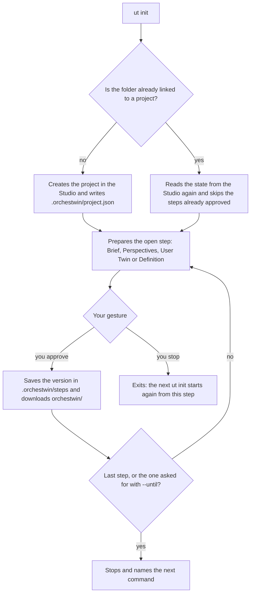

# ut init

`ut init` creates a project in the Studio from the folder you are in and takes it from the idea to an approved Definition, through the same four steps as the web interface: Brief, Perspectives, User Twin and Definition. It exists because code is born in a folder, and the project should be able to start from there as well. Every step waits for your gesture.

```text
usage: ut init [-h] [--name NAME] [--idea TEXT] [--mode {design,design-code}] [--project ID]
               [--answers FILE] [--until {brief,team,twins,requirements}]
```

## Options

| Option | Meaning, from the help | Without the option |
|---|---|---|
| `--name NAME` | name of the project | asked, with the name of the folder proposed |
| `--idea TEXT` | the idea, in one or two sentences | asked |
| `--mode {design,design-code}` | design: design only (default); design-code: design and then code | asked, with "Design only" listed first |
| `--project ID` | link this folder to a project that already exists in the Studio | a new project |
| `--answers FILE` | JSON file with the answers, to run the whole path without questions | questions in the terminal |
| `--until {brief,team,twins,requirements}` | stop after the named step: brief (Brief), team (Perspectives), twins (User Twin) or requirements (Definition) | up to the Definition |

## The path

The diagram follows `flows/journey.py`: a step already approved is skipped, an open step waits for a gesture, and you can always stop.



You need a sign-in to the Studio, or a Studio in local mode. In a new folder the command writes "New OrchesTwin project in this folder.", asks for the mode ("How do you want to work?"), the idea and the name, shows the estimate and creates the project, confirming it with this line:

```text
Project "{name}" created in the Studio. The link with this folder is in {path}.
```

The brief comes out of a dialogue, one question at a time. An empty answer or `?` means "I do not know, propose it yourself", `/done` composes the brief, and `/quit` closes the command while the dialogue stays open in the Studio; the Italian `/fine` and `/esci` work too. The model's proposals for the points you left undecided can be accepted all together, one by one, or not at all. Then "What do you do with the brief?" offers "Approve it and go on", "Correct a point" and "Stop here".

You approve the perspectives as they are, or switch them on and off by number. For the User Twins you confirm or discard the proposed archetypes, and the twins are made from the confirmed ones. For the Definition the Studio writes requirements, stories and acceptance criteria; you can approve them, read them all or ask for a change in words.

After each approval `ut` writes this line, then downloads the knowledge folder with the steps approved so far:

```text
Step "{step}" approved (version {version}). Saved in {path}.
```

At the end it names `ut design` as the next command. The texts are in `messages/init.py`.

## Picking up where you left off

Stopping costs nothing. "Stop here", `/quit`, Ctrl+C or a Studio that stops answering all leave what you approved saved. Launched again in the same folder, `ut init` starts from the open step and announces it like this:

```text
Resuming the project "{name}" from step {number} of {total}: {step}.
```

If a generation was still running, it follows that one instead of starting another. With `--until` you stop on purpose.

## An answers file

`--answers FILE` reads a JSON file of at most one million bytes, with the keys `mode`, `name`, `idea`, `answers`, `proposals`, `team`, `profiles`, `twins` and `requirements` (`flows/answers.py`). With a file the command asks no questions, so spending above 0.50 USD has to be accepted in advance with `--yes`; on the subscription the estimate is only about time, and nothing is asked. The sprint measurements take this road. Here is the file of 2 October 2026, shortened. Its text values were written in Italian and are translated here, while the project name is the real one.

```json
{
  "mode": "DESIGN_AND_CODE",
  "name": "Calcolatrice stile iPhone - Definizione32",
  "idea": "I want a calculator to use in the browser, with the look and the behaviour of the iPhone calculator ...",
  "answers": {
    "problem": "The calculators you find online are full of advertising ...",
    "goals": ["Do an operation between two numbers in less than ten seconds, without instructions"]
  },
  "proposals": "ACCEPT_ALL",
  "team": "APPROVE",
  "profiles": "CONFIRM_ALL",
  "twins": "APPROVE",
  "requirements": {"decision": "STOP"}
}
```

## Real timings

On 29 September 2026 the tip calculator was born entirely in the terminal, back when the Studio still paid for the API: thirteen commands, 19.5 minutes of clock time in the commands that generate, 4.47 USD over 24 generations. `ut --yes init --answers` alone took 229.9 seconds and 0.71 USD, against an estimate of 0.48 to 0.72 USD.

Since 1 October the Studio generates on the subscription. That day at 21:56 this command approved the four steps of the Calcolatrice stile iPhone, an iPhone-style calculator, in 254.4 seconds, against the "about 5 min" it had announced. The run used the Italian interface, and the path of the file is shortened.

```powershell
ut --lang it --yes init --answers risposte.json
```

On 2 October the same path, stopped on purpose before approving the requirements, took 234.0 seconds. Resuming it, with a change in words to the Definition, took another 129.1 seconds.

## Linking a folder to an existing project

With `--project ID`, `ut init` creates nothing. It links the folder to a project of the Studio, resumes from the step the project has reached and downloads the knowledge folder, with no zip to extract by hand. The Dossier step of the web interface offers the commands already filled in under "From the terminal, with `ut`"; in local mode the `ut login` step disappears.


```powershell
ut init --project <project ID> --mode design-code
```

On 6 October 2026 the code folder of the Calcolatrice iPhone was recreated this way: the command downloaded the Dossier at version 5, then `git init` and `ut code` rebuilt the application. A folder already linked to another project refuses a second link with "The folder {root} is already linked to another project of the Studio: --project cannot link it to a second one. Use a new folder."
