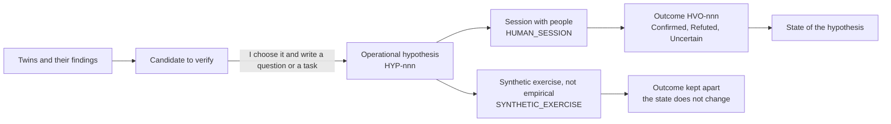

# Validation with people

A twin is not a person, and its opinion does not count as an answer from a user. The Studio says so next to the findings, the discussions and the conversations with the twins. This is how I read the project's measures: the twins find problems and prepare questions, and the answers have to come from real people.

## Pre-validation, not validation

On 1 October 2026 the second supervisor wrote down the principle I have followed since: synthetic evaluation serves mainly as pre-validation, "to identify problems and formulate better questions for the later activities with real users". The example given of a sentence not to write was "Users will prefer solution B".

In the code the principle became a chain. The candidates to verify come from the twins and their findings, and each one carries the limit `HUMAN_VALIDATION_REQUIRED`. An operational hypothesis (`HYP-001`) exists only once I choose a candidate and write a question or a task for a person, what to observe and the limits. Its outcome (`HVO-001`) says "Confirmed", "Refuted" or "Uncertain", with a session code that carries no names and the exact quotation from the source. The diagram shows where people come in.

The state of a hypothesis is computed only from the outcomes of sessions with people, and each of those requires a source declared as empirical research, with its context, method and limits. A synthetic exercise stays on record, apart from the rest. Before every list of findings `ut` prints "The twins' findings are simulated by the model: hypotheses to verify with real people, not evidence". The ["Why?"](framework/why.md) of every artifact has a "To verify with real people" section, with whatever in its chain still asks for a check.

## The two tests

On 1 October 2026 the first supervisor proposed two tests with users. One has different people use the Studio to develop an idea of their own; the other judges the quality of the output on a defined case, the interface for the eBRT operator. I prepared the protocols on 4 October 2026, in sprint 37, and brought them to version 2 on 7 October 2026. Whatever is marked as a proposal, starting with the number of people, has to be decided with the supervisors.

### Usability with an idea of their own

The first test asks whether a person can carry an idea of their own from the brief to a chosen design, how they judge its usability and whether they understand what the twins are. I propose 6 to 10 people who have never seen the Studio: those without a background in user-centred design work in "Guided" mode, those with one in "Expert". Every session takes place in person on my computer, because the generations use my subscription, with a pseudonymous account and no recording of screen or voice.

Each meeting lasts ninety minutes. It holds seven tasks from the brief to the Dossier, done while thinking aloud, then the SUS (System Usability Scale) on paper, eight comprehension questions and an interview with two ratings from 1 to 5 on the designs. The first session is a pilot, which as a rule stays out of the results. The Italian SUS is a working translation, still to be checked against the published version.

### Quality on the eBRT case

The second test compares three conditions with the same model and the same `effort`: the path through the Studio (`STUDIO`), a short direct prompt (`PROMPT_DIRETTO_BREVE`) and a structured one (`PROMPT_DIRETTO_STRUTTURATO`). In the Studio my gestures are fixed in advance, starting with approving every section without changes. I propose three repetitions per condition, nine designs in all, rated blind by at least two independent raters on a grid of ten criteria from 1 to 5. At the end each rater tries to guess where every design came from. Then the hypotheses born from the twins' findings go before operators, or people who know their work closely, to be chosen together with the supervisors. The problems that only they see are counted too.

### Consent and analysis plan

The consent form is a draft of 7 October 2026 that the supervisors have yet to approve, and the files show only codes such as P01, V01 and SES-P01. A limit of the product has to be declared as well: the Studio keeps the request and the response of every generation, and it cannot delete a project or an account for good. The analysis plan, written on 4 October 2026 before any data existed, allows descriptive statistics only, with weighted kappa and ordinal alpha for the agreement between raters. It also says what the thesis will not be able to claim: that the Studio is usable in general, that it produces better designs than a direct prompt, that the twins resemble the users.

## What the tests measure

On 6 October 2026 the supervisors asked: "What kind of test do we want them to take? What do we want to measure?" The answer is the page I prepared on 7 October 2026 for the demo of 15 October 2026.

| Test | Measure | Where it comes from |
|---|---|---|
| 1 | Task completed, completed with help or not completed; assists, errors and problems with their severity | observer's sheet and interview |
| 1 | Time to the approval of each section, waits and attempts of the generations | the Studio's timeline (`ut activity`) |
| 1 | Time spent in each section; details, "Why?" and mockups opened | study session log |
| 1 | SUS and eight comprehension questions | paper questionnaires |
| 1 | Variety among the alternatives and match between the chosen design and the idea, from 1 to 5 | final interview |
| 2 | Ten criteria from 1 to 5, agreement between raters, share of origins guessed | grid filled in blind |
| 2 | Twin hypotheses confirmed, refuted or uncertain; problems seen only by people | hypotheses and outcomes recorded in the Studio |
| 2 | Times, generations and attempts per condition | timeline and the log of the direct prompts |

## The study session log

The Studio derives many times from facts it already records. What leaves no saved trace, such as an opened section or a "Why?" being read, only a study session can see. The facilitator starts one with the "Study session" control or with [`ut activity start SES-P01`](ut/access-and-status.md), and while it is active the line "Recording of times and steps is on · SES-P01" stays visible. The web records a closed vocabulary, with no free text; `ut` records the start, end, outcome and waits of every command, never its arguments. The exported document declares its limits, among them `ELAPSED_INCLUDES_IDLE_TIME`: the time between two events includes the breaks.

On 7 October 2026 I ran a technical trial without people. An AI assistant went through the seven tasks in place of the participant, with an account declared as synthetic and the session `SES-PT0`. There were 20 generations, 19 of them successful, and 34 of the 39 minutes of the run went into waiting for the model; the 1,507 exported events are marked as synthetic data. The chain worked from recording to analysis. The measured wait led the protocol to plan for 30 to 35 minutes of it, against the 15 to 25 estimated on 4 October 2026. The limit lies in the automation: the built-in browser reported the page as hidden between one action and the next, so the time spent in the sections comes out underestimated.

## Where things stand

As of 11 October 2026 no session with people has taken place, and there are no data on usability, on quality or on how twins compare with people. The eBRT material, the participants, the raters and the approved consent have not arrived: the last note on the subject dates from 8 October 2026, and the evidence notes of the following days record nothing new. On 8 October 2026 the supervisors also asked me not to automate the tests with people. The most I could do was run `ut` over the project I had developed, and I did so on the Studio itself: about thirty minutes of model time and an `ALIGNED` verdict from `ut verify`. On 10 October 2026 I decided that the user tests come at the end, in sprint 48, which is still to be planned. Before the first session the protocols have to be brought back in line, because they speak of two alternatives and since 10 October 2026 there have been three.

## The limits of the tests

The protocols themselves list the threats to validity. The sample is small and chosen for convenience, and the facilitator is the author of the system: instructions read from the sheet, counted assists and paper questionnaires soften the problem without removing it. Thinking aloud stretches the times. In test 2 there is a single case, the blinding is imperfect because the Studio's mockups follow a recognisable contract, and twins and designs come from the same model. In the "Why?" the entry "Reaches active evidence" also counts quotations from non-empirical sources, so the counts have to rest on the state of the hypotheses. The project's other limits are in [Limits and future work](limits.md).
