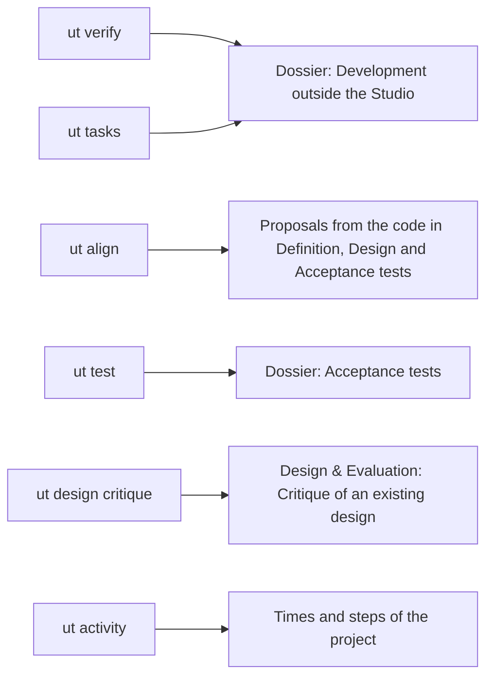
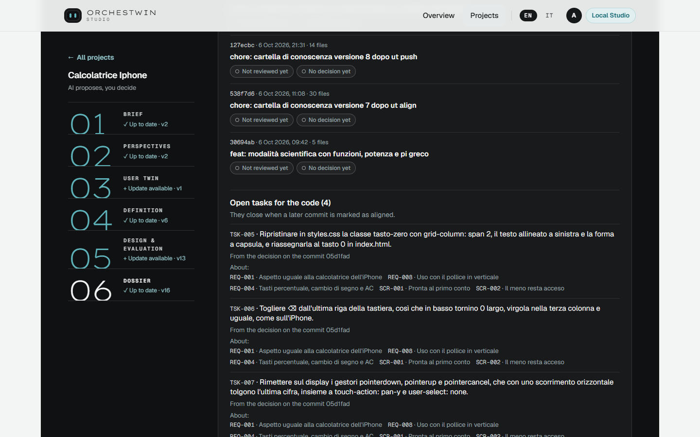
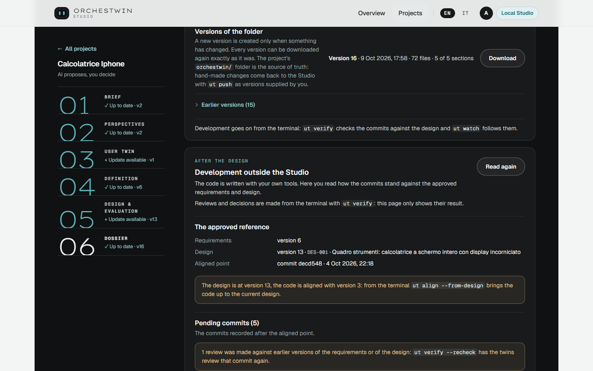
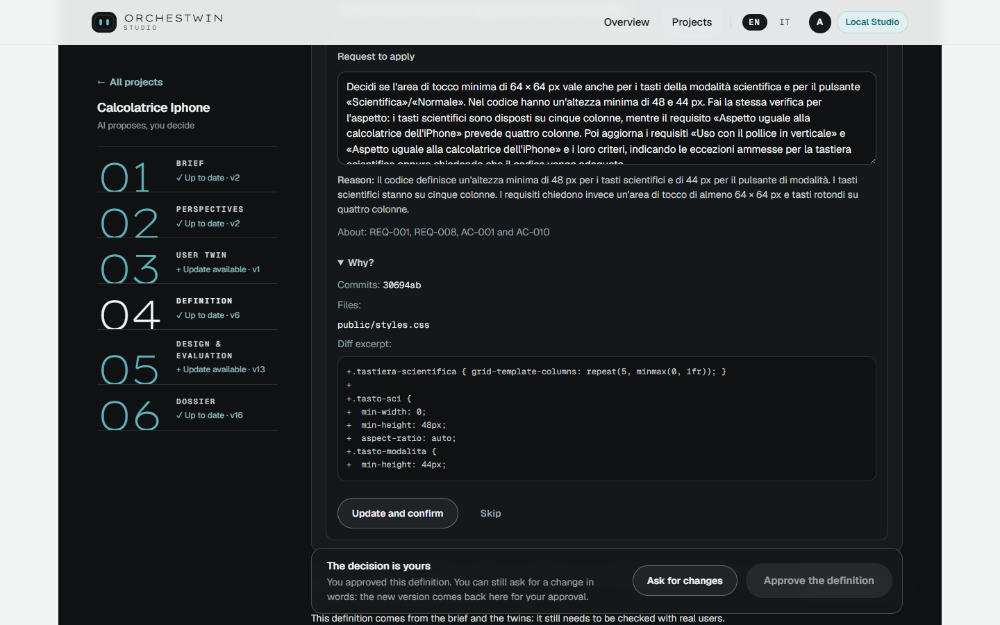
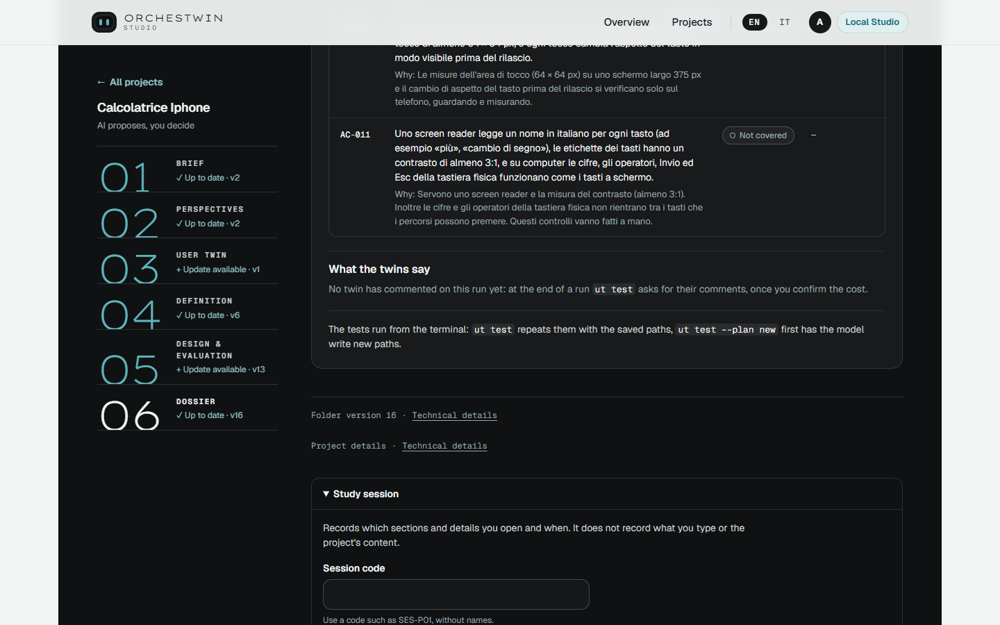
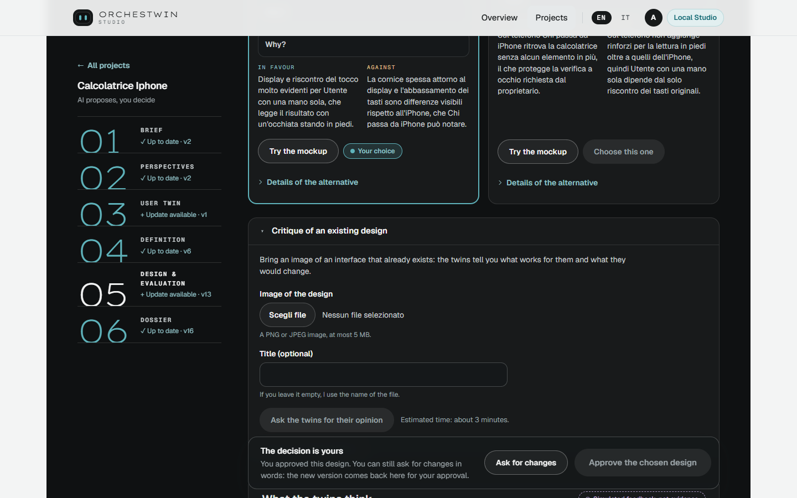
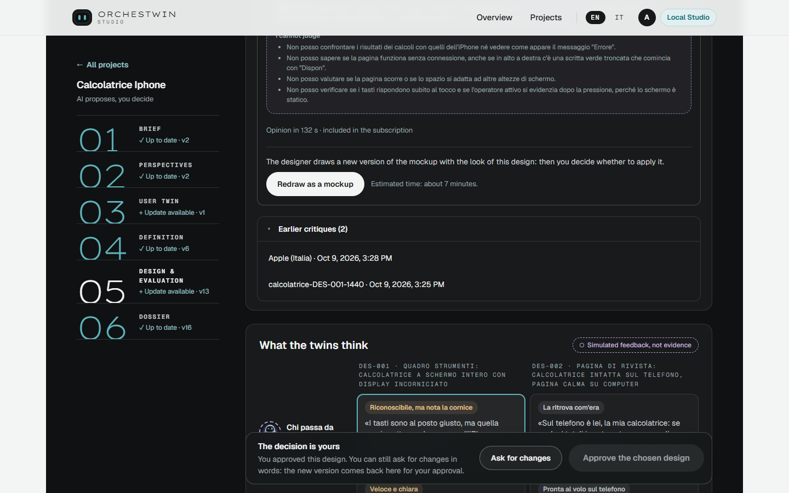

# After the design

Once the design is approved, the code is written outside the Studio, with your own tools and your coding agent. The twins, though, stay at work through `ut`, which reviews the commits, proposes updates to the knowledge and tries the acceptance criteria. The web interface does not run these commands: it shows their results and leaves some of the decisions to you. The cycle itself is told in the framework's [After the design](../framework/development.md), and the commands are in [Development](../ut/development.md).

The diagram shows where the result of each command appears in the web interface, so you know where to look after running it.

## Development outside the Studio

The block sits in the Dossier and makes one thing clear from the start: "Reviews and decisions are made from the terminal with `ut verify`: this page only shows their result." At the top you read the versions of requirements and design that the code is compared with, and the "Aligned point", the last commit marked as aligned. Below, the "Pending commits" carry the outcome of the review and your decision, for example "Review: the code should change" and "Decision: tasks for the code". Then come the open tasks for the code and the latest review, with "The model's verdict". After you run a command, press "Read again".

On 7 October 2026, on the Calcolatrice iPhone (the iPhone-style calculator), Claude Code added the ⌫ key and the change ended up in commit 05d1fad. `ut verify` had the three twins and the model review it in 1 min 51 s. The verdict was that the code was drifting away, because the new key had removed the wide zero that REQ-001 still asks for. The project owner chose tasks for the code, four of them, from TSK-005 to TSK-008. The page lists them with the label "From the decision on the commit 05d1fad".

## When the design is ahead of the code

If the design changes after the code exists, the block points it out and suggests `ut align --from-design`, which brings the code up to the current design. On 11 October 2026 the page of the Calcolatrice iPhone said: "The design is at version 13, the code is aligned with version 3: from the terminal `ut align --from-design` brings the code up to the current design." The aligned point was still commit decd548 of 4 October, because no commit had been marked as aligned since then.

The web interface counts only the aligned point recorded in the Studio. The terminal and the Visual Studio Code panel also read the local file that `ut code` and `ut align --from-design` update, which is why the two can disagree. On 7 October, for example, the web showed the code aligned with design 3 and the terminal with design 7.

## Proposals from the code

`ut align` reads what changed in the code and proposes updates to the Definition, the Design and the test plan. In the web interface the proposals appear under "Proposals from the code", in the Definition, in the text view of the Design and in "Acceptance tests". Each one warns: "A hypothesis of the model drawn from the code diff: no person has verified it." It shows the request to apply, which you can correct, and a "Why?" with the commits, the files and an excerpt of the diff. You decide it with "Update and confirm" or "Skip". Once a proposal is applied, the differences appear in the section and you approve them as you would a change you asked for in words.

On 6 October 2026 `ut align` made seven proposals on the Calcolatrice iPhone: four for the Definition, two for the Design and one for the test plan. On 11 October, ALN-003 in the Definition and ALN-005 in the Design were still waiting for a decision.

## Acceptance tests

`ut test` tries the acceptance criteria in real browsers on the application you built. "Acceptance tests", in the Dossier, shows the latest outcome: for each criterion "Passed", "Failed", "Blocked", "Not covered" or "Not run", with the reason.

## Times and steps of the project

At the bottom of every project sits a collapsed block, "Times and steps of the project", which collects for each section the time to approval, your actions, the generations and the waits. Time spent, details, "Why?" and mockups opened are counted only during a study session, which you start from "Study session" with a code such as SES-P01: it records what you open, not what you type. Under the table come the "Limits of the measure", starting with "The times include breaks." These blocks are there for the sessions with people planned for sprint 48.

## Hypotheses and outcomes

In the Design & Evaluation step, "Hypotheses and outcomes" keeps what the twins say apart from what people would say. The "Candidates to verify" come from the twins and from their findings. A candidate becomes an "Operational hypothesis" only when you pick it and write a question or a task. "Record outcome" then links the result of a session to it, with an anonymous code and an exact quote. The state of a hypothesis is computed only from sessions with people, and none has been held so far ([Validation with people](../validation.md)). In the gym project, on 11 October 2026, the block counted 88 candidates and no operational hypothesis.

## Critique of an existing design

Sometimes the design you want judged was not made by the Studio. The "Critique of an existing design" block, in the Design & Evaluation step, accepts a PNG or JPEG image of up to 5 MB, and the opinion of the twins takes about 3 minutes. A website is a different matter: `ut design critique --url` captures it from the terminal, at 1440 and 390 px, and the critique then shows up here as well.

For each screen every twin gives a verdict, "Works for me", "Slows me down" or "Blocks me", with a "What to do", and the page reminds you that "They are hypotheses of the twins to weigh, not evidence." Under "I cannot judge" the twins list what a still image does not show.

"Redraw as a mockup" asks the designer, in about 7 minutes, for a new version of the mockup with the look of the critiqued design, to apply and approve like any other. On 9 October 2026 the redraw of the Calcolatrice iPhone from the critique of Apple's Italian website took 5 min 41 s and became version 13 of the design. Times and limits of the critiques are in [Critique of an existing design](../design/critique.md).
