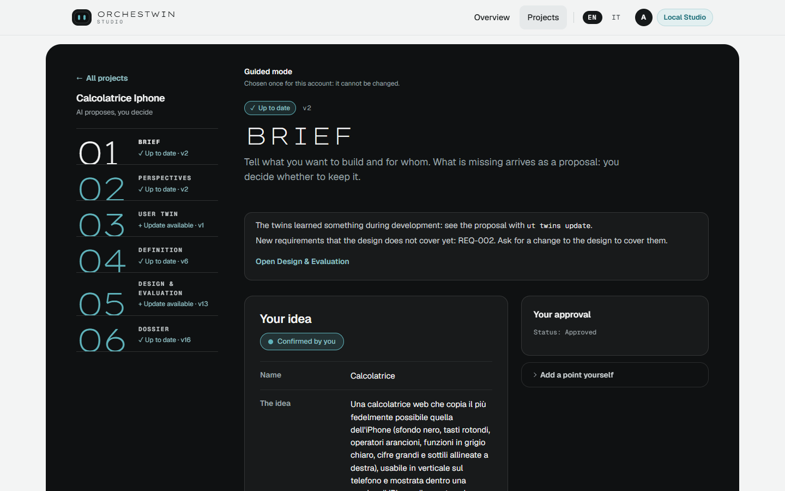

# Brief

Everything that comes later stands on the brief. A form with fifteen empty fields is hard going for someone who does not design for a living, so in guided mode the brief grows out of a dialogue with the requirements analyst, one question at a time. In expert mode the step opens on the form, and the dialogue is still there behind "Back to the dialogue with the analyst".

## The dialogue

The analyst opens with "Hi! I am the requirements analyst. Tell me your idea in two lines: what do you want to build?" You write the idea in "Your idea" and press "Start the dialogue".

Questions arrive one at a time, twenty at most, including up to three follow-ups. A counter tells you how many essential details are still missing. There are five of them: the idea, the problem, the goals, who it is for and what it has to do. The panel "The brief takes shape", next to the conversation, ticks them off as they come in. You answer in your own words and press Enter; when a question asks for a list, you write one item per line and press "Send".

You can stop whenever you like. "Compose the brief now" moves on to the synthesis, and "Switch to the form" takes you to the fields. If the model does not respond, the page tells you so and leaves you the form.

## When you don't know

"I don't know" is a valid answer, and the Studio respects it. The point stays open ("You do not know yet: it stays an open point"), and when the model composes the brief it cannot fill that point with a value. The most it can do is make a proposal, which you decide on. Its instructions forbid it to invent facts, numbers, names, dates or research.

## The composed brief

When the questions are over the Studio composes the brief, and "See the brief and the proposals" takes you to the "Your idea" summary. Each field holds what you said. The missing details that the model considers reasonable show up as proposals, marked "AI proposal, not validated".

You decide the proposals one at a time in the panel alongside, which reminds you: "This was missing from the brief. It is used only if you accept it." You press "Accept" or "Leave open"; leaving a proposal open takes a reason. There are also "Accept all proposals" and, for whatever the model did not see, "Add a point yourself".

Every change produces a new version of the brief. The list of versions, with date and hash, is under "Technical details", in "Brief versions".

## The gesture

When the brief convinces you, press "Approve the brief". If some proposals are still undecided, the bar warns you that approving now leaves those points open. If a field is empty without being marked "I don't know yet", the approval stops and lists the missing fields. In this step "Ask for changes" only records a note: you then update the brief yourself.

## Changing an approved brief

An approved brief can still change. During the first pass in guided mode, when you go back to read it, the page warns you: "If you change it, a new version is made that you approve again, and the steps after it need another look." You change it with "Edit the brief yourself" and "Save description", then approve the new version.

What happens next depends on where you are. In the first pass the project goes back to Perspectives, which have to be prepared again. Once the sections are all open, the ones downstream turn "To update" and a notice at the top offers you "Update and confirm". The Studio re-anchors the sections to the new versions without changing their content. It stops at the first one it cannot update by itself, for example when the chosen perspectives no longer fit the new brief.

The brief also changes when you bring in the insights you set aside while talking to the [twins](twins.md), and then brief, perspectives, twins, requirements and design have to be approved again. The same dialogue runs from the terminal with [ut init](../ut/init.md).
