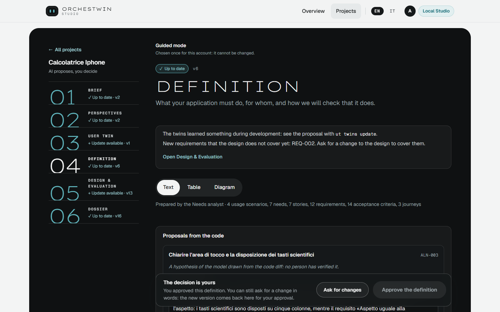
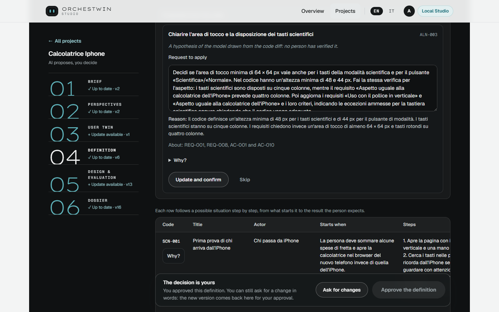
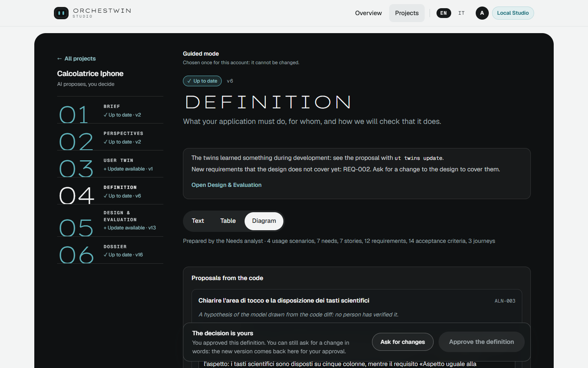
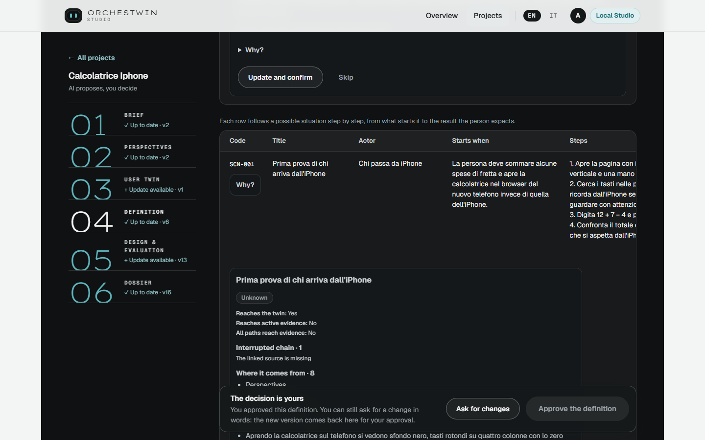

# Definition

The Definition turns the brief and the twins into a baseline you can read and check: what the application has to do, for whom, and how you will know that it does it. You prepare it with "Prepare the definition" once the twins are approved.

## What it contains

Inside you find scenarios, needs, requirements, stories and acceptance criteria, plus the risks and the checks of "When the work is done". Every item has a stable code, such as REQ-001 or AC-012, that you will meet again in the design, in the knowledge folder and in the commits. In the Calcolatrice iPhone project (the iPhone-style calculator), REQ-001 asks for the same look as the calculator on the iPhone.

Requirements have a priority, from "Essential" to "For later", which you read in the table. In the text they are grouped into "Functional requirements", "Non-functional requirements" and "Constraints", and a summary line counts how many things the application must do and how many it should do. Open a requirement and you see which needs and sources it comes from, which twins asked for it and how it will be checked. At the top of the text a sentence warns you: "This definition comes from the brief and the twins: it still needs to be checked with real users."

## Text, table, diagram

The same version can be read in three views. "Text" is the document, with scenarios, needs, stories and requirements one after the other, and "Open every detail" to expand them all. "Table" puts the requirements in front, or the journeys if the Definition has any, and gathers the rest under "Other tables". "Diagram" offers "Use cases", "Requirements" and "Requirements traceability". Under the buttons a line counts what is there: for the Calcolatrice iPhone, 4 usage scenarios, 7 needs, 7 stories, 12 requirements, 14 acceptance criteria and 3 journeys.

The model does not draw the diagrams. The Studio derives them from the current version, and the same content always gives the same diagram. You can enlarge them and download them as an image or as source, and when you touch an element that has a code, you find it again in the text.

## The "Why?" on every row

In the tables of requirements, needs, scenarios and stories, each row has its own "Why?", which opens the chain of that item right below the row. "Where it comes from" climbs back to the twin and the brief. "What depends on it" goes down to whatever uses the item, such as the design alternatives and the elements of the mockup. "To verify with real people" collects what nobody has checked yet, and two lines answer "Reaches the twin" and "Reaches active evidence".

The model does not write the "Why?" either. The Studio derives it from the recorded versions and links, and a rationale generated by the model stays labelled as one. For scenario SCN-001 of the Calcolatrice iPhone the two answers are "Yes" and "No", and the chain breaks at one point: "The linked source is missing". How the chain is built is explained in [The "Why?" and traceability](../framework/why.md).

## Changing the Definition

There are two ways. On a single requirement, "Propose a change" opens the fields and your edit becomes a proposal, which you apply with "Apply the change" or drop with "Discard it". To change it in words, write what you want in "Ask for changes". The analyst rewrites the requirements and shows you the differences item by item, with your request quoted above them; you apply them with "Apply the new version" or throw them away with "Discard", saying why. When the analyst finds nothing to change, the page admits it.

Proposals that come from the code through `ut align` take the same road. On 6 October 2026, on the Calcolatrice iPhone, one of them needed 3 min 31 s of generation and brought eight changes to read before approving. "Request journeys" is a request in words that is already written for you: it adds journeys to the scenarios.

## The gesture

You approve with "Approve the definition". The decision bar at the bottom warns you if some requirement still has no way to be checked, and tells you what happens after the approval. An approved definition can still be changed in words, and the new version comes back to the bar for your decision. The equivalent commands are in [Definition, twins, evidence and archetypes](../ut/definition-and-twins.md).
