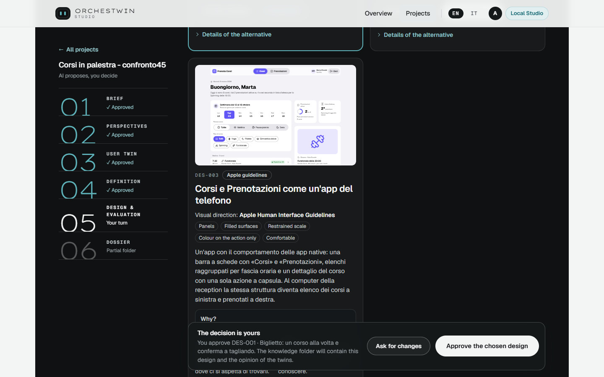
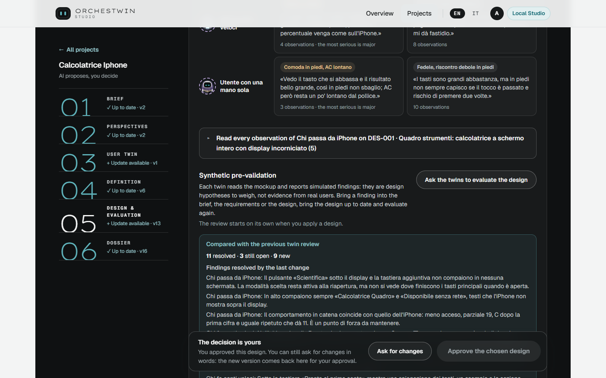
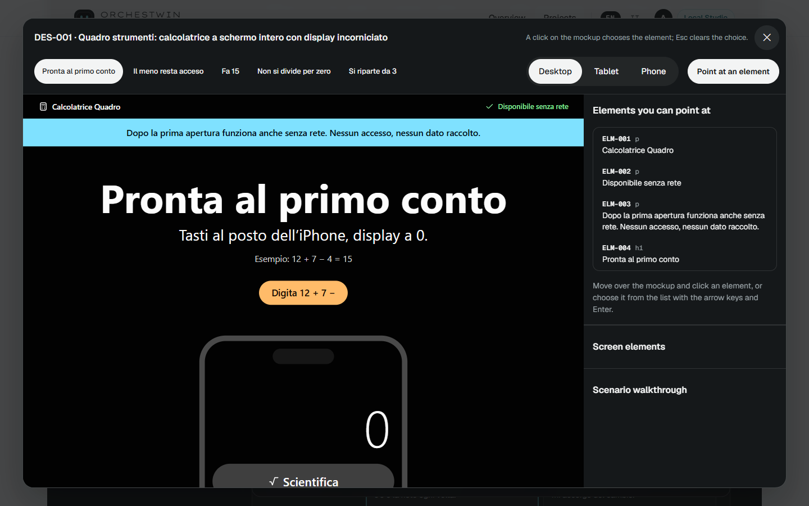
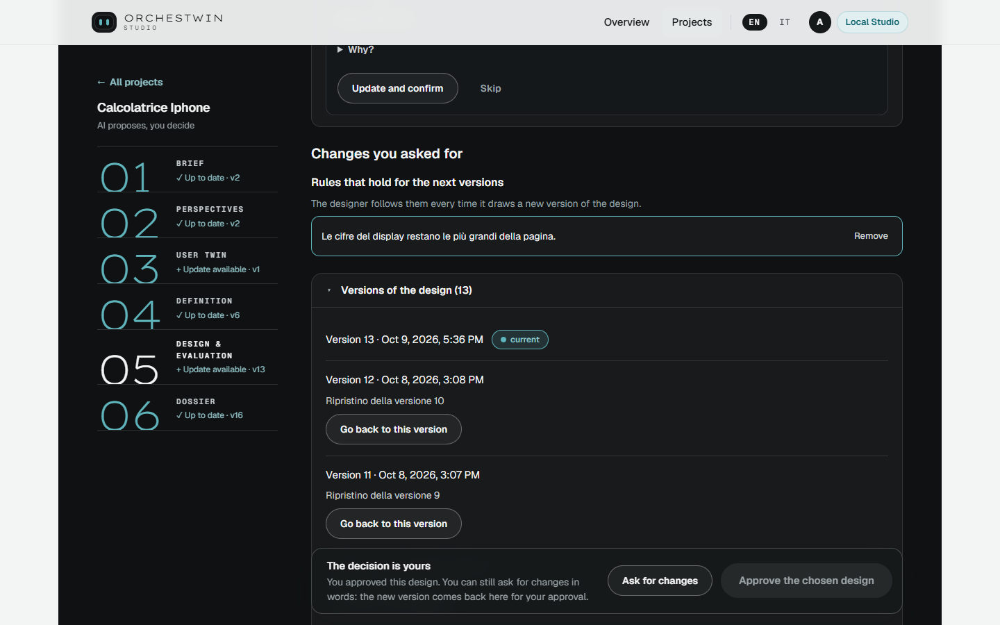

# Design and evaluation

This step is built so that you never get just one design. You get alternatives that differ from each other, each one tried by the twins, and you choose. The goal of quality and variety in the designs is not declared reached; the measures and the judgements are collected in [Design quality and variety](../design/index.md).

## The alternatives

Once the Definition is approved, press "Prepare the design alternatives". The model writes five candidate visual directions and the Studio keeps the two that lie farthest apart. With the Apple design system, on by default, a third one joins them: DES-003, which follows the Human Interface Guidelines. How the directions and the system come about is told in [Visual directions and the Apple HIG system](../design/directions.md).

Each alternative has a code and a title, "In favour" and "Against", "Try the mockup" and "Choose this one". One is "recommended by the designer", and the one that comes from the design system carries the label "Apple guidelines". "Details of the alternative" opens the approach, the rationale, advantages, trade-offs, workflows, "How it serves the twins" and "Visual direction". As in the Definition, you can switch to the table or to the diagrams.

## The mockup

Every alternative has a mockup in HTML. In guided mode the Studio draws it on its own as soon as the alternatives are ready; otherwise you ask for it with "Draw the mockup". It usually takes 5 to 10 minutes. The drawing goes on even if you close the page, and it runs on your Claude subscription without spending credit. On 10 October 2026 the three mockups of the gym project, drawn together, took 10 min 35 s.

"Try the mockup" opens a window with the screens and three widths, "Desktop", "Tablet" and "Phone". You can navigate the mockup. The purple numbers on the screens are the observations of the twins, and the window calls them "hypotheses to weigh, not evidence".

## How far apart the alternatives are

Two alternatives that look alike are not a choice. Above the cards, a "Distance between the alternatives" box for each pair measures the style drawn in the mockups, from 0 to 100, and says "They differ" or, below 45, "Too close". In the gym project, on 10 October 2026, the measure gave 92 between DES-001 and DES-002, 71 between DES-001 and DES-003, and 39 between DES-002 and DES-003. For that last pair the page writes "Alternatives DES-002 and DES-003 look alike in the drawn style. You can regenerate them."

"Details of the measure" keeps the declared choices, the drawn style and the structure of the screens apart, and puts the limit in plain words: "Measure computed by the Studio: it does not replace your judgement." The measure cannot tell a serif typeface from a sans-serif one, and it does not look at how the text is laid out. Its limits are in [Measures](../design/measures.md).

## What the twins think

"What the twins think" is a grid with one row per twin and one column per alternative, under the words "Simulated feedback, not evidence". Each cell holds a short verdict, a sentence from the twin and the number of observations. In the gym project, the twin that stands for members over 60 in the gentle classes finds DES-001 clear and says it feels safe. Open a cell and you read the observations, each with its point on the mockup and a "Suggested action". You answer each one with "I confirm" or "Not relevant", knowing that your confirmation "is a project decision: it is not a check with real people".

## Choosing

"Choose this one" works once the mockup of that alternative is ready, and it creates a new version of the design. Then the twins review the chosen mockup in "Synthetic pre-validation". In guided mode the review starts by itself; in expert mode you ask for it with "Ask the twins to evaluate the design". In the gym project, on 10 October, choosing DES-001 together with the twins' review took 123.6 s.

## Changes in words, and rules

"Ask for changes" opens the field where you write what to change, up to 1,000 characters. The designer draws a new version of the mockup and shows it to you in "Changes you asked for", with "What changed" and the screens to compare. You apply it with "Apply the new version" or leave it with "Discard".

If you tick "Keep it as a rule for the next versions", the request becomes a rule that the designer follows in every new version. A rule can be up to 300 characters long, a design holds up to twenty of them, and each one goes away with "Remove". The Calcolatrice iPhone has had one since 7 October 2026: the digits on the display stay the largest text on the page.

## Pointing at an element

A request about a whole screen can be vague, and pointing at the element makes it precise. In the mockup window press "Point at an element" and click what you want to change. The "Elements you can point at" panel lists the elements with their codes; when you pick one it shows the screen, the text and the linked requirements, and asks "What should I change?". With "Ask the twins for their opinion right away" ticked, press "Apply the change", then apply the new version when it arrives.

The opinion appears next to the element, under "What the twins say about it": "Helps", "Slows down" or "Blocks", with a "What to do" that "Try this" copies into the field. On 8 October 2026, on the Calcolatrice iPhone, the request to make the "=" key (ELM-023) dark blue with a white symbol, taller than the other keys, produced the new version in about 5 minutes. The opinion of the three twins arrived in about 2 minutes: "Slows down", "Helps", "Slows down".

## Versions of the design

Above the alternatives sits a collapsed block, "Versions of the design", with the date of each version, the "current" one marked, and notes such as "Restored from version 9". "Go back to this version" deletes nothing and does not call the model: it creates a new version identical to the one you picked, which you then approve. On 8 October 2026, going back to version 10 of the Calcolatrice iPhone created version 12 in 2.0 s. The Studio refuses to go back if that version cites requirements that no longer exist, or if it was prepared with different twins.

## The gesture

You approve with "Approve the chosen design", and the knowledge folder will contain this design and the opinion of the twins. In the step's technical details one sentence says what the gesture is worth: "Owner approval is governance, not empirical validation." Even afterwards you can ask for changes or use "Regenerate the alternatives". The critique of an existing design and the hypotheses to verify with people, which live in this step too, are described in [After the design](after-design.md); the commands are in [ut design](../ut/design.md).
