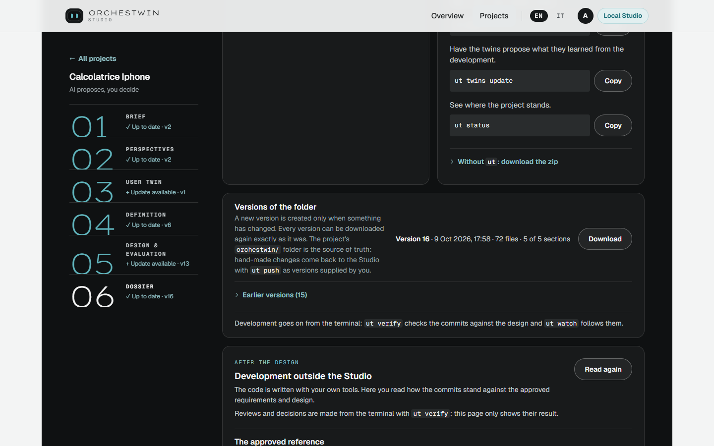

# Dossier

What you approved in the Studio has to leave it and travel with the code. The Dossier gathers it in the knowledge folder: brief, perspectives, twins, requirements and the chosen design, as text, tables and diagrams, with stable codes you can quote while you develop. You do not approve the Dossier the way you approve the other steps. You prepare it and you download it.

When the five steps are approved, the title says "The project is ready". Before that you read "The folder is taking shape", and a line tells you which steps are still missing. On the first pass through guided mode the Dossier opens right after the brief, as a "Partial folder", because each step joins the folder when you approve it.

## Preparing and downloading

"Prepare and download the folder" does two things. If something changed since the last time, the Studio publishes a new version and then downloads the archive. If nothing changed, it tells you so and downloads the same version again.

## What it contains

"What it contains" counts the twins, each in its own reusable file, the diagrams and the tables of requirements and design, and the observations of the twins on the chosen design. It also counts the twins' reviews, your decisions and the approved discussions. For the Calcolatrice iPhone, the iPhone-style calculator, that makes 3 twins, 7 diagrams, 16 tables and 65 observations. Below you see the preview of the chosen design and "The steps and their versions". The index of the folder is the file ORCHESTWIN.md; how the folder is laid out, file by file, is in [The knowledge folder](../architecture/knowledge-folder.md).

## How to use it

"How to use it" gives you three ways in. "From the terminal, with `ut`" composes the commands with the address of the page, the name of the folder and the identifier of the project, each with its own "Copy" button. For the Calcolatrice iPhone the folder is called `calcolatrice`. "Then, during development" lists the commands you will use while you write the code, one line for each. "Without `ut`: download the zip" explains in four steps how to use the archive by hand.

| Command | What it is for |
| --- | --- |
| `ut login --studio <address>` | sign in to the Studio from the terminal; with the local Studio this line does not appear |
| `mkdir <folder>; cd <folder>` | create the project folder and move into it |
| `ut init --project <project-id> --mode design-code` | link the folder to the project and download the knowledge folder into it |
| `code .` | open Visual Studio Code with the OrchesTwin panel |
| `git init` | put the folder under git, because `ut verify` works on the commits |
| `ut code` | have your coding agent write the application |
| `ut test --static .` | check the acceptance criteria in the browsers of your computer |
| `ut verify` | have the twins review the commits |
| `ut align` | propose updates to the knowledge, starting from the code |
| `ut align --from-design` | bring the code up to the current design |
| `ut push` | send to the Studio the changes made by hand in the folder |
| `ut twins update` | have the twins propose what they learned from the development |
| `ut status` | see where the project stands |

Every command is explained in [Dossier, push, why and validation](../ut/dossier.md) and in [Development](../ut/development.md).

## Versions of the folder

"Versions of the folder" shows the latest version with its date, its number of files and the sections it holds, and gathers the others under "Earlier versions"; each one has its own "Download". The rule is written on the page: "A new version is created only when something has changed. Every version can be downloaded again exactly as it was." The folder of the Calcolatrice iPhone reached version 16 on 9 October 2026, with 72 files and five sections out of five.

The `orchestwin/` folder in your project is the source of truth. If you change it by hand, the changes go back to the Studio with `ut push` as versions supplied by you, to be approved like any other. The Dossier is "Up to date" when the last published folder contains exactly the approved steps. If a step changes, the section turns to "To update" and the page asks you to prepare the folder again, after you have brought the sections left behind back in line with "Update and confirm".

Below the versions the page goes on with "Development outside the Studio" and "Acceptance tests", which are described in [After the design](after-design.md).
