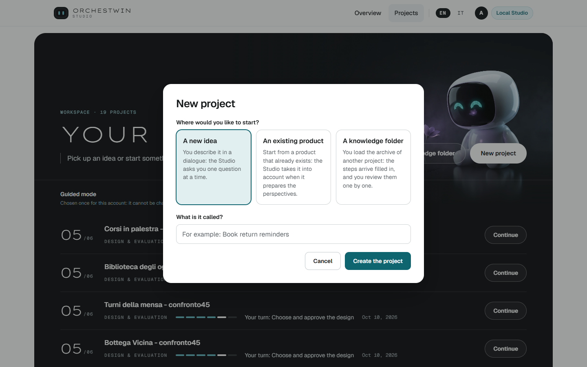
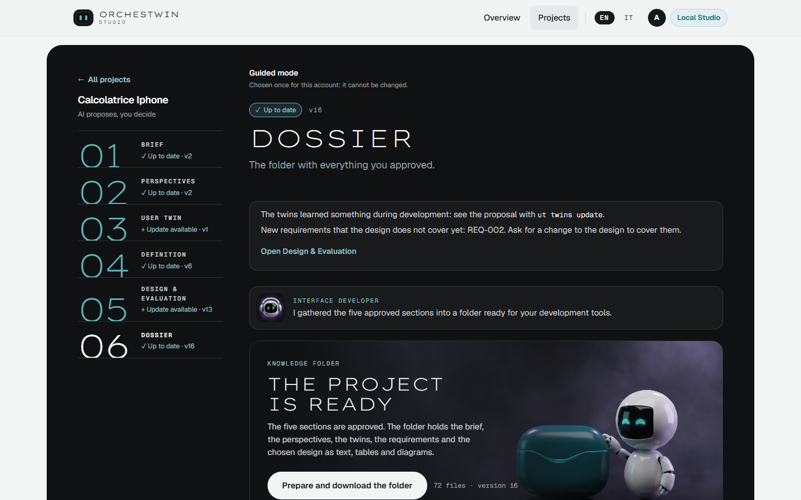
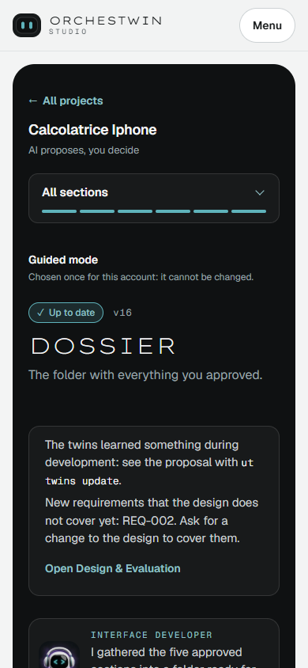

# Web guide

The web interface is where you see the whole project at once: the six steps, the state each one is in, what the model has proposed and the gestures you approve it with. You can do the same things from the terminal with `ut` (see the [ut reference](../ut/index.md)), but the browser is where you can tell at a glance how far along you are. The pages of this guide follow the order in which things appear on screen.

## Where to reach the Studio

While the Studio is running, the web interface is at http://127.0.0.1:8080. The API sits at http://127.0.0.1:8000, but you never need to open it. If the page does not load, the Studio is almost always switched off; [Starting and stopping the Studio](../installation/studio.md) explains how to start it.

The home page is titled "An idea becomes an application. You decide at every step." Further down, "Six steps, six decisions of yours" shows which gesture closes each step.

## Local Studio or accounts

Whoever starts the Studio chooses between accounts and local mode ([Local mode and accounts](../installation/local-mode.md)). In local mode the Studio belongs to the person using the computer: no registration, no login, and the top bar shows "Local Studio". The button on the home page becomes "Open the projects".

With accounts, the bar shows "Log in" and "Register", and the home page says "Enter the Studio". You register with an email address and a password of at least 8 characters, with an uppercase letter and a special character.

## Choosing how you work

The first time you come in, the Studio asks you "How do you want to work?" The question comes before the projects because the mode changes what the Studio does on its own; [Guided and expert](../framework/modes.md) explains why.

The guided mode introduces itself as "One step at a time, with explanations." The brief comes out of a dialogue, and when you approve a step the Studio prepares the proposals for the next one by itself. Sections open in order and, once the first pass is over, they all stay open. The expert mode promises "Everything open from the start, without introductory explanations." You go wherever you like, no model proposal starts unless you ask for it, and you can enter perspectives, twins, definition and prototype yourself.

You make the choice once, and the page says so just before the button: "After you confirm, you will not be able to change mode." From then on a note reminds you of it above the project list and inside every project.

## Your projects

In "Your projects" every row is a project, with the step it has reached and a bar in six segments. After "Your turn:" you read the gesture that is waiting for you, such as "Approve the brief" or "Choose and approve the design", and "Continue" opens the project.

"New project" opens with the question "Where would you like to start?" and three possible answers. "A new idea" is one you will describe in a dialogue. "An existing product" is something the Studio takes into account in the perspectives. "A knowledge folder" is the archive of another project, with its steps already filled in for you to review. Then you give the project a name and press "Create the project". You write the two-line idea in the [Brief](brief.md).

## The project page

On the left you find the project name, with the line "AI proposes, you decide", and the six steps: "Brief", "Perspectives", "User Twin", "Definition", "Design & Evaluation" and "Dossier". On the right is the step you selected. The address stays the same when you switch steps, and if you reload you land on the step where it is your turn.

During the first pass in guided mode the list is called "Steps" and the header tells you where you are, for example "Step 3 of 6". The steps ahead stay closed; only the Dossier opens early, as a "Partial folder", as soon as you approve the brief. In expert mode, or once the first pass is over, the list becomes "Sections" and each one shows its state and version.

| State | What it means |
| --- | --- |
| "Waiting" | the section has no version yet |
| "Your turn" | a version is waiting for your approval |
| "Up to date" | you approved the current version |
| "Update available" | it is approved and there is something to offer you: the twins learned something, the design does not cover new requirements, or the twins' review is missing |
| "To update" | it is approved, but something upstream changed |

The Studio works these states out every time it reads the project, from the versions and the approvals; the mechanism is described in [Gates, sections and versions](../architecture/states.md).

On a narrow screen, such as a phone's, the list hides behind a button, "All steps" or "All sections".

At the bottom of the page, collapsed, you find "Technical details" and "Project details", with the state of the model and "Open the provenance graph". Below them sit "Study session" and "Times and steps of the project", described in [After the design](after-design.md).

## The gesture that approves

Every step closes in the bar at the bottom, "The decision is yours". The button names what you are approving, from "Approve the brief" to "Approve the chosen design", and next to it sits "Ask for changes". The Dossier is not approved: you prepare it and download it. An approval holds for one specific version, and if the content changes you approve the new version again.

No generation starts without a gesture from you. Generations are made by Claude Opus 5.5 through `claude --print`, on the subscription of whoever runs the Studio ([Generating with claude --print](../installation/generation.md)). While the model works you can close the page; the result will be there when you come back.

## English or Italian

The EN and IT buttons at the top right switch the language of the interface, and the browser remembers your choice. The first time, the Studio follows the language of the browser. If that is neither English nor Italian, it starts in English.
