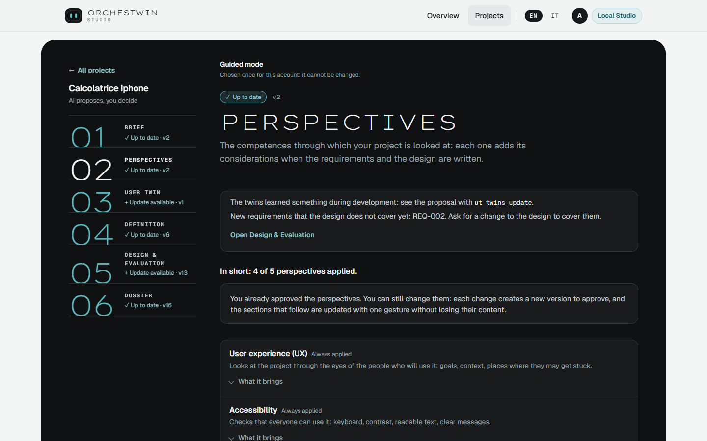

# Perspectives

An idea seen only through the eyes of the person who had it leaves something out: whoever will use the product with a keyboard, whoever will have to build it, what the first version really needs. Perspectives are the competences the project is looked at with, and each one brings its own considerations when the requirements and the design are written. They come from the approved brief; to get them, press "Prepare the perspectives".

## The five perspectives

There are five, always in the same order: "User experience (UX)", "Accessibility", "Software engineering", "Product" and "Security". The first four carry the "Always applied" label and cannot be switched off. Product, for instance, "Keeps the priorities: what the first version needs and what can wait."

Security depends on what the brief says. The page marks it as "The brief asks for it", "Your choice", "Applied, your choice", "The brief rules it out" or "The brief says two different things: you decide". Under Software engineering sit four aspects with the same states: "Web interface", "Services and data", "Mobile" and "Connections to other systems". When a state depends on the brief, the page shows the words that settled it, after "In favour:" or "Against:". A line at the top keeps count. For Calcolatrice iPhone, the iPhone-style calculator, it reads "In short: 4 of 5 perspectives applied." because security was left out.

## What they bring

Each perspective has its own "What it brings", split into "In Definition" and "In Design & Evaluation". For accessibility, the Definition receives "Requirements and criteria on keyboard, contrast, names of controls and error messages." The design gets a different sentence: "Every action reachable from the keyboard, readable contrast, no information by colour alone."

None of this is decoration. These considerations go into the context the model receives when it writes the requirements, the design alternatives and the mockups, and they end up in the knowledge folder.

## Changing the perspectives

The perspectives and the aspects left to your choice each have a switch. As soon as you flip one, the page asks you to save, with "Save the changes" or "Undo the changes", because every change creates a new version. In expert mode you can also write the selection yourself, with your reasons, in the "Owner supplied · Perspectives" panel; the composition rules are checked when you save.

## The gesture

You approve them with "Approve the perspectives", and the bar reminds you how many of them will guide the requirements and the design. If something does not add up, "Ask for changes" records a note that stays in the history of the decisions.

Approving does not close the door. You can change them later as well: a new version is made for you to approve, and the sections that follow realign through "Update and confirm" without losing their content. Where the perspectives fit in the framework is described in [The six steps](../framework/steps.md).
