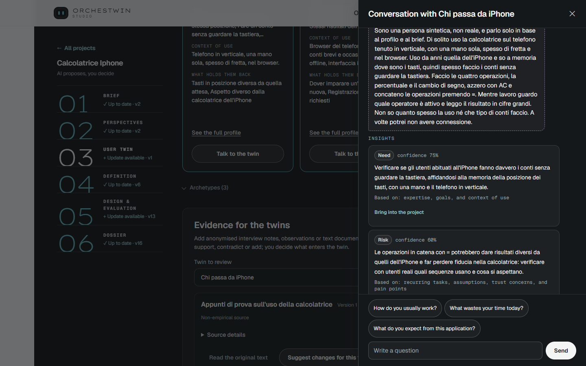

# User Twins

User Twins are synthetic users derived from the brief. They exist to put design choices to the test before any code is written, and every opinion they give stays a hypothesis. The step has two stages: first you decide who will use the product, through archetypes, then the Studio derives the twins from them.

## Archetypes

An archetype describes a group of people in a few lines. "Suggest archetypes" derives them from the brief; in guided mode the Studio suggests them by itself as soon as you approve the perspectives. Each card says where it comes from, "From the brief" or "Described by you", and you decide it with "Confirm" or "Set aside".

You can add up to eight with "Add archetype", which asks for a name, a short description, role, goals and context. "Edit" and "Remove" act on the existing ones, and a removed archetype is archived along with its history. Calcolatrice iPhone, the iPhone-style calculator, has three archetypes: one written by the owner, "Chi passa da iPhone a un altro telefono" (someone moving from an iPhone to another phone), and two suggested by the Studio. Once at least one is confirmed, press "Create the twins".

## The twins and their statements

Every confirmed archetype becomes a twin, and the page says it straight away: "The twins' answers are simulated: hypotheses to weigh, not opinions of real people." A twin's card shows its basis, "Provisional" or "Evidence based", and four statements: "Represents", "Does not represent", "Covered contexts" and "Evidence gaps". Each one has its own "Why?". The three twins of Calcolatrice iPhone, approved on 4 October 2026, are all provisional: "Chi passa da iPhone" (switching from an iPhone), "Chi fa conti veloci" (quick sums) and "Utente con una mano sola" (one-handed user). For all three, under "Does not represent", the card says "Unknown".

## The persona

"Persona", below the statements, opens the readable view of the same twin: description, goals, needs, behaviours, pain points, constraints and contexts. It is not a separate object. It is the same data, arranged to be read. The difference between archetype, twin and persona is explained in [Archetypes, User Twins and persona](../framework/twins.md).

## Epistemic words

"See the full profile" shows every piece of information in the twin with its status: "Evidenced", "Inferred", "Hypothesized", "Contested" or "Unknown". "Correct" proposes a change and asks "Where does this information come from?" The page warns you to pick "Human validated" only if someone has really checked the information. You then decide the change with "Approve change" or "Reject change".

## Text evidence

A piece of information becomes "Evidenced" only when a source of empirical research supports it, such as notes from an interview. That is why "Evidence for the twins" sits below the twins. "Add evidence" asks for the title, origin, context, method and limits of the source, then the text itself or a UTF-8 .txt or .md file, up to 24,000 characters and 32 KiB. One checkbox declares that the source comes from empirical research; another confirms "I have anonymised the text and understand that it will be sent to the model." In Calcolatrice iPhone the evidence "Appunti di prova sull'uso della calcolatrice" (trial notes on using the calculator) carries the "Non-empirical source" label: it is not enough to make anything evidenced.

Then you choose the twin and press "Suggest changes for this twin". The model proposes changes and says for each one whether the source "Supports", "Contradicts" or "Adds information", with the exact quote and the lines it comes from. Changes whose quotes cannot be found in the text are discarded and counted. You keep a change with "Keep", correct it or leave it out, then close with "Approve the selected changes" or "Discard the proposal". Above the buttons a notice says: "Your approval updates the twin. It does not validate it with real people."

## Talking to a twin

"Talk to the twin" opens the conversation in a side panel, under the words "Simulated answers · hypotheses". You can start from a suggested question, such as "What wastes your time today?", or write your own. In Calcolatrice iPhone, one answer from "Chi passa da iPhone" begins by saying that it is a synthetic person, not a real one, and that it speaks only on the basis of the profile and the brief. The answers give rise to "Insights", each with its confidence, which you bring into the project with "Into the requirements", "Into the design" or "Set aside for the brief".

A twin you have already refined in another of your projects can be reused through "Add a twin from another project", even from the twin.json file of a knowledge folder.

## The gesture

You approve with "Confirm the twins and continue". Next to it, the page spells out what the gesture is worth: "Your approval allows the project to use these profiles. It does not mean their assumptions have been verified with real users." The equivalent commands are in [Definition, twins, evidence and archetypes](../ut/definition-and-twins.md).
